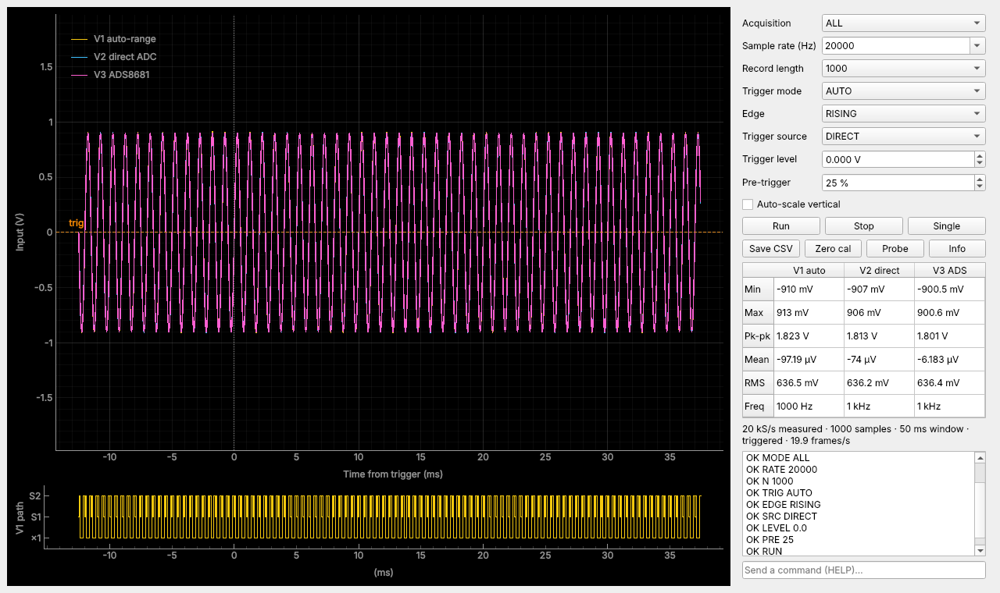
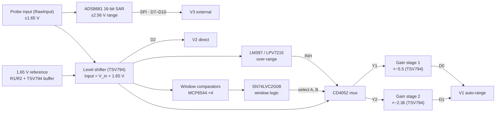

# Oscilloscope

A general-purpose DIY oscilloscope built from scratch on a Seeed XIAO ESP32. It compares three signal-acquisition architectures: hardware auto-ranging (window comparators + analog mux + gain stages), direct ADC sampling, and an external 16-bit SAR ADC. The board is a custom KiCad PCB, and a Python app shows the waveforms in real time.

All three paths look at the same probe input. The firmware can sample them **together, time-aligned** (the V2 and V3 readings at the same instant, V1 one or two ADC reads later), so you can compare them on the same signal.


<sub>The Python GUI in `--demo` mode (simulated signal). The bottom strip shows which V1 path each sample came from: ×1 (direct), S1 (gain stage 1) or S2 (gain stage 2).</sub>

---

## Contents

- [Features](#features)
- [How it works](#how-it-works)
- [Hardware](#hardware)
- [Firmware](#firmware)
- [Python app](#python-app)
- [Calibration](#calibration)
- [Serial command reference](#serial-command-reference)
- [Binary protocol](#binary-protocol)
- [Theory and math](#theory-and-math)
- [Limitations and notes](#limitations-and-notes)
- [Repository layout](#repository-layout)
- [Roadmap](#roadmap)

## Features

- **Three acquisition architectures**, selectable or all at once (`MODE ALL`):
  - **V1 – Auto-range:** window comparators steer the signal through a CD4052 mux into one of two gain stages. The firmware works out which stage is live and divides its gain back out.
  - **V2 – Direct:** the level-shifted signal goes straight into the ESP32's 12-bit ADC.
  - **V3 – External ADC:** an ADS8681 16-bit, 1 MSPS SAR ADC digitizes the raw input over SPI, using a from-scratch driver (no Arduino library exists for the ADS868x).
- **Triggering:** rising/falling edge, adjustable level and hysteresis, AUTO / NORMAL / SINGLE / FREE modes, 0–100 % pre-trigger, on any of the three paths.
- **Timebase:** sampling is paced by the CPU cycle counter. Every sample in a mode costs the same fixed sequence of reads, and the firmware never paces faster than it can sample, so the spacing stays uniform even when you ask for more than the hardware can deliver. The *measured* sample rate is sent with every frame.
- **Records** of up to 4096 samples per channel.
- **Calibration** stored in flash: zero and gain for the direct and ADS8681 paths, and a least-squares fit of each gain stage against the direct path (`CAL BANDS`).
- **Two output formats:** a binary stream for the Python GUI, or plain text that the Arduino IDE **Serial Plotter** draws directly.
- **Python GUI:** live traces, the V1 path strip, a draggable trigger level, measurements (min/max/pk-pk/mean/RMS/frequency), CSV export, and a demo mode that needs no hardware.

## How it works



### Shared front end

R1 and R2 (10 kΩ each) divide 3.3 V down to a 1.65 V mid-rail, which a TSV794 section buffers. A second section is a non-inverting summing amplifier: R3 = R6 average the probe voltage with the reference, and R4 = R5 set a gain of 2. Its output, the net called `Input`, is:

```
V_ls = V_in + 1.65 V        →  a probe voltage of ±1.65 V maps onto 0 … 3.3 V
```

### V1 – Hardware auto-ranging

Two window comparators decide how big the signal is. Each window is two MCP6544 comparators, one checking *above the low threshold* and one checking *below the high threshold*. The MCP6544 has push-pull outputs, so they can't be wire-ANDed; an SN74LVC2G08 gate combines each pair into one *inside this window* signal:

- **Window 1** uses the R19 / R20 / R21 ladder (5 kΩ / 2 kΩ / 5 kΩ across 3.3 V). Its thresholds are 1.375 V and 1.925 V on `Input`, which is ±0.275 V at the probe.
- **Window 2** uses the R15 / R16 / R17 ladder. Its design range is 0.95–2.35 V on `Input`, which is ±0.70 V at the probe.

The two window signals drive the CD4052's select lines, and the mux routes `Input` to one of two **inverting** gain stages. Both stages are biased at the R24/R27 mid-rail (V_ref2 ≈ 1.65 V). Stage 1 (R7 = 255 kΩ feedback) feeds XIAO pin D0, and stage 2 feeds D1:

```
V_D0 = V_ref2 − G1 · (V_ls − V_ref2)        G1 ≈ 5.5   (window 1: ±0.275 V → about 0.14 … 3.16 V)
V_D1 = V_ref2 − G2 · (V_ls − V_ref2)        G2 ≈ 2.36  (window 2: ±0.70 V)
```

A stage whose mux channel is off has no current in its input resistor, so it sits at its idle level V_ref2. The LM397/LPV7215 comparator watches for `Input` going above VDD and inhibits the mux (INH) when it does.

**How the firmware uses it.** The XIAO doesn't see the mux select lines, so it works out which stage is live from the readings. Every V1 sample uses the same four reads: D2, D0, D1, D2. Then, highest gain first, the firmware accepts a stage only if all of these hold:

1. The direct reading, interpolated to the moment that stage was read, is inside the stage's window and outside its *hole*.
2. The stage's reading is in the ADC's linear range.
3. The reading is not at the stage's idle level. (This is skipped once `CAL BANDS` has seen the stage driven around that level.)
4. Its reconstruction `(V_Db − off_b) / g_b`, with a signed gain g < 0, agrees with the interpolated direct reading to within 40 mV.

If no stage passes, the sample comes from the direct reading (×1).

A stage's *hole* is the input range inside its window where the mux never drives it; for nested windows, that's window 1 for stage 2. An undriven stage reads as roughly 0 V, so without these checks it would look valid for small inputs. `CAL BANDS` measures each stage's gain, offset, window and hole on the real board (see [Calibration](#calibration)). The derivation is in [T4.5](#t45-software-band-selection-and-the-consistency-test).

> **⚠ Check the mux wiring.** In the schematic image, select A = window 1 and select B = window 2, with stage 1 on Y1 and stage 2 on Y2. Because the windows are *nested*, a signal inside window 1 is also inside window 2. That gives A = B = 1, which selects **Y3, and Y3 is unconnected**. Y1 (A = 1, B = 0) can never be selected, so gain stage 1 is never driven.
>
> There are two fixes. Drive select B from *window 2 AND NOT window 1*, which takes one more gate (or a re-wire, since the LVC2G08's two gates are both used). Or move stage 1's input from Y1 to Y3.
>
> The PCB has resistors (R9, R10, R28–R38) that aren't in that schematic image, so your built board may already differ. `CAL BANDS` reports whether each stage is ever driven. If stage 1 isn't, the firmware disables it and V1 uses stage 2 plus the direct path. The [Boolean algebra is worked out below](#t4-the-math-inside-the-firmware-and-the-measurements).

### V2 – Direct ESP32 ADC

The baseline: `V_in = (V_D2 − mid) / g`, using the ESP32's factory-calibrated `analogReadMilliVolts()`.

### V3 – ADS8681 external ADC

The ADS8681's AIN_P is wired straight to the probe (RawInput), not to the level shifter. Its supplies are AVDD = 5 V and DVDD = 3.3 V, so its SPI pins are 3.3 V-safe for the ESP32. Its programmable input range is set to ±2.56 V (code 0x4), the tightest range that covers ±1.65 V, which gives 78.125 µV per code. The chip also has its own anti-aliasing filter (about 15 kHz, see [T1](#t1-laplace-transforms-and-the-analog-front-end)).

The ADS8681 starts a conversion on each CS rising edge and shifts the result out during the *next* frame. The driver primes one conversion, and the acquisition loop delays the native-ADC readings by one sample to match. In `MODE ALL` the ADS8681 and direct readings are therefore taken at the same instant, and the V1 stage readings one or two ADC reads later.

## Hardware

### Bill of materials

| Part | Description | Role in this design |
|---|---|---|
| Seeed Studio **XIAO ESP32** (C3 / S3 / C6) | Wi-Fi/BLE MCU module, USB-C | Sampling, triggering, USB link |
| **TSV794IYDT** | Quad 50 MHz, rail-to-rail 5 V op amp (SO-14) | 1.65 V buffer, level shifter, two inverting gain stages |
| **MCP6544-I/ST** | Quad push-pull comparator, 1.6 V min supply (TSSOP-14) | Window comparators (2 windows × 2) |
| **SN74LVC2G08DCTR** | Dual 2-input AND gate | Combines each comparator pair into an "inside window" signal |
| **CD4052BE** | Dual 4-channel analog multiplexer (DIP-16) | Routes `Input` to gain stage 1 (Y1) or 2 (Y2) |
| **LPV7215MF/NOPB** | Micropower CMOS push-pull comparator (SOT-23-5); drawn as LM397 in the schematic | Over-range detector: inhibits the mux when `Input` > VDD |
| **ADS8681IRUMR** | 16-bit, 1 MSPS SAR ADC with programmable input range (WQFN-16) | V3 path, on the raw input |
| Capacitors | 0.1 µF, 10 µF, 22 µF | Decoupling, ADS8681 reference |

### Resistors

| Resistor(s) | Value | Function |
|---|---|---|
| R1, R2 | 10 kΩ each | 1.65 V reference divider (buffered by a TSV794 section) |
| R3, R6 | 10 kΩ each | Level shifter: probe-input and reference summing resistors |
| R4, R5 | 10 kΩ each | Level shifter: feedback and ground legs (gain of 2) |
| R7 | 255 kΩ | Gain stage 1 feedback resistor |
| R8 | *not documented* | Gain stage 2 feedback resistor |
| R11, R14 | 2.0 kΩ each | Comparator hysteresis isolation |
| R12 | 1 MΩ | Comparator D positive feedback (hysteresis) |
| R13, R31 | 1 MΩ each | Comparators B and C positive feedback |
| R15, R16, R17 | *not documented* | Window 2 threshold ladder |
| R19, R21 | 5 kΩ each | Window 1 threshold ladder (outer legs) |
| R20 | 2 kΩ | Window 1 threshold ladder (middle leg, sets the window width) |
| R24, R27 | 10 kΩ each | 1.65 V mid-rail for the gain stages |
| R30 | 1 MΩ | Comparator A positive feedback (hysteresis) |

The gain stages' input resistors, and R9, R10 and R28–R38 on the PCB layout, aren't in the schematic image. `CAL BANDS` measures the stage gains, so the firmware doesn't need these values.

### XIAO pin map

These come from the KiCad schematic and match the pad labels on the PCB layout. They're set in [`firmware/oscilloscope/board_config.h`](firmware/oscilloscope/board_config.h).

| XIAO pin | Net | Connects to | Direction |
|---|---|---|---|
| D0 | OpAmpOut1 | Gain stage 1 output | analog in |
| D1 | OpAmpOut2 | Gain stage 2 output | analog in |
| D2 | Input | Level shifter output (V2 direct) | analog in |
| D3, D4, D5 | — | not connected | — |
| D6 | RST | ADS8681 RST_N | out |
| D7 | MIS1 | ADS8681 SDI (MOSI) | out |
| D8 | MIS0 | ADS8681 SDO-0 (MISO) | in |
| D9 | SCLK | ADS8681 SCLK | out |
| D10 | CS | ADS8681 CONVST/CS | out |

The ESP32 routes SPI through its GPIO matrix, so the ADS8681 works on D7–D10 even though they aren't the XIAO's default SPI pins.

## Firmware

The firmware is an Arduino sketch in [`firmware/oscilloscope/`](firmware/oscilloscope). It compiles cleanly (`-Wall -Wextra`) for the XIAO ESP32C3, ESP32S3 and ESP32C6 on arduino-esp32 **3.3.12**, and for the C3 and S3 on **2.0.9**.

### Build and upload (Arduino IDE 2)

1. **Boards Manager** → install **esp32 by Espressif Systems**.
2. **Tools → Board → esp32 →** `XIAO_ESP32C3` (or `XIAO_ESP32S3` / `XIAO_ESP32C6`). Leave **USB CDC On Boot** enabled; it's the default for the XIAO boards.
3. Open `firmware/oscilloscope/oscilloscope.ino` and click **Upload**.
   If the upload doesn't start, hold the XIAO's **BOOT** button while plugging it in.

Or with `arduino-cli`:

```bash
arduino-cli core install esp32:esp32
arduino-cli compile --fqbn esp32:esp32:XIAO_ESP32C3 firmware/oscilloscope
arduino-cli upload  --fqbn esp32:esp32:XIAO_ESP32C3 -p /dev/ttyACM0 firmware/oscilloscope
```

### First power-up (board bring-up)

1. Open the Serial Monitor (any baud rate; it's native USB) and send `INFO`. Check that it reports `ADS8681 detected`.
2. Short the probe input to GND and send `PROBE`. Expect D2 ≈ 1.65 V, both stage outputs ≈ 1.65 V, and the ADS8681 ≈ 0 V.
3. Apply a small DC voltage, for example a 1.5 V cell through a divider, and `PROBE` again. The direct and ADS8681 readings should agree.
4. Calibrate (see [Calibration](#calibration)), then send `SAVE`.
5. Send `RUN`. Open **Tools → Serial Plotter** to see the traces, or close the monitor and start the Python app.

### Code layout

| File | Contents |
|---|---|
| `oscilloscope.ino` | `setup()` / `loop()`, serial command parser, output formats, calibration commands |
| `board_config.h` | **Everything PCB-specific:** pins, design gains and windows, ADC limits, ADS range |
| `scope.h/.cpp` | Acquisition engine: cycle-counter pacing, ring buffer with pre-trigger, edge trigger with hysteresis, ADS latency alignment, V1 stage selection, least-squares stage fit |
| `ads8681.h/.cpp` | From-scratch ADS8681 SPI driver: register read/write, range select, presence check, fast conversion path |
| `protocol.h/.cpp` | Framed binary packets with CRC-16 |
| `settings.h/.cpp` | Settings and calibration, stored in NVS flash |

## Python app

```bash
pip install -r host/requirements.txt
python host/scope_gui.py              # auto-detects the XIAO's USB port
python host/scope_gui.py --port COM5  # or /dev/ttyACM0, /dev/cu.usbmodem…
python host/scope_gui.py --demo       # no hardware needed
```

The GUI sends its settings to the scope when it connects, so the controls always match what's running. Drag the orange dashed line to set the trigger level, and use the command box at the bottom to send any serial command.

For scripted measurements, for example comparing the three architectures on the same signal:

```bash
python host/scope_capture.py --mode ALL --rate 20000 --n 2000 --frames 5 --out run.csv
```

This writes one CSV per frame (`time_s, AUTO_V, DIRECT_V, EXT_V, band`) and prints measurements for each path.

Protocol tests: `python -m pytest host`

## Calibration

Run these in order, with `SAVE` at the end. The math behind each step is in [T4](#t4-the-math-inside-the-firmware-and-the-measurements).

1. **`CAL ZERO`.** Short the input to GND, or click **Zero cal** in the GUI. This measures the direct path's mid-point, the ADS8681's offset, and the gain stages' idle level.
2. **`CAL GAIN <volts>`.** Apply a DC voltage you've measured with a multimeter (for example 0.500 V). This sets the direct and ADS8681 path gains. The direct path must stay inside the ESP32 ADC's linear range, so on a C3 keep the voltage between about −1.5 V and +0.75 V; the firmware refuses readings outside that range and prints the limits.
3. **`CAL BANDS`.** Apply a slow signal (≤ 10 Hz) that sweeps across at least ±1 V, such as a function generator's sine or triangle, or a potentiometer turned end to end. If the input covers less than 0.5 V, nothing changes. For 2 s the firmware samples D2, D0 and D1 together, then fits each stage with least squares:
   - it fits `V_stage = off + g · V_in`, with `V_in` taken from the already-calibrated direct path;
   - it records each stage's window and hole;
   - it reports the fit residual.

   A stage that is never driven is reported and disabled.
4. **`SAVE`** stores everything in flash. `DEFAULTS` returns to the design values in `board_config.h`.

You can also set values by hand: `MID`, `PGAIN`, `STAGE` and `WINDOW` (see below).

## Serial command reference

Commands are case-insensitive, one per line. Replies start with `OK` or `ERR`.

| Command | Description |
|---|---|
| `RUN` / `STOP` / `SINGLE` | Start, stop, or capture one triggered frame and stop |
| `MODE AUTO\|DIRECT\|EXT\|ALL` | Which path(s) to sample |
| `RATE <Hz>` | Requested sample rate (1 – 1 000 000). The real rate is measured per frame |
| `N <samples>` | Record length, 16 – 4096 |
| `TRIG FREE\|AUTO\|NORMAL` | Trigger mode |
| `EDGE RISING\|FALLING` | Trigger edge |
| `LEVEL <V>` / `HYST <V>` | Trigger level and hysteresis (probe volts) |
| `SRC AUTO\|DIRECT\|EXT` | Trigger source |
| `PRE <0-100>` | Percentage of the record before the trigger |
| `FORMAT CSV\|BIN` | Serial Plotter text (default at boot) or binary for the Python app |
| `ADSRANGE <code>` | ADS8681 range: `0`–`4` bipolar (±12.288 … ±2.56 V; default `0x4` = ±2.56 V), `8`–`11` unipolar |
| `CAL ZERO` / `CAL GAIN <V>` / `CAL BANDS` | Calibration (see above) |
| `MID DIRECT\|EXT <V>` | Node voltage that means 0 V at the probe |
| `PGAIN DIRECT\|EXT <g>` | Path gain from the probe to the ADC node |
| `STAGE <1\|2> <gain> [offset V]` | Gain stage model `V_adc = offset + gain · V_in` (gain is negative: the stages invert) |
| `WINDOW <1\|2> <lo> <hi> [<hole lo> <hole hi>]` / `WINDOW <1\|2> OFF` | Probe-voltage range where a stage may be used, minus an optional hole |
| `PROBE` | Raw reading of every net, for bring-up |
| `INFO` / `HELP` | Show the current settings, calibration and pins / list the commands |
| `SAVE` / `LOAD` / `DEFAULTS` | Store, reload, or erase the saved settings |

In CSV mode each sample is one line, such as `auto:0.12345,direct:0.12000,ext:0.12210,band:1`. The Serial Plotter draws each label as its own trace; use `N 200` to make it easier to read.

## Binary protocol

After `FORMAT BIN`, everything the scope sends is framed (little-endian):

```
A5 5A | type u8 | version u8 (=1) | payload_len u32 | payload | crc16 u16
```

The CRC is CRC-16/CCITT-FALSE (poly 0x1021, init 0xFFFF) over `type … payload`. That's identical to Python's `binascii.crc_hqx(data, 0xFFFF)`.

- **Type 2, text:** a UTF-8 command reply.
- **Type 1, waveform:** a 28-byte header, then one `float32` array per channel (probe volts), then a `uint8` V1 path code per sample (0 = direct ×1, 1 = stage 1, 2 = stage 2) if the band flag is set.

| Header field | Type | Meaning |
|---|---|---|
| `seq` | u32 | Frame counter |
| `mode` | u8 | 0 AUTO, 1 DIRECT, 2 EXT, 3 ALL |
| `nch` | u8 | Number of channel arrays |
| `flags` | u8 | bit 0 triggered, bit 1 band array present, bit 2 single-shot |
| `trig_src` | u8 | 0 AUTO, 1 DIRECT, 2 EXT |
| `nsamples` | u32 | Samples per channel |
| `trig_index` | i32 | Sample index of the trigger (−1 if untriggered) |
| `sample_rate` | f32 | Measured sample rate, Hz |
| `trig_level` | f32 | Trigger level, V |
| `ch_id[4]` | u8 ×4 | Channel id of each array (0 AUTO, 1 DIRECT, 2 EXT; 0xFF unused) |

[`host/scope_protocol.py`](host/scope_protocol.py) is the reference decoder.

## Theory and math

This chapter works through the math behind the board, from the Laplace transform of the analog front end to the checksum on the USB link. Every number is computed from the schematic, from datasheet typical values, or from an assumption that is labelled where it is used. **None of it is a bench measurement.** Each section was checked independently by recomputing its numbers and re-deriving its equations.

- [T1. Laplace transforms and the analog front end](#t1-laplace-transforms-and-the-analog-front-end): transfer functions, bandwidth and rise time of every stage and every path, the ADS8681's filter, input loading, compensated attenuators, input protection.
- [T2. Sampling: from Laplace to the z-transform and the FFT](#t2-sampling-from-laplace-to-the-z-transform-and-the-fft): impulse sampling, aliasing and anti-aliasing filters, zero-order hold, the ADS8681's one-sample delay, spectra, reconstruction, jitter.
- [T3. Resolution and noise](#t3-resolution-and-noise): quantization, SQNR and ENOB, thermal and op-amp noise, aliased noise, supply ripple, hysteresis, averaging and hum rejection, a noise budget per path, and how the three paths compare.
- [T4. The math inside the firmware and the measurements](#t4-the-math-inside-the-firmware-and-the-measurements): reconstruction, window thresholds, the mux logic as Boolean algebra, V1 stage selection, least-squares calibration, triggering, measurements, AC coupling and duty cycle, CRC.

**Notation.** $`V_\text{in}`$ is the probe voltage (RawInput) and $`V_\text{ls} = V_\text{in} + V_\text{ref}`$ the level-shifted node. $`V_\text{ref}`$ (also written $`V_\text{ref1}`$) is the buffered 1.65 V from R1/R2, and $`V_\text{ref2}`$ the unbuffered R24/R27 mid-rail of the gain stages. $`G_1, G_2`$ are the stage gain magnitudes (5.5 and 2.36) and $`g_1 = -G_1`$, $`g_2 = -G_2`$ the signed gains the firmware stores. $`f_s`$ is the sample rate and $`T = 1/f_s`$, except in kT terms, where $`T`$ is absolute temperature. $`N`$ is ADC bits and $`n`$ the record length.

**Key results**

| Quantity | Value (theory) | Where |
|---|---|---|
| Level shifter bandwidth / 10-90 % rise time | 25 MHz / 14 ns | T1.3 |
| Gain stage 1 / stage 2 bandwidth | 7.7 MHz / 14.9 MHz | T1.4 |
| ADS8681 analog bandwidth (internal filter) | 15 kHz; −4.4 % amplitude at 5 kHz | T1.5 |
| Load seen by the probe | 19.6 kΩ to +1.65 V (a 1 kΩ source at 0 V reads +80 mV) | T1.6 |
| Nyquist frequency at the default 10 kS/s | 5 kHz; the native paths alias anything up to several MHz | T2.4 |
| Timing-jitter limit, 1 kHz sine, 1 µs rms jitter | 44 dB SNR (≈ 7 effective bits) on any path | T2.10 |
| Input-referred step: direct / stage 1 / stage 2 / ADS8681 | 1 mV / 0.18 mV / 0.42 mV / 78 µV | T3, T4.1 |
| Front-end noise in every native sample (aliased) | ≈ 194 µV rms at the probe | T3 |
| ADS8681 noise on the ±2.56 V range | ≈ 57 µV rms (≈ 14.7 effective bits) | T3 |
| Dynamic range: direct / auto-ranged / ADS8681 | 55 / 69 / 86 dB (if the ESP32 ADC's own noise is 2 LSB) | T3.11 |
| Window 1 from R19/R20/R21 | ±0.275 V at the probe; as drawn, gain stage 1 can never be selected | T4.2, T4.4 |
| Frequency read-out, 1 kHz sine with 5 mV noise | σ ≈ 0.02 Hz | T4.10 |

### T1. Laplace transforms and the analog front end

The signal path from the probe tip to the ADC pins is linear: resistors, op-amps used with negative feedback, and the CD4052 switch, which acts as a resistor while it is on. The Laplace transform turns that circuitry into algebra. That algebra answers the two questions a scope designer cares about: how fast each stage responds to an edge, and what it does to each frequency. The window comparators and the mux select logic switch rather than amplify, so they have no transfer function. Their logic is covered in T4. Every number below comes from the schematic and the datasheets. None of it is a bench measurement.

#### T1.1 The transform in one page

The idea is to describe a signal as a sum of exponentials $`e^{st}`$ instead of as a function of time. Differentiating $`e^{st}`$ just multiplies it by $`s`$, so a linear circuit's differential equations become polynomial equations in $`s`$.

```math
F(s) = \mathcal{L}\{f(t)\} = \int_{0^-}^{\infty} f(t)\,e^{-st}\,dt, \qquad s = \sigma + j\omega
```

Here $`\omega`$ (rad/s) is the oscillation frequency and $`\sigma`$ (1/s) is the growth or decay rate. The property that does the work is the derivative rule. Differentiation becomes multiplication by $`s`$, and integration becomes division by $`s`$:

```math
\mathcal{L}\left\{\frac{df}{dt}\right\} = sF(s) - f(0^-), \qquad \mathcal{L}\left\{\int_0^t f(\lambda)\,d\lambda\right\} = \frac{F(s)}{s}
```

With zero initial conditions, each component's V-I law becomes Ohm's law with an impedance $`Z(s) = V(s)/I(s)`$. Voltage dividers, nodal analysis and the op-amp rules then work unchanged on every stage of this board:

| Element | Time domain | Impedance |
|---|---|---|
| Resistor | $`v = Ri`$ | $`Z_R = R`$ |
| Capacitor | $`i = C\,dv/dt`$ | $`Z_C = 1/(sC)`$ |
| Inductor | $`v = L\,di/dt`$ | $`Z_L = sL`$ |

The ratio of output to input is the transfer function. Its zeros $`z_k`$ are the values of $`s`$ where the output vanishes, and its poles $`p_k`$ are the values where it blows up:

```math
H(s) = \frac{V_\text{out}(s)}{V_\text{in}(s)} = K\,\frac{(s - z_1)(s - z_2)\cdots}{(s - p_1)(s - p_2)\cdots}
```

Each pole adds a term $`e^{p_k t}`$ to the natural response. A pole at $`s = -1/\tau`$ is an exponential decay with time constant $`\tau`$. The circuit is stable only if every pole has $`\text{Re}\,p_k < 0`$.

For a steady sine wave, set $`s = j\omega`$. The magnitude $`|H(j\omega)|`$ is then the gain at that frequency and the angle $`\angle H(j\omega)`$ is the phase shift. A Bode plot draws $`20\log_{10}|H|`$ and the phase against $`\log f`$. The single pole is the building block for everything in this section:

```math
H(s) = \frac{1}{1 + s\tau} \;\Rightarrow\; |H(j\omega)| = \frac{1}{\sqrt{1 + (\omega\tau)^2}}, \quad \angle H(j\omega) = -\arctan(\omega\tau), \quad f_{-3\,\text{dB}} = \frac{1}{2\pi\tau}
```

At $`f_{-3\,\text{dB}}`$ the gain is $`-3.01\,\text{dB}`$ and the phase is $`-45^\circ`$. Well above that frequency the gain falls 20 dB per decade.

The **final-value theorem** reads the DC gain straight off $`H(s)`$. For a step of height $`\Delta V`$, whose transform is $`\Delta V/s`$, and provided every pole of $`sV(s)`$ is in the left half-plane:

```math
v(\infty) = \lim_{s\to 0} s\,V(s) = \lim_{s\to 0} s\,H(s)\,\frac{\Delta V}{s} = H(0)\,\Delta V
```

To get the whole step response, split $`V(s)`$ into partial fractions and invert each term, using $`\mathcal{L}^{-1}\{1/s\} = 1`$ and $`\mathcal{L}^{-1}\{1/(s+a)\} = e^{-at}`$:

```math
V(s) = \frac{\Delta V}{s\,(1 + s\tau)} = \Delta V\left(\frac{1}{s} - \frac{1}{s + 1/\tau}\right) \;\Rightarrow\; v(t) = \Delta V\left(1 - e^{-t/\tau}\right)
```

Solving $`1 - e^{-t/\tau} = 0.1`$ and $`= 0.9`$ gives the 10-90 % rise time. This is the same "0.35 over bandwidth" rule that bench oscilloscopes are rated by:

```math
t_r = \tau\ln 9 \approx 2.2\,\tau = \frac{\ln 9}{2\pi f_{-3\,\text{dB}}} \approx \frac{0.35}{f_{-3\,\text{dB}}}
```

#### T1.2 The op-amp as a Laplace block (TSV794, IC1)

Across most of its useful range, a voltage-feedback op-amp behaves like an integrator: its open-loop gain falls at 20 dB/decade and reaches 1 at the gain-bandwidth frequency. Above its low-frequency dominant pole it can therefore be modelled as

```math
A(s) \approx \frac{\omega_t}{s}, \qquad \omega_t = 2\pi\cdot\text{GBW}
```

The feedback network returns a fraction $`\beta`$ of the output to the inverting input; $`1/\beta`$ is the noise gain. Substituting $`V_o = A\,(V_+ - \beta V_o)`$ shows that every feedback stage on this board is a single pole, with bandwidth equal to GBW divided by the noise gain:

```math
\frac{V_o(s)}{V_+(s)} = \frac{A}{1 + A\beta} = \frac{1}{\beta}\cdot\frac{1}{1 + s/(\beta\,\omega_t)}, \qquad f_\text{CL} = \beta\cdot\text{GBW}, \qquad \tau = \frac{1}{2\pi\,\beta\,\text{GBW}}
```

ST specifies the TSV79x family with a GBW of 50 MHz typical and 35 MHz minimum (RL = 10 kΩ, CL = 22 pF), unity-gain stability, a 30 V/µs typical slew rate and a 2.2-5.5 V supply. That characterisation table is for $`V_{CC} = 5\,\text{V}`$; no 3.3 V table was found, so the figures below assume the 5 V values also hold at 3.3 V. The $`V_\text{ref}`$ buffer (section 1) has $`\beta = 1`$ and therefore gets the full 50 MHz.

Slew rate is a separate, nonlinear speed limit. $`H(s)`$ only describes an output step whose initial slope $`\Delta V_\text{out}/\tau`$ is below 30 V/µs.

#### T1.3 Level shifter (IC1 section 2)

The op-amp input draws only about 1 pA (ST typical), so R3 and R6 act as a 50/50 divider between the probe and $`V_\text{ref}`$. R4 and R5 then give a non-inverting gain of 2. The halving and the doubling cancel, so the probe voltage passes through with gain 1 and is shifted up by $`V_\text{ref}`$:

```math
V_+ = \frac{R_6\,V_\text{in} + R_3\,V_\text{ref}}{R_3 + R_6} = \frac{V_\text{in} + V_\text{ref}}{2}, \qquad V_\text{ls} = \left(1 + \frac{R_4}{R_5}\right)V_+ = V_\text{in} + V_\text{ref}
```

With finite GBW and $`\beta = R_5/(R_4 + R_5) = 1/2`$, both inputs pass through the same single pole. The final-value theorem gives $`H(0) = 1`$, which matches the ideal result above:

```math
V_\text{ls}(s) = \frac{V_\text{in}(s) + V_\text{ref}(s)}{1 + s/(\beta\,\omega_t)}
```

For this board the numbers are:

- $`f_\text{CL} = 0.5 \times 50\,\text{MHz} = 25\,\text{MHz}`$, or $`17.5\,\text{MHz}`$ at the minimum GBW.
- $`\tau = 6.37\,\text{ns}`$.
- $`t_r = 14.0\,\text{ns}`$, or $`20\,\text{ns}`$ in the worst case.

A small probe step of $`\Delta V`$ starting from $`V_{\text{in},0}`$ therefore produces

```math
v_\text{ls}(t) = V_\text{ref} + V_{\text{in},0} + \Delta V\left(1 - e^{-t/6.37\,\text{ns}}\right)
```

This formula holds for steps smaller than $`\text{SR}\cdot\tau = 30\,\text{V}/\mu\text{s} \times 6.37\,\text{ns} = 0.19\,\text{V}`$. Larger steps are slew-limited. A full 0-3.3 V swing takes $`0.8 \times 3.3\,\text{V} / (30\,\text{V}/\mu\text{s}) = 88\,\text{ns}`$ (10-90 %), or 110 ns end to end. The full-power bandwidth for a 1.65 V-amplitude sine is $`\text{SR}/(2\pi \cdot 1.65\,\text{V}) = 2.89\,\text{MHz}`$.

Even a full-scale step settles within a few hundred nanoseconds, while one ESP32 conversion takes 10-20 µs. To the native-ADC paths the front end is effectively instantaneous. The flip side is that nothing in front of D0-D2 removes content above $`f_s/2`$ (see T2).

#### T1.4 Inverting gain stages (IC1 sections 3 and 4)

Measure every voltage from the R24/R27 mid-rail $`V_\text{ref2}`$. With the stage's mux channel on, $`V_\text{mux} \approx V_\text{ls}`$. With it off, no current flows in $`R_\text{in}`$, so the output sits at its idle level $`V_\text{ref2} \approx 1.65\,\text{V}`$. (As drawn, the nested windows select the unconnected Y3 whenever the input is inside window 1, so stage 1 may never be driven; see T4.) If both mid-rails equal $`V_\text{ref}`$, a driven stage maps the probe voltage to its ADC pin as

```math
V_\text{out} = V_\text{ref2} - \frac{R_f}{R_\text{in}}\left(V_\text{mux} - V_\text{ref2}\right) = V_\text{ref} - G\,V_\text{in}
```

This is where the firmware's signed gains $`g_1 = -G_1`$ and $`g_2 = -G_2`$, and its offsets $`\text{off}_b \approx 1.65\,\text{V}`$, come from. The two mid-rails come from separate dividers (R1/R2 buffered, R24/R27 not). Substituting $`V_\text{mux} = V_\text{in} + V_\text{ref1}`$ shows that the reference on the non-inverting input is amplified by the noise gain $`1 + G`$, not by $`G`$:

```math
V_\text{out} = V_\text{ref1} + (1 + G)\left(V_\text{ref2} - V_\text{ref1}\right) - G\,V_\text{in}
```

*Example, assuming 1 % resistors:* the worst-case R24/R27 divider sits 16.5 mV low, which moves stage 1's offset by $`6.5 \times 16.5\,\text{mV} = 107\,\text{mV}`$. If R1/R2 err 16.5 mV the other way, the offset moves by $`\delta_1 + (1 + G)(\delta_2 - \delta_1) = 16.5 - 214.5 = -198\,\text{mV}`$, about 0.20 V. CAL BANDS fits $`\text{off}_b`$ and absorbs this offset.

**Output range.** The design gains are 3.3 V divided by the design window width, so each design window's edges land on the rails (stage 1 was sized for the earlier ±0.30 V window). With the R19/R20/R21 window-1 ladder (±0.275 V), stage 1 swings from 0.14 V to 3.16 V. Stage 2 swings from about 0 V to 3.30 V over ±0.70 V. That is wider than the ESP32's linear range, so only part of each window is usable. The firmware rejects any stage reading outside that range and falls back to the direct path:

| Stage | Output for its window | Usable $`V_\text{in}`$, S3 (0.10-3.00 V) | Usable $`V_\text{in}`$, C3 (0.10-2.45 V) |
|---|---|---|---|
| 1, $`G_1 = 5.5`$ | 0.14 V to 3.16 V | -0.245 V to +0.275 V | -0.145 V to +0.275 V |
| 2, $`G_2 = 2.36`$ | about 0 V to 3.30 V | -0.572 V to +0.657 V | -0.339 V to +0.657 V |

Negative inputs clip first because the stages invert.

**Bandwidth.** For an inverting stage the feedback factor is $`\beta = R_\text{in}/(R_\text{in} + R_f) = 1/(1 + G)`$, so the noise gain is one more than the signal gain:

```math
H(s) = \frac{V_\text{out}(s) - V_\text{ref2}}{V_\text{mux}(s) - V_\text{ref2}} = \frac{-R_f/R_\text{in}}{1 + s/(\beta\,\omega_t)}, \qquad \beta = \frac{1}{1 + G}
```

| Stage | $`G`$ (design) | Resistors | $`\beta`$ | $`f_\text{CL}`$ at 50 MHz GBW (35 MHz) | $`\tau`$ | $`t_r`$ |
|---|---|---|---|---|---|---|
| 1, D0 | 5.5 | R7 = 255 kΩ, $`R_\text{in}`$ = 46.4 kΩ (inferred) | 0.154 | 7.69 MHz (5.38 MHz) | 20.7 ns | 45.5 ns |
| 2, D1 | 2.36 | R8 and input resistor not documented | 0.298 | 14.9 MHz (10.4 MHz) | 10.7 ns | 23.5 ns |

The 46.4 kΩ value is inferred, not documented. $`255\,\text{k}\Omega / 5.5 = 46.36\,\text{k}\Omega`$, and the nearest E96 value, 46.4 kΩ, gives $`G_1 = 5.496`$.

When the mux connects a stage, its output jumps from the idle level by up to $`5.5 \times 0.275\,\text{V} = 1.51\,\text{V}`$ (stage 1) or $`2.36 \times 0.70\,\text{V} = 1.65\,\text{V}`$ (stage 2). That is well above $`\text{SR}\cdot\tau`$ (0.62 V and 0.32 V), so the jump is slew-limited and takes about 50-55 ns. That is still far shorter than one ESP32 conversion.

**Mux on-resistance.** The CD4052B switch sits in series with $`R_\text{in}`$, so the stage actually sees $`R_\text{in} + R_\text{on}`$:

```math
G = \frac{R_f}{R_\text{in} + R_\text{on}} = \frac{R_f}{R_\text{in}}\cdot\frac{1}{1 + R_\text{on}/R_\text{in}} \approx \frac{R_f}{R_\text{in}}\left(1 - \frac{R_\text{on}}{R_\text{in}}\right)
```

TI gives $`R_\text{on}`$ = 470 Ω typical (1050 Ω max) at $`V_{DD}`$ = 5 V and 25 °C, and 180 Ω and 125 Ω typical at 10 V and 15 V. There is no 3.3 V specification. TI rates the part for a 3-20 V single supply and notes that performance degrades below 3 V, so 3.3 V is near the bottom of its range.

*Estimate for 3.3 V:* fitting $`R_\text{on} = k/(V_{DD} - V_0)`$ to the 5 V and 10 V typical values gives $`V_0 = 1.90\,\text{V}`$ and $`k = 1459\,\Omega\cdot\text{V}`$. That fit predicts 111 Ω at 15 V (datasheet: 125 Ω) and about 1.0 kΩ at 3.3 V. The signal sits near mid-rail, where a CMOS transmission gate has the least gate drive, so 1-3 kΩ is plausible and higher is possible.

| $`R_\text{on}`$ | Stage-1 gain | Error vs 5.496 |
|---|---|---|
| 470 Ω (5 V typical) | 5.441 | -1.0 % |
| 1 kΩ (3.3 V estimate) | 5.380 | -2.1 % |
| 2 kΩ | 5.269 | -4.1 % |
| 3 kΩ | 5.162 | -6.1 % |

The CAL BANDS least-squares fit of $`g_b`$ absorbs the constant part of this error. What a straight-line fit cannot remove is the variation of $`R_\text{on}`$ with signal level and with temperature; that remains as nonlinearity and drift. The switch current is at most $`0.275\,\text{V}/46.4\,\text{k}\Omega = 5.9\,\mu\text{A}`$ in window 1. Across 1 kΩ that is a 5.9 mV drop at a 0.275 V input, which is the same 2.1 % gain error seen from the other side.

**Stability check (based on assumptions).** The model above treats the feedback network as purely resistive. In practice the inverting input has a few pF of capacitance $`C_n`$ (op-amp input plus PCB, value not documented). That capacitance puts a pole in $`\beta(s)`$ at $`1/(2\pi (R_\text{in}\parallel R_f) C_n)`$.

For stage 1, $`R_\text{in}\parallel R_f = 39.3\,\text{k}\Omega`$. With $`C_n`$ = 2 pF the pole is at 2.03 MHz, and with 5 pF it is at 0.81 MHz. Both are below the 7.7 MHz loop crossover. In the single-pole op-amp model that leaves only about 29° and 18° of phase margin. The level shifter, with $`R_4\parallel R_5 = 5\,\text{k}\Omega`$, gets 43° and 28°. The likely result is peaking or ringing at MHz frequencies, and the op-amp's own second pole makes it worse.

There are two ways to deal with this:

- **Compensate it.** Put a capacitor $`C_f`$ across $`R_f`$ with $`R_f C_f = R_\text{in} C_n`$. This is the same RC-matching condition as the compensated probe in T1.7. For stage 1 it works out to 0.36-0.91 pF. For the level shifter ($`R_4 = R_5`$) it is $`C_f = C_n`$, or 2-5 pF.
- **Use it as a filter.** A much larger $`C_f`$ turns each gain stage into a first-order anti-aliasing filter, $`H(s) = -(R_f/R_\text{in})/(1 + sR_fC_f)`$. For example, 120 pF across R7 gives a 5.2 kHz corner.

The BOM lists no small capacitors, so neither option is on the board as drawn.

#### T1.5 ADS8681 internal anti-aliasing filter (U1)

TI places a second-order low-pass filter after the ADS8681's PGA, the same on every input range. The datasheet gives its magnitude and phase plots and two typical figures, −3 dB at 15 kHz and −0.1 dB at 2.5 kHz, but neither its Q nor its transfer function. The general second-order low-pass is

```math
H_\text{AAF}(s) = \frac{\omega_0^2}{s^2 + (\omega_0/Q)\,s + \omega_0^2}
```

A Butterworth shape ($`Q = 1/\sqrt{2}`$) with a 15 kHz corner would stay within 0.1 dB up to 5.9 kHz, so it does not match TI's 2.5 kHz figure. Two equal real poles ($`Q = 0.5`$) match both figures. *This README uses that model; it is a fit to two typical numbers, not TI's actual circuit.*

```math
H_\text{AAF}(s) = \frac{1}{(1 + s\tau)^2}, \qquad |H_\text{AAF}(jf)| = \frac{1}{1 + (f/f_p)^2}, \qquad f_p = \frac{15\,\text{kHz}}{\sqrt{\sqrt{2} - 1}} = 23.3\,\text{kHz}, \quad \tau = 6.83\,\mu\text{s}
```

| $`f`$ | $`\lvert H\rvert`$ | dB | Phase | Amplitude error |
|---|---|---|---|---|
| 1 kHz | 0.9982 | −0.016 | −4.9° | −0.18 % |
| 5 kHz | 0.9560 | −0.39 | −24.2° | −4.4 % |
| 15 kHz | 0.7071 | −3.01 | −65.5° | −29.3 % |
| 50 kHz | 0.1785 | −15.0 | −130.0° | −82.2 % |

The consequences for this board:

- **Bandwidth.** The 16-bit path has an analog bandwidth of about 15 kHz, even though the converter can sample at 1 MSPS. Inverting $`1/(s(1+s\tau)^2)`$ gives the step response $`1 - (1 + t/\tau)\,e^{-t/\tau}`$: a 10-90 % rise time of $`3.36\,\tau = 22.9\,\mu\text{s}`$ with no overshoot.
- **Accuracy.** 16-bit accuracy only holds at low frequency. The amplitude error stays under 1 LSB of the ±2.56 V range ($`78.125\,\mu\text{V}/2.56\,\text{V} = 3.05\times10^{-5}`$) only below about 130 Hz. At 5 kHz the −4.4 % error is about 930 LSB on a 1.65 V-amplitude sine. For amplitude work above a few hundred hertz, divide by $`|H_\text{AAF}|`$ or calibrate at the frequency of interest.
- **Delay.** The low-frequency group delay is $`2\tau = 13.7\,\mu\text{s}`$. In MODE ALL the firmware's $`z^{-1}`$ alignment only lines up sample indices, so the EXT trace still lags by this delay, about 0.14 sample at 10 kS/s, on top of any offset from the order of the reads.
- **Aliasing.** At the default 10 kS/s the filter does not prevent aliasing. Nyquist is 5 kHz, but the filter is only 1.5 dB down at 10 kHz, so a 12 kHz tone folds to 2 kHz attenuated by just 2.0 dB. At 1 MSPS (Nyquist 500 kHz) the filter would be 53 dB down. T2 covers aliasing.

#### T1.6 Input loading: what the probe tip looks like

A bench scope presents 1 MΩ to ground. This board does not. IC1's V+ input draws almost no current, so R3 and R6 are in series from RawInput to the low-impedance $`V_\text{ref}`$ buffer: $`R_\text{LS}`$ = 20 kΩ to 1.65 V. On the ±0.625·VREF range, TI gives the ADS8681 input current as $`I_\text{IN} = (V_\text{IN} - 1.6\,\text{V})/R_\text{IN}`$, with $`R_\text{IN}`$ = 1 MΩ typical (0.85-1.15 MΩ). Its input therefore looks like $`R_\text{IN}`$ to an internal 1.6 V, not 1 MΩ to ground. The Thevenin equivalent of the whole load is

```math
R_L = R_\text{LS}\parallel R_\text{IN} = 19.6\,\text{k}\Omega, \qquad V_\text{th} = R_L\left(\frac{V_\text{ref}}{R_\text{LS}} + \frac{1.6\,\text{V}}{R_\text{IN}}\right) = 1.649\,\text{V}
```

Connecting a source $`V_s`$ with resistance $`R_s`$ creates a voltage divider plus an offset. All three acquisition paths measure the RawInput node, so all three see

```math
V_\text{in} = \frac{R_L}{R_s + R_L}\,V_s + \frac{R_s}{R_s + R_L}\,V_\text{th}
```

When the source sits at 0 V, the board pushes $`1.65\,\text{V}/20\,\text{k}\Omega = 82.5\,\mu\text{A}`$ (84.1 µA including the ADS8681) into the circuit under test:

| $`R_s`$ | Reading at $`V_s = 0`$ | Gain $`R_L/(R_s + R_L)`$ |
|---|---|---|
| 50 Ω | 4.2 mV | 0.9975 |
| 600 Ω | 49 mV | 0.970 |
| 1 kΩ | 80 mV | 0.951 |
| 10 kΩ | 557 mV | 0.662 |
| open | 1.649 V | 0 |

CAL ZERO (input shorted, $`R_s = 0`$) cannot remove these errors, because they depend on the source. Measure low-impedance sources (about 50 Ω or less keeps the error to 0.25 % and 4 mV), or put a buffer in front.

**Open input.** RawInput floats to $`V_\text{th} \approx 1.65\,\text{V}`$, the top of the range. (Modelling the ADS8681 as 1 MΩ to ground instead gives 1.618 V.) Each path then reads:

- **EXT:** about +1.65 V.
- **DIRECT:** $`V_\text{ls} \approx 3.3\,\text{V}`$ clips the ESP32 ADC, so the reconstructed value is roughly the clip level minus 1.65 V: about +0.85 to +1.15 V on a C3 (readings saturate somewhere between 2.5 and 2.8 V) or about +1.45 V on an S3 (3.1 V limit).
- **AUTO:** falls back to the direct reading, because that reading is outside both stage windows.

An unconnected probe therefore shows a large positive constant, not 0 V and not noise, which makes a handy bring-up check.

In the s-domain, cable capacitance $`C_p`$ adds a pole at $`1/(2\pi (R_s\parallel R_L) C_p)`$. With an assumed 100 pF and $`R_s`$ = 10 kΩ, that pole is at 240 kHz. That is far above the 15 kHz ADS8681 filter and the 5 kHz Nyquist frequency at the default 10 kS/s (though not above the 500 kHz Nyquist frequency of the ADS8681's 1 MSPS maximum). On this board, input loading is mainly a DC problem.

#### T1.7 The compensated ×10 attenuator

Extending the ±1.65 V range means putting a divider in front of the input. A purely resistive divider fails at high frequency, because the load always has some capacitance. The classic fix is a capacitor across each resistor: a series arm $`R_t \parallel C_t`$ and a shunt arm $`R_b \parallel C_b`$, where $`C_b`$ includes the input and cable capacitance. Each arm has $`Z = R/(1 + sRC)`$:

```math
H(s) = \frac{Z_b}{Z_t + Z_b} = \frac{R_b\,(1 + sR_tC_t)}{R_b\,(1 + sR_tC_t) + R_t\,(1 + sR_bC_b)} = \frac{R_b}{R_t + R_b}\cdot\frac{1 + sR_tC_t}{1 + s\,(R_t\parallel R_b)(C_t + C_b)}
```

The result has one zero and one pole. At low frequency the resistors set the ratio; at high frequency the capacitors do:

```math
H(0) = \frac{R_b}{R_t + R_b}, \qquad H(\infty) = \frac{C_t}{C_t + C_b}, \qquad H(0) = H(\infty) \iff R_tC_t = R_bC_b
```

When the two RC products match, the zero cancels the pole and the divider is flat at every frequency. When they do not match, partial fractions give a step response that jumps to the capacitive ratio and then relaxes to the resistive one:

```math
v_o(t) = \Delta V\left[H(0) + \big(H(\infty) - H(0)\big)\,e^{-t/\tau_p}\right], \qquad \tau_p = (R_t\parallel R_b)(C_t + C_b)
```

As an example, take a ×10 divider into a 1 MΩ input: $`R_t`$ = 9 MΩ, $`R_b`$ = 1 MΩ, and an assumed $`C_b`$ = 20 pF (an input plus short leads; a real probe cable adds tens of pF more). It needs $`C_t = R_bC_b/R_t = 2.22\,\text{pF}`$:

| $`C_t`$ | $`H(\infty)`$ | Edge vs. settled value | Square wave looks |
|---|---|---|---|
| 2.22 pF | 0.100 | 0 % | square (compensated) |
| 2.60 pF | 0.115 | +15.0 %, decays with $`\tau_p`$ = 20.3 µs | spiky corners (over-compensated) |
| 1.90 pF | 0.0868 | -13.2 %, recovers with $`\tau_p`$ = 19.7 µs | rounded corners (under-compensated) |

**Applying this to the board.** The firmware command `PGAIN DIRECT|EXT <g>` sets the gain from the probe to the ADC node for the direct and ADS8681 paths. With a ratio-$`k`$ attenuator, either set each gain to $`k`$ times its calibrated value (DIRECT 1.0 becomes 0.1 for ×10), or recalibrate with the attenuator in place, in the usual order: CAL ZERO, then CAL GAIN with a known DC voltage at the attenuator input (it measures the product directly and overwrites PGAIN), then CAL BANDS so the gain-stage fits and windows are also referred to the attenuator input, then SAVE.

The divider cannot go straight onto RawInput, though, because the load is 19.6 kΩ to 1.649 V rather than 1 MΩ to ground. Two things go wrong:

- **Low input impedance.** A ×10 series resistor would have to be $`R_t = 9R_L = 176\,\text{k}\Omega`$, giving an input impedance of only 196 kΩ.
- **The bias leaks through.** $`V_\text{in} = 0.1\,V_s + 0.9 \times 1.649\,\text{V} = 0.1\,V_s + 1.484\,\text{V}`$, so the usable source range becomes a lopsided -31.3 V to +1.66 V.

The workable arrangement is: a compensated divider to ground, then a unity-gain buffer, then RawInput. All four TSV794 sections are already in use, so the buffer needs another op-amp. The ADS8681 alone could accept ±12.288 V (its ±3·VREF range), but AIN_P is shared with the level shifter, so the range has to be extended in front of RawInput.

Trim $`C_t`$ with a bench scope. In the example, the compensation error decays with a time constant of about 20 µs. That is shorter than one sample period at 10 kS/s (100 µs) and close to the EXT path's 23 µs rise time, so this board cannot show it clearly.

#### T1.8 Front-end poles at a glance

| Block | $`H(s)`$ (model) | Corner | Basis |
|---|---|---|---|
| $`V_\text{ref}`$ buffer | $`1/(1 + s/\omega_t)`$ | 50 MHz | ST typical GBW |
| Level shifter | $`1/(1 + 2s/\omega_t)`$ | 25 MHz | $`\beta = 1/2`$ |
| Gain stage 1 | $`-5.5/(1 + 6.5\,s/\omega_t)`$ | 7.7 MHz | $`\beta = 1/6.5`$, $`R_\text{in}`$ inferred |
| Gain stage 2 | $`-2.36/(1 + 3.36\,s/\omega_t)`$ | 14.9 MHz | $`\beta = 1/3.36`$, design gain |
| ADS8681 AAF | $`1/(1 + s\tau)^2`$, $`\tau`$ = 6.83 µs | 15 kHz (−3 dB) | fit to TI's −3 dB and −0.1 dB typical figures |
| Source loading | $`R_L/(R_s + R_L)`$ plus offset | DC | $`R_L`$ = 19.6 kΩ to 1.649 V |

The native-ADC paths (V1, V2) have MHz of analog bandwidth, so sampling limits them, not the analog circuit. The 16-bit path (V3) is limited by its own 15 kHz filter.

#### T1.9 Rise time of each complete path, and what the scope can resolve

Cascaded stages that do not overshoot combine roughly as a root-sum-square. The rule is exact for Gaussian step responses and a good approximation for chains of single poles:

```math
t_{r,\text{path}} \approx \sqrt{t_{r,1}^2 + t_{r,2}^2 + \cdots}, \qquad f_{-3\,\text{dB,path}} \approx \frac{0.35}{t_{r,\text{path}}}
```

With the typical 50 MHz GBW of T1.3 and T1.4, and the ADS8681 filter model of T1.5:

| Path | Stages | Rise time | Bandwidth |
|---|---|---|---|
| V2 direct (D2) | level shifter | 14.0 ns | ≈ 25 MHz |
| V1 stage 2 (D1) | level shifter, then stage 2 (23.5 ns) | 27.4 ns | ≈ 12.8 MHz |
| V1 stage 1 (D0) | level shifter, then stage 1 (45.5 ns) | 47.6 ns | ≈ 7.4 MHz |
| V3 ADS8681 | internal filter | ≈ 23 µs | ≈ 15 kHz |

A measured edge combines the signal's own rise time with the instrument's in the same way, so the true value can be backed out:

```math
t_{r,\text{meas}} \approx \sqrt{t_{r,\text{sig}}^2 + t_{r,\text{scope}}^2} \;\Rightarrow\; t_{r,\text{sig}} \approx \sqrt{t_{r,\text{meas}}^2 - t_{r,\text{scope}}^2}
```

To read within about 5 % without this correction, the instrument must be at least three times faster than the edge, because $`\sqrt{1 + 1/9} = 1.054`$.

**Sampling sets the real limit.** The GUI joins samples with straight lines (T2.8), so even a perfect step is drawn with a finite slope. A simulation of a sampled edge at many sample phases (not a bench measurement) gives these 10-90 % rise times, read from the straight-line trace:

- An ideal step always reads $`0.8T`$. A fast but finite edge reads between $`0.8T`$ and $`1.6T`$, depending on whether a sample lands part-way up it.
- A Gaussian edge with $`t_r = 3T`$ reads 0 to 9 % high (6 % on average).
- With $`t_r = 5T`$ the reading is 0 to 3 % high.

A practical rule is therefore three samples on the edge:

```math
t_{r,\min} \approx 3T = \frac{3}{f_s}
```

| Sample rate | $`T`$ | Smallest edge measurable to about 10 % |
|---|---|---|
| 10 kS/s (default) | 100 µs | ≈ 300 µs |
| ≈ 22 kS/s (fastest AUTO, T2.10) | 45 µs | ≈ 140 µs |
| ≈ 89 kS/s (fastest DIRECT, T2.10) | 11 µs | ≈ 34 µs |

The native paths' analog rise times (14-48 ns) are about three orders of magnitude shorter, so on V1 and V2 the sample rate, not the circuit, sets the displayed rise time. On V3 the ≈ 23 µs filter only dominates once $`0.8T`$ falls below it, which happens above about 35 kS/s.

#### T1.10 Input protection: how much overvoltage the front end survives

Above ±1.65 V the level shifter clips at the rails. That protects D0-D2: an op-amp output cannot leave 0-3.3 V, so the ESP32 pins, the comparators and the mux only ever see in-range voltages. Only two things see the raw probe voltage: R3 together with the TSV794's non-inverting input, and the ADS8681's AIN_P.

The op-amp input has ESD diodes to VDD and GND. Model them as clamps at $`V_{DD} + V_D`$ and $`-V_D`$, with $`V_D \approx 0.5`$ V (assumed). Because $`V_+ = (V_\text{in} + V_\text{ref})/2`$, a diode starts to conduct at

```math
V_\text{in} > 2\,(V_{DD} + V_D) - V_\text{ref} = 5.95\ \text{V}, \qquad V_\text{in} < -2V_D - V_\text{ref} = -2.65\ \text{V}
```

Beyond those points, with $`R_3 = R_6 = R`$ = 10 kΩ, the diode carries the current R3 brings in, minus the current R6 returns to the 1.65 V buffer:

```math
I_D = \frac{V_\text{in} - 2(V_{DD} + V_D) + V_\text{ref}}{R}\ \ (\text{positive}), \qquad I_D = \frac{-2V_D - V_\text{ref} - V_\text{in}}{R}\ \ (\text{negative}), \qquad P_{R3} = \frac{(V_\text{in} - V_+)^2}{R}
```

| $`V_\text{in}`$ | $`V_+`$ | Diode current | R3 dissipation |
|---|---|---|---|
| +5 V | 3.33 V (not clamped) | 0 | 0.28 mW |
| +12 V | 3.8 V | 0.61 mA | 6.7 mW |
| +20 V | 3.8 V | 1.41 mA | 26 mW |
| −5 V | −0.5 V | 0.24 mA | 2.0 mW |
| −12 V | −0.5 V | 0.94 mA | 13 mW |
| −20 V | −0.5 V | 1.74 mA | 38 mW |

Three limits apply, and the tightest one wins:

- **Diode current.** A typical 10 mA input-current rating (check ST's absolute-maximum table) is reached only near ±100 V.
- **R3 power.** The PCB uses through-hole resistors. Assuming ¼ W parts, R3 limits the input to about +54 V and −50 V.
- **ADS8681.** TI specifies input overvoltage protection to ±20 V on AIN_P with AVDD powered (check the absolute-maximum table; the limit is lower with AVDD off). This is the binding limit: about ±20 V with the board powered.

There are two side effects:

- **Rail injection.** The clamp current flows into the 3.3 V rail. The XIAO's regulator can only source current, so the rail holds only while the board draws more than is injected. 1-2 mA is far below the ESP32's own draw.
- **Back-powering.** With the board unpowered ($`V_{DD} = V_\text{ref} = 0`$), $`V_+`$ clamps at about 0.5 V once the input exceeds about 1 V. A 5 V signal then pushes about 0.4 mA into the dead rail through R3. Do not drive the input while the board is off, or add a series resistor and Schottky clamps (that resistor then adds to $`R_s`$ in T1.6).

### T2. Sampling: from Laplace to the z-transform and the FFT

Every channel on this board turns a continuous voltage into a list of numbers taken every $`T = 1/f_s`$ seconds. D0, D1 and D2 go through the ESP32's own SAR ADC, and the ADS8681 is read over SPI. This section starts from the Laplace transform and works up to the z-transform and the FFT, then applies the results to this board. It covers which input frequencies are safe at the default 10 kS/s and which ones alias, why the ADS8681 path behaves differently, how its one-sample pipeline delay is handled, and what limits timing accuracy. All numbers here are calculated from theory and datasheet typical values. None of them are bench measurements.

#### T2.1 Ideal impulse sampling

Model the ADC as multiplying the input by a train of unit impulses spaced $`T`$ apart. The product keeps only the values at the sampling instants, but it is still a continuous-time signal, so ordinary Laplace tools still apply.

```math
x^*(t) = x(t)\sum_{k=-\infty}^{\infty}\delta(t-kT) = \sum_{k} x(kT)\,\delta(t-kT)
```

A delay of $`kT`$ becomes the factor $`e^{-skT}`$. The one-sided Laplace transform of the sampled signal is therefore a sum of delays, each weighted by a sample value.

```math
X^*(s) = \mathcal{L}\{x^*(t)\} = \sum_{k=0}^{\infty} x(kT)\,e^{-skT}
```

For this firmware, $`T = 100\,\mu\text{s}`$ at the default $`f_s = 10\,\text{kS/s}`$ and $`T = 50\,\mu\text{s}`$ at 20 kS/s.

#### T2.2 From s to z

$`X^*(s)`$ contains $`s`$ only through integer powers of $`e^{sT}`$. Calling that quantity $`z`$ gives the z-transform, in which $`z^{-1}`$ simply means "one sample of delay".

```math
z = e^{sT}, \qquad X(z) = \sum_{k=0}^{\infty} x[k]\,z^{-k}, \qquad x[k] = x(kT)
```

Write $`s = \sigma + j\omega`$. The real part of $`s`$ sets the radius in the z-plane, and the frequency sets the angle.

```math
|z| = e^{\sigma T}, \qquad \angle z = \omega T = 2\pi f/f_s
```

| s-plane | z-plane | Meaning |
|---|---|---|
| Left half-plane, $`\sigma < 0`$ | Inside the unit circle | Decaying, stable |
| $`j\omega`$ axis | On the unit circle | Steady sinusoids |
| Right half-plane, $`\sigma > 0`$ | Outside the unit circle | Growing, unstable |
| $`s = 0`$ (DC) | $`z = 1`$ | |
| $`\omega = \omega_s/2`$ | $`z = -1`$ | Nyquist frequency |

Worked examples at 10 kS/s:
- A decay with $`\tau = 1\,\text{ms}`$ (pole at $`s = -1000\,\text{s}^{-1}`$) maps to $`z = e^{-0.1} = 0.905`$.
- A 1 kHz sinusoid sits at $`z = e^{\pm j36^\circ}`$.
- A 12 kHz sinusoid gives $`\omega T = 432^\circ \equiv 72^\circ`$, which is exactly the angle of a 2 kHz sinusoid.

The angle repeats every $`\omega_s = 2\pi f_s`$. Every horizontal strip of the s-plane that is $`\omega_s`$ tall therefore maps onto the whole z-plane, and points that differ by $`j\omega_s`$ land on the same $`z`$. That folding is aliasing, seen from the z-plane.

#### T2.3 The spectrum of a sampled signal repeats every f_s

The impulse train is periodic, so it has a Fourier series in which every harmonic has the same weight, $`1/T`$.

```math
\sum_{k}\delta(t-kT) = \frac{1}{T}\sum_{\ell=-\infty}^{\infty} e^{j\ell\omega_s t}, \qquad \omega_s = 2\pi f_s
```

Multiplying $`x(t)`$ by $`e^{j\ell\omega_s t}`$ shifts its spectrum by $`\ell\omega_s`$. The sampled spectrum is therefore the original spectrum copied to every multiple of $`f_s`$.

```math
X^*(j\omega) = \frac{1}{T}\sum_{\ell=-\infty}^{\infty} X\big(j(\omega-\ell\omega_s)\big)
```

Once two copies overlap, nothing done after the ADC can separate them. The only cure is to prevent the overlap before sampling.

#### T2.4 Nyquist-Shannon and aliasing on this board

**Nyquist-Shannon theorem.** If $`x(t)`$ contains no frequencies above $`B`$, samples taken at $`f_s > 2B`$ determine $`x(t)`$ exactly. The folding (Nyquist) frequency $`f_s/2`$ is 5 kHz at 10 kS/s and 10 kHz at 20 kS/s. A sinusoid above $`f_s/2`$ does not disappear. It reappears at the alias frequency:

```math
f_{\text{alias}} = \left\lvert f - \ell f_s \right\rvert, \qquad \ell = \operatorname{round}(f/f_s)
```

| Input $`f`$ | Alias at $`f_s = 10\,\text{kS/s}`$ | Alias at $`f_s = 20\,\text{kS/s}`$ |
|---|---|---|
| 12 kHz | $`\lvert 12 - 1\cdot 10\rvert = 2\,\text{kHz}`$ | $`\lvert 12 - 1\cdot 20\rvert = 8\,\text{kHz}`$ |
| 19 kHz | $`\lvert 19 - 2\cdot 10\rvert = 1\,\text{kHz}`$ | $`\lvert 19 - 1\cdot 20\rvert = 1\,\text{kHz}`$ |

An alias looks exactly like a real signal. At either rate a 19 kHz sine is drawn as a 1 kHz sine, the trigger locks onto it, and the host's frequency measurement reports 1 kHz.

**Native ESP32 paths (V1 auto-ranging, V2 direct).** Between RawInput and D0, D1 and D2 there are only op-amps and the CD4052 mux. No RC low-pass sits in front of the ADC pins. The intended band limit is the closed-loop bandwidth of each TSV794 section, roughly GBW divided by noise gain. ST specifies 50 MHz GBW and 30 V/µs slew rate (typical, at a 5 V supply; this board runs at 3.3 V, so treat them as approximate).

| Stage | Noise gain | Closed-loop bandwidth |
|---|---|---|
| Level shifter | 2 | ≈ 25 MHz |
| Gain stage 1 (design $`G_1 = 5.5`$) | $`1 + G_1 = 6.5`$ | ≈ 7.7 MHz |
| Gain stage 2 (design $`G_2 = 2.36`$) | $`1 + G_2 = 3.36`$ | ≈ 14.9 MHz |

For large signals, the slew rate limits a 1.65 V-amplitude sine to about $`SR/(2\pi A) \approx 2.9\,\text{MHz}`$. Parasitic capacitance can lower these figures, but they stay in the MHz range. For example, an assumed 0.2 pF of stray capacitance across R7 = 255 kΩ would add a pole at about 3.1 MHz. The bandwidth of the ESP32's internal sampling network is undocumented, and this section assumes it is also far above $`f_s`$.

Every one of these limits is roughly 500 to 5000 times $`f_s/2 = 5\,\text{kHz}`$. The native paths will therefore alias anything between $`f_s/2`$ and several MHz, and noise aliases in the same way. Each sample carries the total noise of the whole MHz-wide analog bandwidth, folded into $`0 \ldots f_s/2`$. Sampling more slowly does not reduce the noise per sample. Only averaging or an analog filter does.

**ADS8681 path (V3).** The ADS8681 has a 2nd-order anti-aliasing low-pass after its PGA. TI gives two typical figures for it, valid on all input ranges: −3 dB at 15 kHz and −0.1 dB at 2.5 kHz. A Butterworth shape ($`Q = 0.707`$) with a 15 kHz corner would stay within 0.1 dB up to 5.9 kHz, which does not match TI's 2.5 kHz figure. Two equal real poles ($`Q = 0.5`$) at $`15\,\text{kHz}/\sqrt{\sqrt2 - 1} = 23.3\,\text{kHz}`$ match both figures, so this section uses that model. It is a fit to two typical numbers, not the actual circuit.

```math
\lvert H_{\text{AAF}}(jf)\rvert = \frac{1}{1 + (f/f_p)^2}, \qquad f_p = 23.3\,\text{kHz}
```

| Frequency | Role | Model attenuation |
|---|---|---|
| 5 kHz | $`f_s/2`$ at 10 kS/s | −0.39 dB (×0.96) |
| 10 kHz | $`f_s/2`$ at 20 kS/s; $`f_s`$ at 10 kS/s (aliases to DC) | −1.47 dB (×0.85) |
| 12 kHz | Example input | −2.04 dB (×0.79) |
| 19 kHz | Example input | −4.43 dB (×0.60) |
| 20 kHz | $`f_s`$ at 20 kS/s | −4.79 dB (×0.58) |
| 100 kHz | High-frequency noise | −25.8 dB |
| 500 kHz | $`f_s/2`$ at the ADC's maximum 1 MS/s | −53.3 dB |

At this firmware's 10 to 20 kS/s the filter corner lies above Nyquist, so it gives little protection against aliasing. A 12 kHz input sampled at 10 kS/s still reaches the converter at about 79% of its amplitude and appears at 2 kHz. A 19 kHz input arrives at about 60% and appears at 1 kHz. The filter also costs some accuracy inside the band. A 5 kHz sine reads about 4% low on V3, while at 1 kHz the loss is only 0.02 dB.

The V3 path rejects high-frequency interference and wideband noise much better than V1 and V2, about 26 dB down at 100 kHz. It is still **not** alias-free at the default rate. Under this model, 40 dB of attenuation at $`f_s/2`$ would need $`f_s/2 \ge 232\,\text{kHz}`$, that is $`f_s \ge 464\,\text{kS/s}`$, far beyond a software-paced loop. Below that rate it is up to the user to keep inputs under $`f_s/2`$. The alternative is to add an external low-pass filter.

**Sizing an anti-aliasing filter for the native paths.** For a record to be alias-free from DC to $`f_p`$, every input between $`f_s - f_p`$ and $`f_s + f_p`$ must be attenuated, because those frequencies fold into $`0 \ldots f_p`$. An $`N`$th-order Butterworth low-pass with corner $`f_c`$ gives

```math
|H(f)| = \frac{1}{\sqrt{1 + (f/f_c)^{2N}}}, \qquad A(f_s - f_p) \approx 20N\log_{10}\frac{f_s - f_p}{f_c}\ \text{dB}, \qquad N \ge \frac{A_\text{req}}{20\log_{10}\big((f_s - f_p)/f_c\big)}
```

Take the default 10 kS/s and the 10-samples-per-period passband of T2.8, $`f_p`$ = 1 kHz. The first folding band then starts at 9 kHz:

| Filter | Loss at 1 kHz | Attenuation at 9 kHz |
|---|---|---|
| 1st-order RC, $`f_c`$ = 15.9 kHz (the noise filter in T3.5) | −0.02 dB | −1.2 dB |
| 1st-order RC, $`f_c`$ = 1.59 kHz | −1.45 dB | −15.2 dB |
| 2nd-order Butterworth, $`f_c`$ = 2 kHz | −0.26 dB | −26.1 dB |
| 4th-order Butterworth, $`f_c`$ = 1.5 kHz | −0.17 dB | −62.3 dB |

If the ESP32 ADC delivers about 9-10 effective bits (an assumption; T3.2), pushing aliases down to its noise floor (54-60 dB) takes roughly a 4th-order filter: two Sallen-Key sections per pin, which means another quad op-amp. A single RC mainly limits the noise bandwidth (T3.5). It does not make the native paths alias-free.

**Charge kickback.** The ESP32 has one SAR sampling capacitor $`C_s`$, which is switched between D2, D0 and D1. In AUTO, each read therefore starts with $`C_s`$ still holding another pin's voltage, up to about 3 V away. A capacitor $`C`$ at the pin shares charge with it:

```math
\Delta V_\text{kick} = \Delta V\,\frac{C_s}{C_s + C} \le \frac{\text{LSB}}{2} \;\Rightarrow\; C \ge C_s\left(\frac{2\,\Delta V}{\text{LSB}} - 1\right)
```

$`C_s`$ is not documented. For an assumed 5 pF and $`\Delta V`$ = 3 V the rule asks for at least about 40 nF, which agrees with Espressif's recommended 100 nF at the ADC pad. With 3 V of swing, 10 nF gives 1.5 mV of kickback (1.9 nominal LSB) and 100 nF gives 0.15 mV. To keep a 15.9 kHz corner with the larger capacitor, use R = 100 Ω and C = 100 nF, and take the op-amp's feedback from its own output, ahead of R, so that the loop sees a mostly resistive load at high frequency.

#### T2.5 Holding a sample: the zero-order hold

A sample-and-hold freezes a value and keeps it for one period. A DAC or a staircase plot does the same when it turns samples back into a waveform. "Hold for $`T`$" has a rectangular impulse response, $`u(t) - u(t-T)`$.

```math
H_{\text{zoh}}(s) = \frac{1 - e^{-sT}}{s}
```

On the $`j\omega`$ axis this becomes a sinc-shaped magnitude droop and a delay of $`T/2`$. The factor $`T`$ cancels the $`1/T`$ of T2.3.

```math
H_{\text{zoh}}(j\omega) = T\,e^{-j\omega T/2}\,\frac{\sin(\pi f/f_s)}{\pi f/f_s}
```

| $`f/f_s`$ | Example at 10 kS/s | ZOH droop |
|---|---|---|
| 0.01 | 100 Hz | −0.001 dB |
| 0.1 | 1 kHz | −0.14 dB |
| 0.25 | 2.5 kHz | −0.91 dB |
| 0.5 | 5 kHz | −3.92 dB |

The hold delay $`T/2`$ is 50 µs at 10 kS/s and 25 µs at 20 kS/s.

On this board, the stored numbers themselves are not drooped. Each conversion returns the value at its sampling instant, and the hold only keeps it steady while the SAR works. Droop and the $`T/2`$ delay appear only when samples are turned back into a causal staircase, and the GUI never does that with a waveform. It draws waveforms as straight lines (T2.8). It draws the band-code strip as steps centred on each sample: a centred hold with no $`T/2`$ delay, applied to a label for which droop has no meaning.

#### T2.6 The ADS8681 pipeline delay as z⁻¹

The ADS8681 samples and starts a conversion on the CS rising edge, but shifts the result out during the **next** SPI frame. The value read in frame $`k`$ therefore belongs to the conversion started at the end of frame $`k-1`$. That is a pure one-sample delay:

```math
y_{\text{ads}}[k] = x(t_{k-1}) \;\Rightarrow\; Y_{\text{ads}}(z) = z^{-1}X(z), \qquad z^{-1}\big|_{z = e^{j\omega T}} = e^{-j\omega T}
```

The delay has unit magnitude and a linear phase of $`-360^\circ \cdot f/f_s`$. Left uncorrected, the ADS trace in MODE ALL would lag D2 by 100 µs at 10 kS/s:

| Input frequency | Phase error |
|---|---|
| 100 Hz | 3.6° |
| 1 kHz | 36° |
| 5 kHz | 180° (the two traces would look inverted) |

The firmware primes one conversion before the loop. On every tick it reads the ADS8681, which returns the previous tick's conversion and starts a new one. It then reads the native pins and stores the ADS value together with the native readings saved on the *previous* tick. In effect the native channels also get a $`z^{-1}`$, so both refer to the same tick:

```math
\big[\,y_{\text{ads}}[k],\; z^{-1}y_{\text{native}}[k]\,\big] = \big[\,x_{\text{ads}}(t_{k-1}),\; x_{\text{native}}(t_{k-1})\,\big]
```

Two sub-sample skews remain, both estimates. Within a tick the native reads follow the CS edge one after another, each on the order of 10 to 20 µs. In addition, the ADS8681's filter delays the signal by its group delay, $`2/(2\pi f_p) \approx 14\,\mu\text{s}`$ at low frequency for the Q = 0.5 model (−4.9° at 1 kHz). Both make the ADS trace lag, so they add. A total skew $`\Delta t`$ of 10, 20 or 50 µs gives a phase error $`360^\circ f\Delta t`$ of 3.6°, 7.2° or 18° at 1 kHz.

The AUTO path has its own, separate timing, which concerns D2 versus the gain-stage pins, not the ADS8681. Every AUTO sample uses the same read sequence: $`x_0`$ = D2, then each enabled stage (stage 1 in slot 1, stage 2 in slot 2), then $`x_1`$ = D2 in slot 3. Each stage reading is checked against the direct reading interpolated to its own slot, which cancels the first-order (linear-in-time) skew (T4.5). The value AUTO stores comes from the read that produced it: slot 0 for band 0, slot 1 for stage 1, slot 2 for stage 2. The AUTO trace's effective sampling instant therefore steps by one or two read times (roughly 10 to 40 µs) when the band changes. The step is the same every time for a given band. Correcting it would mean subtracting a slope estimated from the D2 reads, which would add the direct path's noise back into the stage readings and cancel their advantage.

#### T2.7 DTFT, DFT and FFT: what a spectrum view would show

Evaluating $`X(z)`$ on the unit circle, $`z = e^{j\Omega}`$, gives the discrete-time Fourier transform (DTFT). It repeats every $`2\pi`$ in $`\Omega`$, which is every $`f_s`$ in hertz: the same image structure as in T2.3.

```math
X(e^{j\Omega}) = \sum_{k} x[k]\,e^{-j\Omega k}, \qquad \Omega = 2\pi f/f_s
```

A record holds only $`n`$ samples. The DFT samples the DTFT of the windowed record at $`n`$ equally spaced frequencies. The FFT computes it in $`O(n\log n)`$ operations instead of $`O(n^2)`$.

```math
X[m] = \sum_{k=0}^{n-1} w[k]\,x[k]\,e^{-j2\pi mk/n}, \qquad f_m = m\,\frac{f_s}{n}, \quad m = 0,\dots,n/2
```

The bin spacing is $`\Delta f = f_s/n = 1/(nT)`$, one over the record duration.

| $`n`$ | Record at 10 kS/s | $`\Delta f`$ at 10 kS/s | Record at 20 kS/s | $`\Delta f`$ at 20 kS/s |
|---|---|---|---|---|
| 1000 (default) | 0.1 s | 10 Hz | 0.05 s | 20 Hz |
| 4096 (maximum) | 0.4096 s | 2.44 Hz | 0.2048 s | 4.88 Hz |

**Leakage.** The DFT treats the record as one period of a repeating signal. If the record does not hold a whole number of cycles, the jump where it wraps around spreads energy into every bin. Take two synthetic, noise-free tones at 10 kS/s with $`n = 1000`$. A 1000 Hz tone is exactly 100 cycles and lands entirely in bin 100. A 1005 Hz tone is 100.5 cycles, the worst case. With no window, the bins 10 away from its peak are only about −26 dB down, and at 2 kHz the leakage is −43 to −49 dB, depending on the tone's phase.

A Hann window tapers the record towards zero at both ends. The equation below is the periodic form. `numpy.hanning(n)` puts $`n-1`$ in the denominator instead, which makes a negligible difference at this length.

```math
w[k] = \tfrac12\left(1 - \cos\frac{2\pi k}{n}\right), \qquad k = 0,\dots,n-1
```

With Hann, the same 1005 Hz tone is about −70 dB down 10 bins from the peak and about −129 dB down at 2 kHz, far below any ADC noise floor. The price is a wider main lobe and a lower amplitude, which must be corrected.

| Property | Rectangular (no window) | Hann |
|---|---|---|
| Highest sidelobe | −13.3 dB | −31.5 dB |
| Main lobe, null to null | 2 bins | 4 bins |
| Equivalent noise bandwidth (ENBW) | 1.00 bin | 1.50 bins |
| Worst-case scalloping loss (tone halfway between bins) | −3.92 dB | −1.42 dB |
| Coherent gain $`\tfrac1n\sum w[k]`$ | 1.0 | 0.5 |

For a tone centred on bin $`m`$, its amplitude is $`A \approx 2\lvert X[m]\rvert / \sum_k w[k]`$. A tone between bins reads low by up to the scalloping loss. For white noise, each bin holds only $`\text{ENBW}/(n/2)`$ of the total noise power. The FFT noise floor therefore sits $`10\log_{10}\big(n/(2\,\text{ENBW})\big)`$ below the total noise: 27.0 dB (rectangular) or 25.2 dB (Hann) for $`n = 1000`$, and 33.1 dB or 31.4 dB for $`n = 4096`$.

The GUI has no FFT view yet, so this subsection describes what one would show. `numpy.fft.rfft(x*w)` accepts any $`n`$, including 1000. Only 0 to $`f_s/2`$ is meaningful. An alias appears as an ordinary-looking peak, and the FFT cannot flag it.

#### T2.8 Reconstruction for display: sinc vs straight lines

The ideal reconstruction (Whittaker-Shannon) applies an ideal low-pass at $`f_s/2`$ (gain $`T`$) to the impulse train. It is exact for a band-limited input with $`f_s > 2B`$, but it needs every sample, past and future. In practice it is approximated with a windowed sinc or with FFT zero-padding.

```math
x(t) = \sum_{k} x[k]\,\operatorname{sinc}\!\left(\frac{t - kT}{T}\right), \qquad \operatorname{sinc}(u) = \frac{\sin \pi u}{\pi u}
```

The GUI plot instead joins the samples with straight lines. That is linear interpolation: a triangular kernel, two samples wide, whose baseband response is $`\operatorname{sinc}^2(f/f_s)`$. It gives −0.29 dB at $`0.1f_s`$, −1.82 dB at $`0.25f_s`$ and −7.84 dB at $`f_s/2`$, and leaves attenuated images that show up as corners in the trace.

The time domain makes this more concrete. Take a sine with $`M`$ samples per period. The worst case is a peak that falls midway between two samples, and the drawn line then tops out at $`A\cos(\pi/M)`$:

```math
\frac{\Delta A}{A} = 1 - \cos\frac{\pi}{M} \approx \frac{\pi^2}{2M^2}
```

| $`M`$ (samples per period) | Worst-case peak error |
|---|---|
| 4 | 29% |
| 10 | 4.9% |
| 20 | 1.2% |

This is where the rule of thumb of about 10 samples per period for a faithful-looking trace comes from. It means up to 1 kHz at 10 kS/s and 2 kHz at 20 kS/s. Between that limit and $`f_s/2`$ the samples are still valid (nothing aliases), but the line plot looks jagged.

The host's min, max and pk-pk values come from the raw samples, so a peak can read low by up to $`A(1-\cos(\pi/M))`$. This worst case occurs when the sample phases repeat every period, for example when $`f_s`$ is an exact multiple of $`f`$. Otherwise the phases drift over a long record, some sample lands close to the true peak, and the error shrinks.

#### T2.9 Real-time vs equivalent-time sampling

**Real-time sampling (this scope).** Every sample of a record comes from one acquisition, so $`f_s`$ itself must satisfy Nyquist for the signal. This is what allows one-shot events to be captured.

**Equivalent-time sampling.** For a strictly repetitive signal, a scope can take a few samples per trigger, shift the delay by $`\Delta t`$ on each trigger, and assemble the pieces. The effective rate is $`1/\Delta t`$. For example, 100 points per period of a 50 kHz signal needs $`\Delta t = 200\,\text{ns}`$ (an effective 5 MS/s).

That only works if the trigger-to-sample delay is known to a small fraction of $`\Delta t`$. Here the trigger is found in software from the samples themselves, and timing uncertainty is at the µs level (T2.10), so this design cannot do it.

#### T2.10 Sample timing, measured rate and jitter

**Pacing.** The firmware busy-waits on the CPU cycle counter, with a period of $`\lfloor f_{\text{clk}}/f_s \rfloor`$ cycles. The clock frequencies below are assumed Arduino-core defaults. The firmware reads the actual value at run time.

| CPU clock (assumed default) | One cycle | Cycles per sample at 10 kS/s |
|---|---|---|
| 160 MHz (C3, C6) | 6.25 ns | 16000 |
| 240 MHz (S3) | 4.17 ns | 24000 |

Rounding the period to whole cycles has a negligible effect. For example, 7 kS/s at 160 MHz becomes 22857 cycles, or 7000.04 S/s (+6.25 ppm).

Every sample in a given mode costs the same fixed sequence of reads: one native read for DIRECT, four for AUTO with both stages enabled (D2, D0, D1, D2), and an ADS8681 SPI frame added for EXT and MODE ALL. Before each capture the firmware times four dry-run samples and never paces faster than the slowest one plus 12.5 % margin. At an assumed 10 to 20 µs per read, AUTO therefore runs at up to about 11 to 22 kS/s, and DIRECT at up to about 44 to 89 kS/s. Asking for more gives evenly spaced samples at the achievable rate, not unevenly spaced ones. An interrupt can still delay an individual sample; the loop then shortens the next interval to get back on the grid, unless it has fallen more than a whole period behind. The firmware measures the rate it actually achieved and sends it with the frame. It counts all $`n_\text{acq}`$ samples of the acquisition, including those overwritten in the ring while waiting for the trigger (T4.9), which span $`n_\text{acq} - 1`$ intervals:

```math
\hat f_s = \frac{n_\text{acq} - 1}{t_{\text{last}} - t_{\text{first}}}
```

With 1 µs timestamps over a span of at least 99.9 ms (a 1000-sample record at 10 kS/s), timestamp resolution contributes at most 10 ppm. The timestamps and the cycle counter both run from the board's crystal, so $`\hat f_s`$ cannot detect the crystal's own frequency error (assumed to be tens of ppm). That error remains as a small scale error on the time axis. $`\hat f_s`$ is also an average, so it does not show the occasional interrupt-delayed sample.

**Jitter.** Suppose each sampling instant has a random error with rms value $`\sigma_t`$. The voltage error is then approximately the signal's slope times the timing error. For a sine of amplitude $`A`$, the rms slope is $`2\pi f A/\sqrt2`$ and the rms signal is $`A/\sqrt2`$, so $`A`$ cancels:

```math
\text{SNR}_{\text{jitter}} = -20\log_{10}\!\left(2\pi f_{\text{in}}\,\sigma_t\right)\ \text{dB}, \qquad \text{ENOB} = \frac{\text{SNR} - 1.76}{6.02}
```

The two values of $`\sigma_t`$ below are assumptions that bracket the timing; neither has been measured. 0.1 µs represents a tight spin loop. 1 µs represents software pacing disturbed by interrupts such as the RTOS tick or USB. Occasional interrupt delays of many µs act more like isolated glitches than like Gaussian jitter.

| $`f_{\text{in}}`$ | $`\sigma_t = 0.1\,\mu\text{s}`$ | $`\sigma_t = 1\,\mu\text{s}`$ |
|---|---|---|
| 100 Hz | 84.0 dB, 13.7 bits | 64.0 dB, 10.3 bits |
| 1 kHz | 64.0 dB, 10.3 bits | 44.0 dB, 7.0 bits |
| 10 kHz (needs $`f_s > 20\,\text{kS/s}`$) | 44.0 dB, 7.0 bits | 24.0 dB, 3.7 bits |

For comparison, the ideal quantization SNR $`6.02N + 1.76`$ is 74.0 dB for $`N = 12`$ (ESP32) and 98.1 dB for $`N = 16`$ (ADS8681). With 1 µs of jitter, a full-scale 1 kHz sine is limited to about 7 effective bits, whichever ADC converts it.

In volts, a 1 µs timing error on a 1.65 V-amplitude 1 kHz sine produces up to $`2\pi f A\,\delta t = 10.4\,\text{mV}`$ (7.3 mV rms for $`\sigma_t = 1\,\mu\text{s}`$). That is about 10 times the 1 mV resolution of `analogReadMilliVolts()` and about 133 ADS8681 LSBs (78.125 µV each). The ADS8681's 16 bits therefore pay off only for slow signals, or if its conversions were timed by hardware, for example with CS driven by a timer peripheral. The converter's own aperture jitter was not looked up for this section and is assumed to be negligible next to software jitter.

### T3. Resolution and noise

Two different things limit the smallest voltage this scope can resolve. **Quantization** is deterministic: the ADC rounds every sample to the nearest code, so there is a step size below which nothing is visible. **Noise** is random: resistors, op-amps, the sampling capacitor and the supply all add a fluctuating voltage that makes the code jump around even with a perfectly still input. A path is only as good as the larger of the two. Every number in this section is a design or datasheet estimate, not a bench measurement.

#### T3.1 Quantization step and quantization noise

An $`N`$-bit ADC divides its full-scale range (FSR) into $`2^N`$ equal steps. The step size is the smallest change the ADC can report, so it sets the resolution of each path.

```math
\text{LSB} = \frac{\text{FSR}}{2^N}
```

| Converter | FSR | $`N`$ | LSB | $`\sigma_q = \text{LSB}/\sqrt{12}`$ |
|---|---|---|---|---|
| ESP32 ADC, nominal $`3.3\,\text{V}/4096`$ | 3.3 V | 12 | 805.7 µV | 232.6 µV |
| `analogReadMilliVolts()` result (integer mV) | n/a | n/a | 1 mV | 288.7 µV |
| ADS8681, range code 0x4 ($`\pm 0.625\,V_{\text{REF}} = \pm 2.56\,\text{V}`$) | 5.12 V | 16 | 78.125 µV | 22.55 µV |

Three practical notes for the native path:

- **The true code step depends on the chip.** At the highest attenuation the voltage at code 4095 is set by the chip's internal reference (1.0 to 1.2 V from chip to chip, per Espressif) times the attenuation, not by VDD. One ESP32-C3 user reports code 4095 at about 2.8 V, which is about 0.68 mV per code. This section uses the nominal 805.7 µV.
- **The reported step is 1 mV.** `analogReadMilliVolts()` returns an integer number of millivolts, so the firmware only ever sees 1 mV steps. This second quantizer is slightly coarser than the nominal code step.
- **The calibrated span is narrower than 0 to 3.3 V.** Espressif's ESP-IDF v4.4 pages give 0 to 2500 mV for the ESP32-C3 and 0 to 3100 mV for the ESP32-S3 at the highest attenuation. Espressif's 2025 ADC comparison article lists about 0 to 2900 mV for the S3. If a C6 is fitted, check its datasheet. On a C3 the direct path therefore saturates at $`V_{\text{ls}} = 2.5\,\text{V}`$, i.e. $`V_{\text{in}} = +0.85\,\text{V}`$, not +1.65 V. The inverting stages also clip for negative inputs. A C3 build of the firmware therefore treats stage readings above 2.45 V (instead of 3.00 V) as clipped, so it uses stage 1 only above $`V_{\text{in}} = -0.145\,\text{V}`$ and stage 2 only above $`-0.339\,\text{V}`$.

Why $`\sqrt{12}`$: if the input is "busy" (it moves by many LSBs between samples, or carries noise larger than about half an LSB), the rounding error $`e`$ is equally likely to be anywhere in $`[-\text{LSB}/2, +\text{LSB}/2]`$. Its probability density is the constant $`1/\text{LSB}`$, and its variance is

```math
\sigma_q^2 = \int_{-\text{LSB}/2}^{+\text{LSB}/2} e^2\,\frac{1}{\text{LSB}}\,de
= \frac{1}{\text{LSB}}\left[\frac{e^3}{3}\right]_{-\text{LSB}/2}^{+\text{LSB}/2}
= \frac{\text{LSB}^2}{12}
\qquad\Rightarrow\qquad \sigma_q = \frac{\text{LSB}}{\sqrt{12}} \approx 0.289\,\text{LSB}
```

The uniform model fails for a perfectly clean DC input, because the error is then a fixed offset, not noise. It becomes accurate once the analog noise is about 0.5 LSB rms or more: with 0.5 LSB of Gaussian noise the average error of the quantizer is below 0.003 LSB. The ADS8681's datasheet noise is about 0.7 LSB rms (see below). The ESP32's own noise is expected to be larger than 1 LSB, but it has to be measured.

#### T3.2 Ideal SQNR and ENOB

The signal-to-quantization-noise ratio compares a full-scale sine with $`\sigma_q`$. A full-scale sine has amplitude $`\text{FSR}/2 = 2^{N}\,\text{LSB}/2`$ and RMS value $`2^{N}\,\text{LSB}/(2\sqrt{2})`$:

```math
\text{SQNR} = 20\log_{10}\frac{2^{N}\,\text{LSB}/(2\sqrt{2})}{\text{LSB}/\sqrt{12}}
= 20\log_{10}\!\left(2^{N}\sqrt{\tfrac{3}{2}}\right)
= N\cdot 20\log_{10}2 + 20\log_{10}\sqrt{1.5}
= 6.02\,N + 1.76\ \text{dB}
```

For $`N = 12`$ this is 74.0 dB; for $`N = 16`$ it is 98.1 dB. A real converter also has thermal noise and distortion, measured together as SINAD. Inverting the formula gives the effective number of bits, the resolution of an ideal ADC with the same SINAD:

```math
\text{ENOB} = \frac{\text{SINAD} - 1.76\ \text{dB}}{6.02\ \text{dB}}
```

With a shorted input you can measure only the noise standard deviation $`\sigma`$. Putting $`\text{SNR} = (\text{full-scale sine rms})/\sigma`$ into the same formula gives a noise-only ENOB that can be computed from a DC capture:

```math
\text{ENOB}_{\text{noise}} = N - \log_2\!\left(\sqrt{12}\;\frac{\sigma}{\text{LSB}}\right)
```

**ESP32 native ADC.** The Espressif documents checked for this README give no ENOB or SNR for the C3 or S3 ADC. What they do give:

- DNL $`\pm 7`$ LSB and INL $`\pm 12`$ LSB for the ESP32-C3 (Espressif 2025 comparison article).
- DNL $`\pm 4`$ LSB and INL $`\pm 8`$ LSB for the ESP32-S3 (same article).
- A total error of $`\pm 35\,\text{mV}`$ on the C3's 0 to 2500 mV range (C3 datasheet table, as reproduced on the Espressif forum).

A DNL larger than 1 LSB means some codes are missing or doubled, so resolution is already below 12 bits before noise is counted. One third-party blog test of an original ESP32 (a different chip, and not independently checked for this README) reported $`\sigma \approx 16`$ LSB, which by the formula above is 6.2 bits. For comparison, $`\sigma`$ = 1, 2 or 4 LSB would give 10.2, 9.2 or 8.2 bits.

**The real ENOB of this board's ADC must be measured.** In the current sketch, CAL ZERO reads 2048 shorted-input samples per channel and prints their peak-to-peak spread. For 2048 Gaussian samples the expected spread is about $`6.9\sigma`$ (Monte Carlo), so $`\sigma \approx \text{p-p}/6.9`$. This is a rough estimate, since one interference spike inflates it. Accumulating the sum of squares and printing $`\sigma`$ directly would be better.

#### T3.3 Input-referred resolution of each path

What matters to the user is the step size and noise **at the probe**. So every ADC-side quantity is divided by the gain between $`V_{\text{in}}`$ and the ADC pin.

**V2 direct.** The level shifter has gain 1 from $`V_{\text{in}}`$ to $`V_{\text{ls}}`$, so the input-referred LSB equals the ADC LSB: 805.7 µV nominal (1 mV as reported).

**V1 auto-range.** Gain stage $`b`$ multiplies the input by $`G_b`$ before the ADC, so one ADC code corresponds to a smaller input change:

```math
\text{LSB}_{\text{in},b} = \frac{\text{LSB}_{\text{ADC}}}{G_b},\qquad \Delta N_b = \log_2 G_b
```

- **Stage 1:** $`805.7/5.5 = 146.5\,\mu\text{V}`$ (181.8 µV with 1 mV rounding), a gain of $`\log_2 5.5 = +2.46`$ bits.
- **Stage 2:** $`805.7/2.36 = 341.4\,\mu\text{V}`$ (423.7 µV with 1 mV rounding), a gain of $`\log_2 2.36 = +1.24`$ bits.

The catch is that gain cannot separate signal from noise that is **already on** $`V_{\text{ls}}`$. Referring all the noise of stage $`b`$ to the probe:

```math
\sigma_{\text{in},b}^2 = \sigma_{\text{ls},b}^2 + \frac{\sigma_{\text{stage},b}^2 + \sigma_{\text{ADC}}^2 + \text{LSB}_{\text{ADC}}^2/12}{G_b^2}
```

Only the terms that enter after the gain shrink by $`G_b`$: the stage's own resistor and op-amp noise (referred to its output), the ADC noise and quantization. The level-shifter noise $`\sigma_{\text{ls},b}`$ (the part that fits inside stage $`b`$'s bandwidth) is not divided by $`G_b`$.

Stage 1 only helps if it is driven. In the schematic as drawn, a signal inside window 1 is also inside window 2, so the mux selects channel 3 (Y3, not connected) and stage 1 is never selected. The firmware then falls back to the direct path, and stage 2 is driven only for $`0.275\,\text{V} < |V_{\text{in}}| < 0.70\,\text{V}`$ (design-intent windows). The PCB shows extra resistors (R28 to R38) that may change this, so check the built board. All stage-1 numbers below assume the stage is driven.

**V3 ADS8681.** LSB = $`5.12\,\text{V}/65536 = 78.125\,\mu\text{V}`$ and $`\sigma_q = 22.55\,\mu\text{V}`$. TI's datasheet table, as returned by searches (TI's PDF could not be opened for this review), gives these values for the $`\pm 0.625\,V_{\text{REF}}`$ range: SNR about 90 dB typical (87.75 dB minimum) and SINAD 90 dB typical (87.65 dB minimum). Typical values are at 25 °C with AVDD = 5 V and the internal 4.096 V reference; minima cover −40 to +125 °C. The headline 92 dB SNR belongs to the $`\pm 3\,V_{\text{REF}}`$ range. Confirm these in the electrical-characteristics table, and note that the ADS8681**W** variant is much noisier (about 77 dB SNR on this range).

- **ENOB:** 90 dB gives 14.66 bits (14.27 bits at the minimum).
- **SINAD vs SNR:** distortion is far lower (TI's product page quotes THD of −107 dB), so SINAD ≈ SNR here.
- **Input-referred noise:** 90 dB below a full-scale sine ($`2.56/\sqrt{2} = 1.810\,\text{V}_{\text{rms}}`$) is $`1.810\,\text{V}\times 10^{-90/20} = 57.2\,\mu\text{V}_{\text{rms}}`$, about 0.73 LSB. Quantization accounts for 22.6 µV of this and the converter's analog noise for the remaining 52.6 µV.
- **Unused range:** the probe swing of $`\pm 1.65\,\text{V}`$ uses only part of the $`\pm 2.56\,\text{V}`$ range. That costs $`\log_2(2.56/1.65) = 0.63`$ bits (3.8 dB). The noise stays at 57 µV, so a $`\pm 1.65\,\text{V}`$ sine gets 86.2 dB, about 14.0 effective bits.

#### T3.4 Thermal noise of resistors and op-amps

Every resistor generates Johnson-Nyquist noise from the random motion of electrons. Its density is flat with frequency, so the RMS value grows with the square root of the bandwidth $`B`$ that reaches the ADC:

```math
v_n = \sqrt{4kTRB},\qquad e_R = \sqrt{4kTR}\ \ \left[\text{V}/\sqrt{\text{Hz}}\right]
```

Here $`T`$ is absolute temperature, not the sample period. At $`T = 300\,\text{K}`$, 10 kΩ gives 12.87 nV/√Hz and 20 kΩ gives 18.20 nV/√Hz (5 kΩ: 9.10; 255 kΩ: 65.0). Real filters do not cut off like a brick wall, so $`B`$ is the equivalent noise bandwidth: the width of a brick-wall filter that passes the same noise power.

```math
B_n = \int_0^{\infty} |H(f)|^2\,df =
\begin{cases}
\dfrac{\pi}{2}\,f_{-3\text{dB}} \approx 1.57\,f_{-3\text{dB}} & \text{single pole}\\
\dfrac{\pi}{2\sqrt{2}}\,f_{-3\text{dB}} \approx 1.11\,f_{-3\text{dB}} & \text{2nd-order Butterworth}\\
\dfrac{\pi}{4}\,f_p \approx 1.22\,f_{-3\text{dB}} & \text{two equal real poles at } f_p
\end{cases}
```

The bandwidth is what makes the two halves of this board so different:

- **ADS8681 path.** Its internal 2nd-order anti-aliasing filter has $`f_{-3\text{dB}} \approx 15\,\text{kHz}`$ on every range (TI datasheet, typical). With the two-real-pole model of T1.5 ($`f_p`$ = 23.3 kHz), $`B_n = 18.3\,\text{kHz}`$. A 10 kΩ resistor in this band gives 1.74 µV. The resistor noise that actually reaches AIN_P is that of $`R_s \,\|\, (R_3 + R_6) \,\|\, R_{\text{IN}}`$, where $`R_s`$ is the source resistance, $`R_3 + R_6 = 20\,\text{k}\Omega`$ and $`R_{\text{IN}} \approx 1\,\text{M}\Omega`$. That is 0.12 µV for a 50 Ω source, 0.54 µV for 1 kΩ, and at most 2.44 µV with the input open. All are negligible next to the converter's 57 µV.
- **Level shifter (IC1 section 2).** Noise gain 2 with GBW = 50 MHz gives a closed-loop bandwidth of about 25 MHz, so $`B_n = 39.3\,\text{MHz}`$. In this band a single 10 kΩ resistor already gives 80.7 µV.

With the probe driven by a low-impedance source (or shorted, as in CAL ZERO), the level-shifter output noise density is the power sum of four terms:

- the 5 kΩ Thevenin resistance of R3 ∥ R6 at the non-inverting input, times the noise gain of 2;
- the feedback pair R4 ∥ R5 (also 5 kΩ), times 2;
- the op-amp voltage noise, times 2;
- the noise of the buffered $`V_{\text{ref1}}`$, times 1.

The TSV794 voltage noise is 6.5 nV/√Hz typical at 10 kHz (ST datasheet). It is assumed flat up to the closed-loop bandwidth, which the datasheet figures found for this review do not confirm. Current noise is neglected (CMOS inputs, pA bias). The R1/R2 divider (5 kΩ Thevenin, no filter capacitor assumed) plus the buffer give $`e_{\text{ref1}} = \sqrt{9.10^2 + 6.5^2} = 11.2\,\text{nV}/\sqrt{\text{Hz}}`$.

```math
e_{\text{ls}} = \sqrt{(2\cdot 9.10)^2 + (2\cdot 9.10)^2 + (2\cdot 6.5)^2 + 11.2^2}\ \text{nV}/\sqrt{\text{Hz}} = 30.9\,\text{nV}/\sqrt{\text{Hz}},
\qquad \sigma_{\text{ls}} = e_{\text{ls}}\sqrt{B_n} = 194\,\mu\text{V}_{\text{rms}}
```

In an inverting gain stage, each noise source reaches the output with a different gain:

- $`R_f`$ noise appears directly at the output.
- Input-resistor noise is amplified by $`G_b`$. The mux on-resistance $`R_{\text{on}}`$ sits in series with $`R_{\text{in}}`$, so it is amplified too.
- Anything at the non-inverting input is amplified by the noise gain $`1 + G_b`$. That covers the op-amp $`e_n`$ and the unbuffered R24 ∥ R27 = 5 kΩ reference node.

```math
e_{o,b}^2 = 4kTR_f + G_b^2\,4kT\,(R_{\text{in}} + R_{\text{on}}) + (1+G_b)^2\left(e_{n}^2 + 4kT\,(R_{24}\|R_{27})\right) + G_b^2\,e_{\text{ls}}^2
```

| Contribution at stage output (nV/√Hz) | Stage 1 | Stage 2 |
|---|---|---|
| $`R_f`$ = 255 kΩ | 65.0 (R7) | 65.0 (assumed $`R_8`$ = 255 kΩ) |
| $`R_{\text{in}} + R_{\text{on}}`$, times $`G_b`$ | 152.4 (46.4 kΩ) | 99.9 (108 kΩ) |
| R24 ∥ R27 = 5 kΩ, times $`1+G_b`$ | 59.2 | 30.6 |
| op-amp 6.5 nV/√Hz, times $`1+G_b`$ | 42.3 | 21.8 |
| upstream $`e_{\text{ls}}`$, times $`G_b`$ | 170.1 | 73.0 |
| closed-loop $`f_{-3\text{dB}}`$ = 50 MHz / $`(1+G_b)`$ | 7.69 MHz | 14.9 MHz |
| total RMS at the ADC pin | 814 µV (1.01 LSB) | 665 µV (0.83 LSB) |
| referred to the probe ($`\div G_b`$) | 148 µV | 282 µV |

Assumptions behind the table:

- $`R_{\text{in}} + R_{\text{on}}`$ is chosen to give the design gains with $`R_f`$ = 255 kΩ. Only R7 is documented. Because the sum is fixed by the gain, the split between $`R_{\text{in}}`$ and $`R_{\text{on}}`$ (unspecified for the CD4052B at 3.3 V) does not change the noise. $`R_{\text{on}}`$ does vary with signal level, which makes the gain slightly signal-dependent. CAL BANDS' straight-line fit cannot remove that.
- The upstream term is integrated through both the level-shifter pole and the stage pole.
- The op-amp is modelled as a single pole. In reality a few pF of op-amp and mux input capacitance against 255 kΩ raises the high-frequency noise gain and can cause peaking. A small capacitor across $`R_f`$ would both stabilise the stage and narrow its noise bandwidth.

Three lessons follow:

- **Largest term.** At the stage-1 output the largest single term is the amplified level-shifter noise (170 nV/√Hz). Within the stage's own noise, $`R_f`$ and $`R_{\text{in}}`$ supply 166 of the 181 nV/√Hz, so scaling all stage resistors down by 10 would cut those two terms by $`\sqrt{10} = 3.2`$.
- **Stage 1 vs direct.** Stage 1 is only a little quieter than the direct path at the probe (148 µV versus 194 µV). That is mostly because its 7.7 MHz bandwidth filters the level-shifter noise (194 µV down to 94 µV), not because of its gain.
- **Stage 2 vs direct.** Stage 2 is noisier than the direct path at the probe (282 µV), because its own noise referred to the probe (256 µV) outweighs that filtering. The gain stages only pay off once the ESP32 ADC's own noise dominates (see the budget).

#### T3.5 Aliasing of wideband noise

A sample-and-hold takes an instantaneous snapshot. The variance of each sample is therefore the noise power integrated over the **whole** front-end bandwidth, whatever $`f_s`$ is. Noise above $`f_s/2`$ does not disappear; it folds into the band from 0 to $`f_s/2`$:

```math
\sigma_{\text{sample}}^2 = \int_0^{\infty} e^2\,|H(f)|^2\,df = e^2 B_n \quad\text{(independent of } f_s\text{)},
\qquad \frac{\sigma_{\text{sample}}}{\sigma_{\text{in-band}}} = \sqrt{\frac{B_n}{f_s/2}}
```

At $`f_s = 10\,\text{kS/s}`$, the level shifter's noise inside 0 to 5 kHz is only $`30.9\,\text{nV}\times\sqrt{5000} = 2.19\,\mu\text{V}`$. Yet each sample carries the full 194 µV: a factor of 88.6, or 39 dB. There is no RC filter in front of the ESP32 ADC pins, so the op-amps set the bandwidth. The ESP32's own sampling bandwidth is undocumented and is assumed to be wider.

As an illustration of a possible change, sized for the default 10 kS/s: put 100 Ω in series with 100 nF to GND at each ADC pin ($`f_{-3\text{dB}} = 15.9\,\text{kHz}`$, $`B_n = 25\,\text{kHz}`$). The series resistor matters because the TSV79x is rated stable with only about 1 nF of direct capacitive load (typical, ST). The 100 nF matches Espressif's recommendation for the ADC pad, and it is large enough to swamp the SAR's charge kickback when the ADC switches between pins (T2.4).

- The direct-path noise would drop to 4.9 µV.
- Stage 1 would drop to 39 µV at the pin (7.1 µV at the probe), and stage 2 to 23 µV (9.7 µV).
- The resistor itself adds only 1.3 nV/√Hz, and the kT/C noise of 100 nF is 0.20 µV.
- When the ADC switches to this pin from one up to 3 V away, its sampling capacitor (assumed 5 pF) disturbs the 100 nF by about 0.15 mV. With 1 kΩ and 10 nF (the same corner) it would be 1.5 mV, about 2 LSB.

Its corner is above $`f_s/2 = 5\,\text{kHz}`$, so it mainly limits noise. A filter that also stops *signals* above $`f_s/2`$ from aliasing needs a lower corner and a steeper roll-off. The ADS8681 path already has its 15 kHz filter inside the chip.

#### T3.6 kT/C noise of the sampling capacitor

When the sampling switch opens, the thermal noise of its on-resistance is frozen on the hold capacitor. Integrating $`4kTR`$ through the single-pole RC, with $`B_n = (\pi/2)\cdot 1/(2\pi RC)`$, makes $`R`$ cancel:

```math
\overline{v_n^2} = 4kTR\cdot\frac{\pi}{2}\cdot\frac{1}{2\pi RC} = \frac{kT}{C},\qquad v_n = \sqrt{\frac{kT}{C}}
```

At 300 K, 1 pF gives 64.4 µV, 2 pF gives 45.5 µV and 5 pF gives 28.8 µV. The ESP32 hold capacitance is not documented. For a few pF this is under 0.1 LSB of the native ADC, so it is negligible. The ADS8681's internal sampling capacitor sits behind its PGA and filter, and its kT/C noise is already included in the datasheet SNR.

#### T3.7 Reference and supply noise

$`V_{\text{ref1}}`$ is half of VDD, so the level-shifted node is $`V_{\text{ls}} = V_{\text{in}} + V_{DD}/2`$. The ESP32 ADC measures against its own internal reference, not against VDD, so the measurement is **not ratiometric**. Half of any supply ripple $`\delta V_{DD}`$ therefore appears in the direct-path reading as if it were input signal. With an assumed 10 mV p-p ripple on the XIAO's 3.3 V rail, that is 5 mV p-p, about 6.2 nominal LSB. A 1 % DC change of VDD shifts $`V_{\text{ls}}`$ by 16.5 mV. CAL ZERO removes the offset present at calibration time, but not later drift.

The gain stages behave better because both their references come from VDD. Write $`V_{\text{ref1}} = \tfrac{V_{DD}}{2}(1+\varepsilon_1)`$ for the R1/R2 divider and $`V_{\text{ref2}} = \tfrac{V_{DD}}{2}(1+\varepsilon_2)`$ for the R24/R27 divider. Then:

```math
V_{\text{out},b} = V_{\text{ref2}} - G_b\left(V_{\text{ls}} - V_{\text{ref2}}\right)
= (1+G_b)\,V_{\text{ref2}} - G_b V_{\text{ref1}} - G_b V_{\text{in}}
= \frac{V_{DD}}{2}\Big[1 + (1+G_b)\,\varepsilon_2 - G_b\,\varepsilon_1\Big] - G_b V_{\text{in}}
```

**Ripple.** With equal dividers the VDD/2 terms collapse to VDD/2, so the ripple at the stage output is $`\delta V_{DD}/2`$. It is **not** multiplied by $`G_b`$. Referred to the probe it is divided by $`G_b`$: $`\delta V_{DD}/11`$ for stage 1 and $`\delta V_{DD}/4.72`$ for stage 2.

**Divider mismatch.** Mismatch, however, is multiplied. With 1 % resistors at opposite tolerance limits, a divider is off by $`\varepsilon = 1\,\%`$ of VDD/2 (16.5 mV, worst case).

| Case (worst case, 1 % resistors) | Stage 1 output (at the probe) | Stage 2 output (at the probe) |
|---|---|---|
| Error in R24/R27 only, $`(1+G_b)\times 16.5\,\text{mV}`$ | 107 mV (19.5 mV) | 55 mV (23.5 mV) |
| Opposite errors in both dividers, $`(1+2G_b)\times 16.5\,\text{mV}`$ | 198 mV (36 mV) | 94 mV (40 mV) |

The TSV794's offset (200 µV maximum, ST) adds at most 1.3 mV at the stage-1 output, which is small by comparison. CAL BANDS fits $`\text{off}_b`$, so the static part is calibrated out. The shift still uses up output headroom: stage 1 already swings from 0.14 to 3.16 V across window 1.

**Cautions for future revisions.** Filtering only one of the two divider nodes breaks the cancellation. Stage-1 ripple at the output would rise from $`0.5\,\delta V_{DD}`$ to $`2.75\,\delta V_{DD}`$ (only R24/R27 filtered) or $`3.25\,\delta V_{DD}`$ (only $`V_{\text{ref1}}`$ filtered). A design option, not in the current schematic, is to tie both stages to the single buffered $`V_{\text{ref1}}`$. That makes $`\varepsilon_2 = \varepsilon_1`$, so the offset shrinks to $`\varepsilon_1 V_{DD}/2`$ instead of being multiplied by $`1+2G_b`$. The R24 ∥ R27 noise term is then replaced by $`e_{\text{ref1}}`$, which reaches the output with gain 1 because it is common to both inputs.

**ADS8681 path.** The ADS8681 uses its internal 4.096 V reference with AIN_GND = GND, so it does not depend on VDD with one exception. The probe's source resistance $`R_s`$ forms a divider with the 20 kΩ load to $`V_{\text{ref1}}`$, so a fraction $`R_s/\big(2(R_s + 20\,\text{k}\Omega)\big)`$ of $`\delta V_{DD}`$ reaches AIN_P (the same happens on the native paths). That is 0.12 % for a 50 Ω source and 2.4 % for 1 kΩ. Ripple on its AVDD (USB 5 V) is set by the ADS8681's supply rejection, which is not analysed here.

The window-comparator thresholds also track VDD: window 1 sits at $`V_{\text{in}} = \pm V_{DD}/12 = \pm 0.275\,\text{V}`$, so a 1 % VDD change moves each edge by 2.75 mV. These hardware edges decide which mux channel, and so which stage, is driven. The firmware's software windows only decide which stage to try, and its consistency test rejects a stage that is not driven. So a small shift costs some band-switching range, not accuracy.

#### T3.8 Comparator hysteresis versus noise

A comparator whose input sits near its threshold will chatter if noise carries the input back and forth across it. Positive feedback fixes this by moving the threshold away from the input once the output has switched.

For comparator A, R30 = 1 MΩ feeds OUTA back to the non-inverting input, which sees the ladder through R11. The source resistance is R11 plus the ladder's Thevenin resistance at the upper tap (topology-derived):

```math
R_s = R_{11} + R_{19}\,\|\,(R_{20}+R_{21}) = 2.0\,\text{k}\Omega + 5\,\text{k}\Omega\,\|\,7\,\text{k}\Omega = 4.92\,\text{k}\Omega,
\qquad
\Delta V_{\text{hyst}} = V_{DD}\,\frac{R_s}{R_s + R_{30}} = 3.3\,\text{V}\times\frac{4.92\,\text{k}\Omega}{1004.9\,\text{k}\Omega} = 16.1\,\text{mV}
```

The trip point is $`V_{\text{th}}R_{30}/(R_s+R_{30}) + V_{\text{OUT}}R_s/(R_s+R_{30})`$. It is 1.9317 V while OUTA is high and 1.9156 V while OUTA is low, around the nominal 1.925 V. The MCP6544 adds internal hysteresis of 3.3 mV typical (Microchip MCP6541 family). Distributor listings also show 6.5 mV, which appears to be the maximum; the guaranteed minimum is below 3.3 mV. Comparator A's total is therefore about 19.4 mV typical.

Comparator B's 1 MΩ feedback (R31), and that of window 2's comparator C, lands on the Input node instead. That node is driven by the level-shifter output, whose impedance is assumed to be of the order of 1 Ω. The feedback therefore adds only about $`3.3\,\text{V}\times 1\,\Omega/1\,\text{M}\Omega = 3.3\,\mu\text{V}`$, so B and C rely on the internal 3.3 mV (typical) alone. Window 2's comparator D cannot be computed because R15 to R17 are undocumented. If it mirrors A (R14 = 2 kΩ isolation, R12 or R13 = 1 MΩ feedback), a ladder Thevenin resistance of 2 to 3 kΩ would give 13 to 16 mV.

For Gaussian noise, 99.9 % of samples lie within $`\pm 3.29\sigma`$, a peak-to-peak band of about $`6.6\sigma`$. A rule of thumb is that hysteresis must be wider than this:

```math
\Delta V_{\text{hyst}} > 6.6\,\sigma \qquad\Rightarrow\qquad \sigma_{\max} = \frac{\Delta V_{\text{hyst}}}{6.6}
```

Here is how the board compares with this rule:

- **Board noise.** Comparator A tolerates up to about 3 mV rms of noise (2.45 mV from the external hysteresis alone), but B and C tolerate only 0.50 mV rms. The board's own level-shifter noise (194 µV rms, 1.3 mV p-p over 25 MHz) is below both. The comparators also respond far more slowly than that bandwidth (about 4 µs propagation delay), so they see less of it.
- **Probe noise.** A probe signal carrying more than about 0.5 mV rms of its own noise will make B and C chatter near their thresholds, and the AND gates and the mux then toggle. The firmware's consistency test (each stage must agree within 0.04 V with the direct reading interpolated to its read slot, T4.5) rejects samples taken mid-switch and falls back to the direct reading, so the expected effect is mostly a flickering band code rather than a wrong voltage.
- **Comparator offset.** The MCP6544's input offset (up to about ±7 mV in distributor listings) is larger than B and C's hysteresis. It moves the thresholds but does not cause chatter.

The same rule applies to the firmware trigger, which arms below $`L - h`$ and fires at $`L`$ on the selected trigger channel, with $`h = 0.03\,\text{V}`$ by default. It stays clean for noise up to $`30/6.6 = 4.6\,\text{mV}`$ rms on that channel. On the direct path that holds in the optimistic case below (1.65 mV) but not in the pessimistic one (12.9 mV rms, about 85 mV p-p), where $`h`$ would have to be raised or the trigger run on a short moving average.

#### T3.9 Averaging and oversampling

Averaging $`M`$ samples whose noise is uncorrelated keeps the signal and shrinks the noise standard deviation by $`\sqrt{M}`$. ($`M`$ is used here because $`N`$ already means bits.)

```math
\sigma_{\bar v} = \frac{\sigma}{\sqrt{M}},\qquad \Delta\text{SNR} = 10\log_{10}M\ \text{dB},\qquad \Delta N_{\text{eff}} = \tfrac{1}{2}\log_2 M
```

$`M`$ = 4, 16 and 256 give 6.0, 12.0 and 24.1 dB, i.e. 1, 2 and 4 extra bits. CAL ZERO's 2048-sample mean is 33.1 dB (a factor of 45) quieter than a single sample for the white part of the noise. The 2048 reads take only about 20 to 40 ms, so 1/f noise, drift and mains hum are not averaged away to the same degree.

Oversampling and decimation apply the same idea in time. You sample at $`\text{OSR}\cdot f_s`$, low-pass filter, keep every OSR-th value, and gain half a bit per doubling of OSR. One native read takes 10 to 20 µs (50 to 100 kS/s), so at best, decimating 100 kS/s to 10 kS/s (OSR = 10) would give +10 dB, about 1.7 bits. Three conditions apply:

- The noise must be at least about 0.5 LSB rms so that it acts as dither. This is expected for the ESP32 (to be confirmed by measurement), and it is also what lets averaging see through the 1 mV rounding of `analogReadMilliVolts()`.
- The noise must be uncorrelated between samples. Supply ripple and interference are not.
- Averaging cannot remove deterministic errors, such as the ESP32's INL of up to $`\pm 12`$ LSB.

For repetitive signals, averaging successive triggered frames gives the same $`\sqrt{M}`$ gain without lowering the bandwidth, but only up to the trigger's timing jitter. The trigger is tested only at sample instants, so each frame is misaligned by a random fraction of one sample period ($`T/\sqrt{12} = 28.9\,\mu\text{s}`$ rms at 10 kS/s). Averaging then acts as a low-pass filter $`|\sin(\pi fT)/(\pi fT)|`$, which is −3 dB at $`0.44\,f_s`$ and −3.9 dB at $`f_s/2`$. Noise adds a further jitter $`\sigma_t = \sigma_v/|dv/dt|`$ at the crossing. For example, 1.65 mV of noise on a 1 V, 100 Hz sine gives 2.6 µs, much smaller than the sample-grid term.

**Choosing the averaging window to reject mains hum.** Averaging is also a filter. The mean of $`n`$ samples spaced $`T`$ apart passes a tone of frequency $`f`$ with gain

```math
|H_\text{avg}(f)| = \left|\frac{\sin(\pi f nT)}{n\,\sin(\pi f T)}\right| \approx \left|\frac{\sin(\pi f T_w)}{\pi f T_w}\right|, \qquad T_w = nT
```

Its nulls sit at multiples of $`1/T_w`$. A 100 ms window holds exactly 5 cycles of 50 Hz and 6 cycles of 60 Hz, so it nulls both mains frequencies and all their harmonics. The default record (1000 samples at 10 kS/s) is exactly such a window, so the host's mean rejects hum. If the real sample rate is off by 1 %, about 1 % of the hum (−40 dB) gets through.

CAL ZERO's 2048 reads are not paced, so its window is however long 2048 reads take: about 20 to 41 ms on the native paths, and roughly 15 ms on the ADS8681, whose reads are faster. The worst-case hum left in the mean is $`|H_\text{avg}|`$ times the hum amplitude:

| Window | 50 Hz residual | 60 Hz residual |
|---|---|---|
| 15 ms (ADS8681) | 30 % | 11 % |
| 20 ms | 0 | 16 % |
| 30 ms | 21 % | 10 % |
| 41 ms | 2.4 % | 13 % |
| 100 ms | 0 | 0 |

For example, 1 mV of hum picked up by the shorting lead could leave up to 0.21 mV in a native mid-point (about a quarter of an ESP32 LSB) and up to 0.3 mV in the ADS8681's (about 4 of its LSBs). Pacing CAL ZERO so that its 2048 samples span exactly 100 ms (20.48 kS/s) would null both mains frequencies on every path.

#### T3.10 Noise and error budget per path (theoretical)

All values below are design estimates referred to the probe ($`V_{\text{in}}`$), at 300 K, with the assumptions stated above. None of them are measured. Stage-1 values apply only if stage 1 is actually driven (see the Y3 note above). $`\sigma_{\text{ADC}}`$ is the ESP32 ADC's own noise, which is not documented. The last two rows use an optimistic value (2 LSB) and a pessimistic one (16 LSB, the unverified third-party ESP32 figure).

| Quantity (input-referred) | V2 direct, gain 1 | V1 stage 1, $`G_1 = 5.5`$ | V1 stage 2, $`G_2 = 2.36`$ | V3 ADS8681, ±2.56 V |
|---|---|---|---|---|
| Step size (nominal / with 1 mV rounding) | 806 µV / 1 mV | 146 µV / 182 µV | 341 µV / 424 µV | 78.1 µV |
| Quantization noise rms | 233 µV / 289 µV | 42 µV / 52 µV | 99 µV / 122 µV | 22.6 µV |
| Analog front-end noise rms (aliased, no AA filter) | 194 µV | 148 µV | 282 µV | 0.1 to 2.4 µV (source-dependent) |
| ADC noise rms | $`\sigma_{\text{ADC}}`$ | $`\sigma_{\text{ADC}}/5.5`$ | $`\sigma_{\text{ADC}}/2.36`$ | 57 µV (from 90 dB typ., incl. quantization) |
| Supply-ripple sensitivity | $`\delta V_{DD}/2`$ | $`\delta V_{DD}/11`$ | $`\delta V_{DD}/4.72`$ | $`\tfrac{R_s}{2(R_s+20\,\text{k}\Omega)}\,\delta V_{DD}`$ |
| Static offset from 1 % dividers, before calibration (worst case) | 16.5 mV | 36 mV | 40 mV | not affected |
| Total random noise, $`\sigma_{\text{ADC}}`$ = 2 LSB (1.6 mV) | 1.65 mV | 0.33 mV | 0.75 mV | 57 µV |
| Total random noise, $`\sigma_{\text{ADC}}`$ = 16 LSB (12.9 mV) | 12.9 mV | 2.35 mV | 5.47 mV | 57 µV |

What the budget shows:

- **Native paths:** the ESP32 ADC's own noise is expected to dominate, since anything above about 0.25 LSB rms already exceeds the 194 µV front-end noise. Dividing that noise by $`G_b`$ is therefore the real benefit of the V1 gain stages, more than the nominal extra bits. If the ADC turns out to be quiet, stage 2's advantage nearly disappears, because its own analog noise (282 µV) already exceeds the direct path's (194 µV).
- **Analog front end:** its noise is set mainly by the level shifter, the high-value stage resistors and the missing anti-aliasing filter, which lets tens of MHz of noise bandwidth alias into every sample.
- **ADS8681:** this path is about 30 to 230 times quieter than the direct path, and 6 to 40 times quieter than stage 1. It has both a better converter and a 15 kHz filter that limits the noise bandwidth.

#### T3.11 Comparing the three paths: SNR versus signal size

Take a sine of amplitude $`A`$ on a path whose input-referred noise is $`\sigma_\text{in}`$ (the last rows of the budget table). Its signal-to-noise ratio, and the equivalent number of bits, are

```math
\text{SNR}(A) = 20\log_{10}\frac{A/\sqrt{2}}{\sigma_\text{in}}, \qquad \text{ENOB}(A) = \frac{\text{SNR}(A) - 1.76}{6.02}
```

Each path only carries signals up to its usable range (T1.4; ESP32-S3 linear range 0.10-3.00 V, smaller on a C3). Below, $`\sigma_\text{ADC}`$ is 2 LSB / 16 LSB, as in the budget:

| Path | Largest usable amplitude (S3) | SNR at that amplitude | SNR for a 0.1 V sine |
|---|---|---|---|
| V2 direct | 1.35 V | 55.2 dB / 37.4 dB | 32.6 dB / 14.8 dB |
| V1 stage 2 | 0.572 V | 54.6 dB / 37.4 dB | not driven below 0.275 V |
| V1 stage 1 (if driven) | 0.245 V | 54.4 dB / 37.4 dB | 46.6 dB / 29.6 dB |
| V3 ADS8681 | 1.65 V | 86.2 dB | 61.9 dB |

Two results stand out:

- **A gain stage does not widen its own path's dynamic range.** When the ESP32's noise dominates, a stage shrinks both the input range and the input-referred noise by $`G_b`$, so every native path reaches the same SNR at full range (37.4 dB in the pessimistic case). Auto-ranging pays off in *combined* dynamic range: the largest signal the direct path can carry, over the noise floor of the highest-gain stage. That is 69.2 dB (optimistic) or 52.2 dB (pessimistic), 14.0 to 14.8 dB more than the direct path and close to $`20\log_{10}G_1 = 14.8`$ dB. With stage 1 undriven, as drawn (T4.4), stage 2 sets the floor and the figures fall to 62.1 dB and 44.8 dB.

```math
\text{DR}_\text{AUTO} = 20\log_{10}\frac{A_{\max,\text{direct}}/\sqrt{2}}{\sigma_{\text{in},1}}
```

- **The ADS8681 wins at every amplitude.** At any given amplitude it is 29 to 47 dB ahead of the direct path, and its 86.2 dB dynamic range is still 17 to 34 dB more than the auto-ranged combination. That is the quantitative answer to the question the board was built to ask.

### T4. The math inside the firmware and the measurements

The firmware and the Python host apply a short chain of algebra to every reading. They undo the analog front end to get probe volts back, decide which acquisition path to trust, line the samples up in time, and turn a record into readable numbers. This section derives each step from the schematic and plugs in this board's values. Every number here is a design or theory value, computed from the schematic, datasheets or a labelled assumption. None of them is a bench measurement.

#### T4.1 Reconstruction: from ADC reading back to probe volts

**Direct path (V2, pin D2).** Section 2 of IC1 is a non-inverting summing amplifier. R3 and R6 (10 kΩ each) average the probe and the 1.65 V reference at its non-inverting input, and R4/R5 give a gain of 2. The halving and the doubling cancel, so the probe is simply shifted up by $`V_{\text{ref}}`$:

```math
V_+ = \frac{V_{\text{in}} + V_{\text{ref}}}{2}, \qquad V_{\text{ls}} = \left(1 + \frac{R_4}{R_5}\right) V_+ = V_{\text{in}} + V_{\text{ref}}
```

Real resistors and a real reference are slightly off. The firmware therefore models the reading as a general straight line, $`V_{D2} = \text{mid} + g\,V_{\text{in}}`$, and inverts it with calibrated constants (defaults mid = 1.65 V, g = 1.0):

```math
V_{\text{in}} = \frac{V_{D2} - \text{mid}_{\text{direct}}}{g_{\text{direct}}}
```

On this path the ESP32 ADC sets the limit, not the op-amp. If the ADC is trusted from 0.10 V to 3.00 V (the span the firmware uses as "linear" for the gain stages), the probe range is −1.55 V to +1.35 V. The ESP32-C3 is specified only up to about 2.5 V at its highest attenuation, which lowers the top end to about +0.85 V. `analogReadMilliVolts()` returns whole millivolts, and the raw 12-bit code step at this attenuation is somewhat finer (roughly range / 4096, about 0.6–0.8 mV), so the integer-millivolt output sets a 1 mV step at the probe.

All the reconstructions return the voltage at RawInput itself. RawInput is loaded by R3 + R6 = 20 kΩ to the 1.65 V buffer (in parallel with the ADS8681's ≥ 1 MΩ to GND), so a source with internal resistance is pulled toward 1.65 V. For example, a 0 V source with 1 kΩ of internal resistance sits at about +80 mV. Calibrating with a stiff (low-impedance) source does not remove this.

**External ADC (V3, ADS8681).** AIN_P is wired to RawInput itself, so there is no level shift to undo. Range code 0x4 selects ±0.625·VREF = ±2.56 V with straight-binary output, so 0 V reads as code 0x8000. With $`N = 16`$, the ideal transfer function the firmware assumes, and its inverse, are:

```math
\text{LSB} = \frac{2 \times 2.56\,\text{V}}{2^{16}} = 78.125\,\mu\text{V}, \qquad \text{code} = \left\lfloor \frac{V_{\text{in}} + 2.56\,\text{V}}{\text{LSB}} \right\rfloor, \qquad V_{\text{ads}} = -2.56\,\text{V} + \text{code}\cdot\text{LSB}
```

The firmware then applies $`V_{\text{in}} = (V_{\text{ads}} - \text{mid}_{\text{ext}})/g_{\text{ext}}`$, with defaults 0 V and 1.0. The probe's ±1.65 V maps to codes 11 648 through 53 888. That is 42 240 codes, or about 15.4 of the 16 bits. ±2.56 V is the ADS8681's narrowest bipolar range, so no better fit is available. With the floor quantizer, the inverse returns the bottom edge of each code bin, which is a −LSB/2 = −39 µV bias. If the real converter puts its first transition half an LSB up (check the transfer-function figure in the datasheet), there is no bias. Either way, CAL ZERO absorbs it into mid_ext.

**Gain stages (V1, pins D0 and D1).** Each stage is an inverting amplifier biased at $`V_{\text{ref2}}`$, the unbuffered R24/R27 divider. When its mux channel is on, the stage sees $`V_{\text{ls}}`$ through $`R_{\text{in}} + R_{\text{on}}`$, where $`R_{\text{on}}`$ is the CD4052B switch resistance. Writing the output in terms of the probe voltage separates an offset from a negative gain:

```math
V_{\text{out}} = V_{\text{ref2}} - G\,(V_{\text{ls}} - V_{\text{ref2}}) = \underbrace{V_{\text{ref2}} - G\,(V_{\text{ref}} - V_{\text{ref2}})}_{\text{off}} + \underbrace{(-G)}_{g}\,V_{\text{in}}, \qquad G = \frac{R_f}{R_{\text{in}} + R_{\text{on}}}
```

The firmware stores the gain with its sign, so the stage is inverted by the same formula as the other paths:

```math
V_{\text{in}} = \frac{V_{\text{out}} - \text{off}_b}{g_b}, \qquad g_1 = -5.5,\; g_2 = -2.36,\; \text{off}_1 = \text{off}_2 = 1.65\,\text{V}\ \text{(defaults)}
```

Two effects make calibration necessary:

- **Reference mismatch.** Suppose the two 1.65 V dividers (R1/R2 and R24/R27) use 1 % resistors that err in opposite directions (assumed tolerance). Then $`V_{\text{ref}} - V_{\text{ref2}}`$ can reach 33 mV, and stage 1 multiplies it into a 0.18 V shift of its output. Including the shift of $`V_{\text{ref2}}`$ itself, the true offset differs from the 1.65 V default by up to 0.20 V, which is 36 mV at the probe. That is almost the whole 40 mV tolerance of the consistency test (T4.5), so the stages need CAL BANDS before AUTO mode can be trusted.
- **Switch resistance.** With R7 = 255 kΩ and an inferred $`R_{\text{in1}}`$ = 46.4 kΩ, the ideal gain is $`G_1`$ = 5.496. The CD4052B datasheet gives an on-resistance of 470 Ω typical and 1050 Ω maximum at 25 °C, but only for VDD = 5 V. Those values would lower the gain to 5.44 or 5.37, which is 1.0–2.2 % low. The tables have no 3.3 V row. At 3.3 V the resistance is higher and depends more on the signal level, so 1–2 % is a lower bound. The signal dependence also leaves a nonlinearity that a straight-line calibration cannot remove. The CAL BANDS residual (T4.6) shows how large it is.

| Path | Pin | Model the firmware inverts | Defaults (offset, gain) | Quantization step at the probe |
|---|---|---|---|---|
| Direct (V2) | D2 | $`V_{D2} = \text{mid} + g\,V_{\text{in}}`$ | 1.65 V, 1.0 | 1 mV |
| Stage 1 (V1) | D0 | $`V_{D0} = \text{off}_1 + g_1 V_{\text{in}}`$ | 1.65 V, −5.5 | 0.18 mV |
| Stage 2 (V1) | D1 | $`V_{D1} = \text{off}_2 + g_2 V_{\text{in}}`$ | 1.65 V, −2.36 | 0.42 mV |
| ADS8681 (V3) | SPI | $`V_{\text{ads}} = \text{mid} + g\,V_{\text{in}}`$ | 0 V, 1.0 | 78.125 µV |

The last column shows quantization only. The ESP32 ADC's noise and nonlinearity are typically larger than 1 mV and belong to the noise discussion.

#### T4.2 Window thresholds from the resistor ladder

Window 1 is set by a three-resistor divider from VDD to GND. The comparators compare $`V_{\text{ls}}`$ against its two tap voltages:

```math
V_{\text{upper}} = V_{DD}\,\frac{R_{20} + R_{21}}{R_{19} + R_{20} + R_{21}} = 3.3\,\text{V}\cdot\frac{7}{12} = 1.925\,\text{V}, \qquad V_{\text{lower}} = V_{DD}\,\frac{R_{21}}{R_{19} + R_{20} + R_{21}} = 3.3\,\text{V}\cdot\frac{5}{12} = 1.375\,\text{V}
```

Subtracting $`V_{\text{ref}} = V_{DD}/2`$ gives the half-width at the probe. Because $`R_{19} = R_{21}`$, the window is centred on mid-rail, which is also where $`V_{\text{ls}}`$ sits for 0 V in. The centre at the probe therefore stays at 0 V whatever VDD is, and only the width scales with VDD. A 1 % error in VDD moves each edge by 2.75 mV.

```math
\pm\,\frac{V_{DD}\,R_{20}}{2\,(R_{19} + R_{20} + R_{21})} = \pm\,\frac{V_{DD}}{12} = \pm 0.275\,\text{V at the probe}
```

| Window | Design intent (website), on $`V_{\text{ls}}`$ | At the probe | What the schematic gives |
|---|---|---|---|
| 1 | 1.35–1.95 V | ±0.30 V | 1.375–1.925 V = ±0.275 V (R19/R20/R21 = 5k/2k/5k, the redone ladder) |
| 2 | 0.95–2.35 V | ±0.70 V | R15–R17 not documented; the design needs $`R_{16}/R_{\text{tot}} = 1.40/3.3 = 0.424`$ with $`R_{15} = R_{17}`$ |

For illustration only (these are not the board's values), a 5.6k/8.2k/5.6k ladder would give ±0.697 V.

Comparator A has positive feedback. R30 (1 MΩ) runs from OUTA to the threshold node, which the ladder feeds through R11, so R30 sees the ladder's Thévenin resistance plus R11, $`R_s = R_{19}\parallel(R_{20}+R_{21}) + R_{11} = 2.917 + 2.0 = 4.917\,\text{k}\Omega`$. When OUTA switches between the rails (push-pull output assumed to swing 0 to 3.3 V), the upper threshold moves by a fraction of that swing:

```math
\Delta V_{\text{hyst}} = V_{DD}\,\frac{R_s}{R_s + R_{30}} = 3.3\,\text{V}\cdot\frac{4.917\,\text{k}\Omega}{1004.9\,\text{k}\Omega} = 16.1\,\text{mV}
```

The upper edge is therefore 1.932 V for a rising input and 1.916 V for a falling one. The R30 current (about 1.4 µA while OUTA is high) also lifts the lower tap by 2.9 mV, to about 1.378 V. Comparator B's feedback resistor R31 drives a node held by a low-impedance op-amp output, so B gets essentially no external hysteresis. It keeps only the MCP6544's small internal hysteresis, a few millivolts (3.3 mV typical in the MCP6541-family datasheet).

Resistor tolerance matters more than hysteresis. With 1 % parts in R19–R21 and R1/R2 (assumed), the worst-case window-1 edge lands anywhere from 0.242 V to 0.308 V from zero. Add 6.7 mV of rising-edge hysteresis and a comparator offset of up to about 7 mV (datasheet maximum, to be verified for this suffix), and the outermost edge is 0.321 V. That just fits inside the firmware's 0.05 V search margin (0.275 + 0.05 = 0.325 V, T4.5). CAL BANDS then replaces the nominal edges with learned ones.

#### T4.3 Choosing the stage gains

Each stage gain was chosen so that the full width of its window just fills the 0–3.3 V supply span, which is the op-amp's output range:

```math
G = \frac{3.3\,\text{V}}{\text{window width}}: \qquad G_1 = \frac{3.3}{0.60} = 5.5, \qquad G_2 = \frac{3.3}{1.40} = 2.357 \approx 2.36
```

These gains were sized for the website's windows. The redone ±0.275 V window is only 0.55 V wide, which would allow $`G_1 = 6.0`$. Keeping $`G_1 = 5.5`$ leaves headroom: the swing is $`5.5 \times 0.275 = 1.51\,\text{V}`$ either side of 1.65 V, or 0.14 V to 3.16 V at D0. At ±0.70 V, stage 2 swings from −0.002 V to 3.302 V and touches both rails at the window edges.

The ESP32 ADC does not span 0–3.3 V, so the stages clip in the ADC before they reach the rails. The stages invert, so negative inputs drive the outputs high. The bias of 1.65 V is closer to the top of the ADC range than to the bottom, so the upper limit is reached first. Within the firmware's linear window of 0.10–3.00 V, the stages at their ideal gains are usable over these ranges:

| Stage | Usable $`V_{\text{in}}`$ for a 0.10–3.00 V reading | Negative limit on a C3 (firmware limit 2.45 V) |
|---|---|---|
| 1 ($`G_1 = 5.5`$) | −0.245 V to +0.275 V (window edge; the ADC alone would allow +0.282 V) | −0.145 V |
| 2 ($`G_2 = 2.36`$) | −0.572 V to +0.657 V | −0.339 V |

Covering all of ±0.275 V inside 0.10–3.00 V would need $`G_1 \le 1.35/0.275 = 4.9`$, or 2.9 under the C3's 2.45 V limit. Beyond these limits the firmware rejects the stage reading and falls through to the next path (T4.5).

#### T4.4 The window logic as Boolean algebra

Comparator A is high when $`V_{\text{ls}} < 1.925`$ V and comparator B is high when $`V_{\text{ls}} > 1.375`$ V, so ANDing them yields the window-1 flag directly. Window 2 is built the same way from C and D, and the two flags drive the mux select lines:

```math
W_1 = A \land B, \qquad W_2 = C \land D, \qquad S_A = W_1,\quad S_B = W_2, \qquad \text{channel} = 2S_B + S_A
```

The truth table below uses the design-intent window 2 (0.95–2.35 V) and ignores hysteresis.

| $`V_{\text{ls}}`$ region | A | B | $`W_1`$ | $`W_2`$ | Channel | CD4052 pin | Stage driven |
|---|---|---|---|---|---|---|---|
| 0 to 0.95 V | 1 | 0 | 0 | 0 | 0 | Y0 (not connected) | none |
| 0.95 to 1.375 V | 1 | 0 | 0 | 1 | 2 | Y2 | stage 2 |
| 1.375 to 1.925 V | 1 | 1 | 1 | 1 | 3 | Y3 (not connected) | none |
| 1.925 to 2.35 V | 0 | 1 | 0 | 1 | 2 | Y2 | stage 2 |
| 2.35 V to VDD | 0 | 1 | 0 | 0 | 0 | Y0 (not connected) | none |
| above VDD (MUXEN) | 0 | 1 | 0 | 0 | INH = 1 | all off | none |

The last row changes nothing as drawn. Channel 0 is already unconnected there, and 'Input' is an op-amp output on the 3.3 V rail, so it can hardly exceed VDD.

**Claim: as drawn, stage 1 (on Y1) can never be selected.**

1. Channel 1 requires $`S_A = 1`$ and $`S_B = 0`$, that is, $`W_1 \land \lnot W_2 = 1`$.
2. The windows are nested: $`[1.375, 1.925] \subset [0.95, 2.35]`$. Any $`V_{\text{ls}}`$ inside window 1 is therefore also inside window 2, so $`W_1 \Rightarrow W_2`$, which is the same statement as $`W_1 \land \lnot W_2 = 0`$ for every input.
3. Channel 1 is therefore unreachable. Only channels 0, 2 and 3 can occur, and the input that window 1 was designed for lands on the unconnected Y3.

The proof needs only the nesting, not the exact R15–R17 values. The PCB layout also shows resistors in the R28–R38 range that the schematic image does not explain, so check the built board: probe the CD4052 A and B select pins, and watch whether D0 leaves 1.65 V, while the input sits inside window 1.

There are two fixes:

1. **Change the logic.** Make the select lines encode the inner window and the ring separately: $`S_A = W_1`$, $`S_B = W_2 \land \lnot W_1`$. Because $`W_1 \Rightarrow W_2`$, this equals $`W_2 \oplus W_1`$, so one extra XOR gate does it (both gates of U4 are already used). Inside window 1 the mux then picks channel 1 (Y1, stage 1), in the ring it picks channel 2 (Y2, stage 2), and outside both it picks channel 0.
2. **Change the wiring.** Leave the logic alone and move stage 1's input from Y1 to Y3. This needs only a trace change, no extra gate.

#### T4.5 Software band selection and the consistency test

The XIAO cannot see $`S_A`$, $`S_B`$ or MUXEN, so the firmware decides which stage to trust from the readings alone. Every AUTO sample uses the same read sequence, so every sample takes the same time (T4.9):

1. Read D2 to get $`x_0`$ (slot 0).
2. Read every enabled stage, highest $`|g_b|`$ first: stage 1 in slot 1, stage 2 in slot 2.
3. Read D2 again to get $`x_1`$ (slot $`m_s`$, here 3).
4. For each stage in that order, take the direct reading interpolated to the stage's own slot $`k`$, $`x_k = x_0 + (x_1 - x_0)\,k/m_s`$, and accept the stage if all of these hold:
    - $`x_k`$ lies in the stage's window $`[\text{lo}_b - 0.05,\ \text{hi}_b + 0.05]`$ V and not inside its hole (below);
    - $`y_b`$ lies within the ADC's linear range, 0.10-3.00 V (2.45 V on a C3);
    - $`y_b`$ is not at the idle level, $`|y_b - \text{idle}| \ge 0.1`$ V, unless CAL BANDS has confirmed that the stage is driven on both sides of its idle point;
    - the reconstruction agrees with the direct path:

```math
\left|\, \frac{y_b - \text{off}_b}{g_b} - \left(x_0 + (x_1 - x_0)\,\frac{k}{m_s}\right) \right| \le 0.04\,\text{V}
```

The first accepted stage supplies the output, with band 1 or 2. If no stage is accepted, the output is $`x_0`$, with band 0.

**Why interpolate the direct reads.** The conversions happen one after another, roughly $`\delta`$ apart, so the stage in slot $`k`$ samples the signal at $`t_0 + k\delta`$ while the two D2 reads bracket it at $`t_0`$ and $`t_0 + m_s\delta`$. Linear interpolation between them is exact for any straight-line signal. For a curved one the error is the standard interpolation remainder:

```math
x_k - x(t_0 + k\delta) = \frac{k\,(m_s-k)}{2}\,\delta^2\,\ddot x(\xi), \qquad t_0 < \xi < t_0 + m_s\delta
```

For a sine of peak amplitude $`V_p`$ and angular frequency $`\omega`$, the worst-case mismatch therefore falls from $`V_p\omega k\delta`$ (comparing with $`x_0`$ alone) to $`k(m_s-k)V_p\omega^2\delta^2/2`$. With $`m_s = 3`$, both slots have $`k(m_s-k) = 2`$. Take $`\delta = 15\,\mu\text{s}`$ (assumed, from the 10-20 µs per read), $`V_p`$ = 0.5 V and 1 kHz. Comparing with $`x_0`$ alone would give 47 mV for stage 1 and 94 mV for stage 2, both beyond the 40 mV tolerance. With interpolation both are 4.4 mV. At this amplitude the tolerance is reached at 849 Hz (stage 1) or 424 Hz (stage 2) without interpolation, and at about 3.0 kHz with it.

**Why the test is robust to the Y3 problem.** Every sample falls into one of three cases:

- **Stage driven and calibrated.** The two estimates agree to within noise plus calibration error, so the stage is accepted.
- **Stage clipped.** The linear-range check rejects it.
- **Stage idle (its channel is off).** No current flows in $`R_{\text{in}}`$, so the output sits at $`y_b = V_{\text{ref2}}`$, the idle level that CAL ZERO measures. That reconstructs to the constant input $`x_{0,b} = (V_{\text{ref2}} - \text{off}_b)/g_b`$, which is within a few tens of millivolts of 0 V. Without further checks, an idle stage would pass whenever $`|x_k - x_{0,b}| \le 0.04`$ V, and a small signal would be replaced by a flat line labelled as a stage.

Two rules close that last case. First, a reading at the idle level is rejected unless CAL BANDS saw the stage driven on both sides of its idle point. Near $`x_{0,b}`$ a driven stage also reads close to idle, so only that observation can distinguish the two. Second, each stage has a hole: an input range inside its window where the mux never drives it. For nested windows that is window 1 for stage 2. The firmware does not try a stage inside its hole (shrunk by the 0.05 V margin). The default hole for stage 2 is ±0.275 V, and CAL BANDS measures both holes on the real board (T4.6).

With these rules, an accepted stage always agrees with the direct reading to within the tolerance, so the auto path is never worse than the direct path by more than 0.04 V. On the board as drawn, stage 2 is used in the ring of window 2 wherever it is not clipped (T4.3). Inside window 1 both stages are idle, so the output falls back to the direct reading.

The AUTO value comes from the slot that produced it, so its effective sampling instant is one read time (stage 1) or two (stage 2) after the direct path's. That offset is fixed for each band. Removing it would mean subtracting a slope estimated from the D2 reads, which adds the direct path's noise back into the stage reading and cancels its advantage.

#### T4.6 Calibration as least squares

**Two-point calibration (direct and ADS8681 paths).** A straight line has two unknowns, so two known inputs determine it. CAL ZERO (input shorted) averages many readings to get mid, and CAL GAIN applies a known DC voltage $`V`$:

```math
\text{mid} = \overline{V}_{\text{reading}}\big|_{V_{\text{in}}=0}, \qquad g = \frac{\overline{V}_{\text{reading}}\big|_{V_{\text{in}}=V} - \text{mid}}{V}, \qquad \frac{\sigma_g}{g} \approx \sqrt{\frac{\sigma_{\text{mid}}^2 + \sigma_{\overline V}^2}{V^2} + \left(\frac{\sigma_V}{V}\right)^2}
```

Because $`g \approx 1`$, the relative gain error is roughly the combined error of the two averages divided by $`V`$, plus the relative error of the known voltage itself. The first part falls as $`1/V`$, so calibrate with as large a $`V`$ as the path's range allows. For example, if each average is good to 1 mV (illustrative), $`V`$ = 0.500 V gives about 0.28 %. The direct path must stay inside the ESP32 ADC's linear range, though. On the ESP32-C3, +1.000 V would put D2 at 2.65 V, above its roughly 2.5 V ceiling, so CAL GAIN refuses a direct-path reading outside 0.10-2.45 V (3.00 V on other chips) and prints the usable input range: about −1.50 V to +0.75 V on a C3. CAL ZERO also records the stage idle level as the mean of D1. With the input shorted, the signal sits inside window 1, where stage 2 is never driven.

**CAL BANDS (gain stages).** Here the input is a slowly varying signal (≤ 10 Hz) swept across at least ±1 V; CAL BANDS refuses to change anything if the input covered less than 0.5 V. Each sample gives a pair $`(x_i, y_i)`$, where $`x_i`$ is the mean of the two D2 reads and $`y_i`$ is the stage output. A sample counts as active when $`y_i`$ is not clipped and $`|y_i - \text{idle}| > 0.1`$ V. This skips inputs within 0.1 V / G of $`x_0`$: 18 mV for stage 1 and 42 mV for stage 2.

The firmware fits the line $`y = \text{off} + g\,x`$ to the $`m`$ active samples ($`m`$ rather than $`n`$, which is the record length). It minimises the squared error, and setting both partial derivatives to zero gives two linear equations, the normal equations:

```math
S(\text{off}, g) = \sum_{i=1}^{m} \left(y_i - \text{off} - g\,x_i\right)^2, \qquad \frac{\partial S}{\partial\,\text{off}} = \frac{\partial S}{\partial g} = 0 \;\Rightarrow\; \begin{cases} m\,\text{off} + g\,S_x = S_y \\ \text{off}\,S_x + g\,S_{xx} = S_{xy} \end{cases}
```

Here $`S_x = \sum x_i`$, $`S_y = \sum y_i`$, $`S_{xx} = \sum x_i^2`$, $`S_{xy} = \sum x_i y_i`$ and $`S_{yy} = \sum y_i^2`$. All five can be accumulated as running sums in one pass. Accumulate them in double precision, because $`m S_{xx} - S_x^2`$ subtracts two large, similar numbers. Solving the two equations gives closed forms:

```math
g = \frac{m\,S_{xy} - S_x S_y}{m\,S_{xx} - S_x^2}, \qquad \text{off} = \frac{S_y - g\,S_x}{m}, \qquad \sigma_r = \sqrt{\frac{S_{yy} - \text{off}\,S_y - g\,S_{xy}}{m}}
```

$`\sigma_r`$ is the RMS residual; the identity under its square root holds only at the optimum. Dividing $`\sigma_r`$ by $`|g|`$ gives the fit error referred to the input. A second pass refits without points more than $`3\sigma_r`$ from the line, which removes samples caught mid-switch. The learned window is $`[\min x_i, \max x_i]`$ over the active samples. CAL BANDS takes 4000 samples at 2 kS/s (2 s). A stage with fewer than 100 active samples is reported as never driven and disabled; one with enough samples but less than 0.1 V of input span keeps its previous calibration. On the board as drawn, that is exactly what stage 1 should report (T4.4).

**Finding the hole.** The fit predicts where a driven stage should read, $`\hat y_i = \text{off} + g\,x_i`$. A sample inside the learned window that reads idle, $`|y_i - \text{idle}| < 0.1`$ V, although the fit puts it well away from idle, $`|\hat y_i - \text{idle}| > 0.2`$ V, can only come from an input where the mux is not driving the stage. The hole is the range of those inputs, if there are at least five. For stage 2 with nested windows, that is window 1. The stage counts as driven around its idle point ("trusted near idle", T4.5) when active samples lie on both sides of $`x_{0,b}`$ and $`x_{0,b}`$ is not in a hole. This test looks only at samples that contradict the fit. Inferring holes from gaps between active samples instead would give false holes whenever the sweep frequency divides the 2 kS/s sampling rate, because the samples then land on the same few input values every cycle.

Two smaller effects are negligible:

- **Noise in $`x`$.** Noise in the input variable shrinks a least-squares slope by the factor $`\operatorname{Var}(x)/(\operatorname{Var}(x) + \sigma_x^2)`$. Assume 5 mV rms per read (3.5 mV after averaging two) and a sweep that is uniform over the window. The slope is then low by 0.05 % for stage 1 (once it is driven) and 0.005 % for stage 2.
- **Read order.** CAL BANDS reads D2, D0, D1, D2, so the D2 average is centred between D0 and D1 and each stage is off-centre by half a read-time, $`\delta/2`$. The first-order skew is reduced but not cancelled. For a slow sweep, such as a 1 Hz, ±1.5 V triangle (6 V/s), it amounts to 6 V/s × 7.5 µs = 45 µV.

#### T4.7 Edge trigger with hysteresis

A plain rule such as "fire when $`x \ge L`$" also fires on noise: when the signal hovers near $`L`$, or falls slowly through it, noise creates extra upward crossings at the wrong phase. The displayed trace then jumps between alignments. The firmware instead uses a two-state machine, a software Schmitt trigger. For a rising edge with level $`L`$ and hysteresis $`h`$ (the falling edge is mirrored):

```math
\text{armed} \leftarrow 1 \ \text{ if } x[k] < L - h; \qquad \text{fire if } \text{armed} \land x[k] \ge L, \ \text{then armed} \leftarrow 0
```

A false trigger now needs one sample below $`L - h`$ and a later one at or above $`L`$ while the true signal is not rising. The noise on the two samples must therefore cover at least $`h`$ between them. For independent Gaussian noise of rms $`\sigma`$, the most likely split is $`h/2`$ each, which gives a bound for any one such pair of samples (for $`h`$ well above $`\sigma`$):

```math
P_{\text{false, per pair}} \le Q\!\left(\frac{h}{2\sigma}\right)^{2}
```

$`Q`$ is the Gaussian tail probability. With the default $`h`$ = 30 mV and an assumed $`\sigma`$ = 5 mV, the bound is $`Q(3)^2 \approx 1.8\times10^{-6}`$. At $`\sigma`$ = 10 mV it rises to $`4.5\times10^{-3}`$, and without hysteresis it is 1/4. A fast edge crosses the band in a sample or two and offers few such pairs. A slow or flat signal parked inside the band offers many, and it will eventually false-trigger. Keep $`h`$ above about $`6.6\sigma`$ (the rule of T3.8), which for the default 30 mV means noise below about 4.5 mV rms, and set $`L`$ away from flat parts of the waveform. The cost is that a signal must dip at least $`h`$ below $`L`$ before it can trigger at all.

The trigger fires on the first sample at or above $`L`$, without interpolation. For a signal unrelated to the sample clock, the displayed trigger point therefore jitters uniformly over one sample period, with rms $`T/\sqrt{12}`$ = 28.9 µs at 10 kS/s. The level $`L`$ is in reconstructed probe volts (default 0 V). The trigger modes are FREE (no trigger), AUTO (sends an untriggered record if no trigger arrives in time), NORMAL (waits for a trigger) and SINGLE (one triggered record, then stop).

#### T4.8 Pre-trigger ring buffer

While waiting for a trigger, samples go into an $`n`$-sample ring at write index $`w`$, which increments mod $`n`$. The number of pre-trigger samples is $`\text{pre} = \lfloor n p / 100 \rfloor`$, and a trigger is accepted only once at least pre samples exist. If the trigger sample is written at index $`w_t`$, the firmware takes $`n - \text{pre} - 1`$ more samples. The ring is then full, so the next write index also holds the oldest sample, and rotating the buffer to start there puts the trigger at a fixed position:

```math
w_{\text{end}} = (w_t + n - \text{pre}) \bmod n, \qquad \text{out}[j] = \text{buf}[(w_{\text{end}} + j) \bmod n], \qquad j_t = (w_t - w_{\text{end}}) \bmod n = \text{pre}
```

The trigger therefore always appears at index pre, wherever the ring happened to be. With the defaults $`n`$ = 1000 and $`p`$ = 25 %, pre = 250. At 10 kS/s that gives 25.0 ms before the trigger and 74.9 ms after it, in a 100 ms record. For $`n`$ = 4096, pre = 1024.

#### T4.9 Sample timing: pacing, measured rate and ADS8681 alignment

The loop waits for the CPU cycle counter to reach the next tick, spaced $`\lfloor f_{\text{CPU}}/f_s \rfloor`$ cycles apart: 16 000 cycles at 160 MHz (C3, C6) or 24 000 cycles at 240 MHz (S3), for 10 kS/s. Each mode costs a fixed number of native reads per sample: one for DIRECT and four for AUTO with both stages (T4.5), plus an ADS8681 frame for EXT and ALL. Before each capture the firmware times four dry-run samples and paces no faster than the slowest one plus 12.5 %. At an assumed 15 µs per read that caps AUTO at about 14.8 kS/s and DIRECT at about 59 kS/s; a faster request runs at the cap with evenly spaced samples. The firmware timestamps the first and last samples with the 1 µs system timer and sends the measured rate, where $`n_{\text{acq}}`$ is the number of samples in that acquisition (including those overwritten in the ring while waiting):

```math
f_s = \frac{n_{\text{acq}} - 1}{t_{\text{last}} - t_{\text{first}}}
```

The 1 µs timestamp resolution contributes about 10 ppm over a 99.9 ms record. This is an average rate, so it does not reveal sample-to-sample jitter caused by interrupts; after a delayed sample the loop shortens the next interval to return to the grid. The host scales every time and frequency by this $`f_s`$, so any error in it passes straight into the readouts.

**ADS8681 pipeline.** The ADS8681 samples on the rising edge of CONVST/CS and shifts that result out during the next SPI frame. The code read in tick $`k`$ therefore belongs to tick $`k-1`$, a one-sample delay, $`z^{-1}`$. Left alone, the ADS8681 trace in MODE ALL would lag the native traces by $`T`$, which is 36° of phase at 1 kHz and 10 kS/s. The firmware primes one conversion before the capture and delays the native readings by one sample in software, so both paths carry the same $`z^{-1}`$:

```math
\text{stored}[k] = \big(\,y_{\text{native}}[k-1],\ y_{\text{ads}}[k]\,\big), \qquad y_{\text{ads}}[k] = Q_{16}\!\left(V_{\text{in}}(t_{\text{CS},k-1})\right)
```

Here $`Q_{16}`$ is the 16-bit quantizer of T4.1. What remains is the short gap between the CS edge and the first native read in the same tick, at most about one read time $`\delta`$. On top of that, the EXT signal lags by the group delay of the ADS8681's internal filter, about 14 µs at low frequency (T1.5), which no sample alignment removes.

#### T4.10 Host measurements

For a record $`y_0 \dots y_{n-1}`$, the host computes the basic statistics. Its RMS includes the DC component, and AC RMS follows from it:

```math
\bar y = \frac{1}{n}\sum y_i, \qquad \text{RMS} = \sqrt{\frac{1}{n}\sum y_i^2}, \qquad \text{AC RMS} = \sqrt{\text{RMS}^2 - \bar y^2}, \qquad \text{pk-pk} = \max y_i - \min y_i
```

For example, a 0.5 V-amplitude sine on 0.2 V DC reads 0.406 V RMS, of which 0.354 V is AC. A record seldom holds a whole number of cycles. For a sine spanning $`K`$ cycles, the partial cycle changes the RMS by at most about $`1/(4\pi K)`$: 0.8 % at 10 cycles and 0.08 % at 100. Noise biases pk-pk upward. For pure Gaussian noise of rms $`\sigma`$, the expected max − min of 1000 samples is about $`6.5\sigma`$ (about $`7.3\sigma`$ for 4096). A flat trace with an assumed 5 mV of noise therefore reads about 32 mV pk-pk.

Frequency comes from rising crossings of the mid-level $`v_{\text{mid}} = (\max + \min)/2`$, with 10 % of pk-pk as hysteresis. The detector re-arms below $`v_{\text{mid}} - 0.1\,\text{pk-pk}`$, the same logic as T4.7. A crossing between samples $`i`$ and $`i+1`$ is located by linear interpolation. The period uses only the first and last of the $`k`$ crossings, and at least two crossings are needed:

```math
t_c = i + \frac{v_{\text{mid}} - y_i}{y_{i+1} - y_i}\ \text{(samples)}, \qquad \hat P = \frac{c_{\text{last}} - c_{\text{first}}}{(k-1)\,f_s}, \qquad \hat f = \frac{1}{\hat P}
```

Noise of rms $`\sigma_v`$ shifts each crossing in time by about $`\sigma_v`$ divided by the slope there, which is $`V_p\omega`$ for a sine. Only the two end crossings enter the estimate, so their error is spread over the whole span $`D = (c_{\text{last}} - c_{\text{first}})/f_s`$:

```math
\sigma_t \approx \frac{\sigma_v}{V_p\,\omega}, \qquad \frac{\sigma_f}{f} \approx \frac{\sqrt{2}\,\sigma_t}{D}
```

As an example, take a 1 kHz sine of 0.5 V amplitude with an assumed $`\sigma_v`$ = 5 mV, sampled at $`f_s`$ = 10 kS/s with $`n`$ = 1000. That gives $`k`$ ≈ 100 crossings, $`D`$ ≈ 99 ms, $`\sigma_t`$ = 1.6 µs and $`\sigma_f`$ ≈ 0.023 Hz. A software simulation running the host's own function on synthetic noisy sines gave about 0.020 Hz. The simulated figure is slightly lower because each interpolated point blends two samples, which partly averages their noise.

Without noise, interpolation is very accurate at a sine's mid-level crossing, because the curvature there is zero. At 10 samples per cycle the error is at most 0.0065 samples (0.65 µs). In practice, error in $`f_s`$ (T4.9) and aliasing (there is no anti-aliasing filter ahead of the ESP32 pins) matter more than either effect.

#### T4.11 AC coupling and duty cycle

**Hardware AC coupling does not work on this input as it stands.** A series capacitor $`C`$ into the board's load (T1.6: $`R_L`$ = 19.6 kΩ to $`V_\text{th}`$ = 1.649 V) forms a high-pass filter:

```math
H(s) = \frac{sR_LC}{1 + sR_LC}, \qquad f_c = \frac{1}{2\pi R_L C} \quad (C = 1\,\mu\text{F} \Rightarrow f_c = 8.1\,\text{Hz})
```

But the capacitor also removes the DC path from the source, so RawInput settles to $`V_\text{th}`$ = 1.649 V, the top of the range, and the signal clips. A resistor $`R_g`$ to GND only pulls the operating point down to $`V_\text{th}R_g/(R_g + R_L)`$. Staying under 10 mV needs $`R_g \le`$ 120 Ω, which then loads the source through $`C`$. On this board, AC coupling belongs in software, or behind a buffer that has its own ground-referenced bias.

**Software AC coupling.** Subtracting the record mean is exact for a whole number of cycles; it is the AC RMS of T4.10. For a live trace, a running first-order digital high-pass also works:

```math
y[k] = a\,\big(y[k-1] + x[k] - x[k-1]\big), \qquad a = \frac{\tau}{\tau + T}, \qquad f_c \approx \frac{1}{2\pi\tau} \quad (\tau \gg T)
```

Any high-pass tilts a square wave. Over a flat half-period $`t_h`$ the level decays by $`1 - e^{-t_h/\tau} \approx t_h/\tau`$. For 1 % tilt on a 10 Hz square wave ($`t_h`$ = 50 ms) that means $`\tau \ge`$ 5 s, or $`f_c \le`$ 0.032 Hz.

**Duty cycle moves the baseline.** After AC coupling, a pulse train of height $`V`$ and duty cycle $`D`$ has zero mean, so it sits at $`(1 - D)V`$ and $`-DV`$. A rising trigger at $`L`$ = 0 V with hysteresis $`h`$ only re-arms if the low level goes below $`-h`$, that is if $`DV > h`$. With the default $`h`$ = 30 mV and $`V`$ = 1 V, pulses with $`D`$ < 3 % would never trigger. The firmware triggers on DC-coupled samples, so this only matters if AC coupling is ever moved into the firmware.

**Measuring duty cycle.** Using the same interpolated mid-level crossings as T4.10, $`D = (t_\text{fall} - t_\text{rise})/P`$. For edges much faster than $`T`$, interpolation cannot help, and each edge is only known to within one sample period. Two independent uniform errors give, per cycle:

```math
\sigma_D = \frac{T}{\sqrt{6}\,P}
```

That is 4.1 percentage points for a 1 kHz square wave at 10 kS/s. Averaging $`K`$ cycles divides the error by $`\sqrt{K}`$ (0.41 points over 100 cycles), but only if the sample phase drifts from cycle to cycle. When $`f_s`$ is an exact multiple of $`f`$ the phases repeat, and the error becomes a fixed bias of up to $`T/P`$. The host does not compute duty cycle yet; this is what such a measurement would deliver.

#### T4.12 CRC-16/CCITT-FALSE

Each packet carries a 16-bit CRC over the type, version, length and payload fields; the A5 5A sync word is not covered. The CRC treats the bit string as a polynomial over GF(2), where coefficients are 0 or 1 and addition is XOR. The checksum is the remainder after dividing by a fixed generator polynomial:

```math
G(x) = x^{16} + x^{12} + x^5 + 1 \;\; (\texttt{0x1021}), \qquad R(x) = x^{16}\, M'(x) \bmod G(x)
```

$`M'(x)`$ is the message with its first 16 bits inverted. That inversion is the effect of the 0xFFFF initial value, and it makes leading zero bytes count. The receiver recomputes the CRC and compares, so an error pattern $`E(x)`$ goes undetected only if $`G(x)`$ divides it. Over GF(2), $`G(x) = (x+1)(x^{15}+x^{14}+x^{13}+x^{12}+x^4+x^3+x^2+x+1)`$, and the degree-15 factor is primitive, with order $`2^{15}-1 = 32767`$. The guarantees follow from this factorization:

| Error pattern | Detected? | Why |
|---|---|---|
| any single bit | always | the only divisors of $`x^i`$ are powers of $`x`$, and $`G(0) = 1`$ |
| any odd number of bits | always | $`G(1) = 0`$ so $`(x+1)`$ divides $`G`$, but $`E(1) = 1`$ |
| two bits $`d`$ apart | unless $`d`$ is a multiple of 32767 | $`G`$ divides $`x^d + 1`$ only when 32767 divides $`d`$ |
| burst of length 16 or less | always | $`E = x^i B(x)`$ with $`\deg B < 16`$ and $`G(0) = 1`$ |
| burst of exactly 17 bits | all but $`2^{-15} \approx 3.1\times10^{-5}`$ | standard CRC burst result |
| longer bursts, random patterns | all but $`2^{-16} \approx 1.5\times10^{-5}`$ | one remainder in $`2^{16}`$ is zero |

Within 32 767 bits (4093 data bytes plus the CRC), every 1-, 2- and 3-bit error is caught, which is a Hamming distance of 4. With the current packet layout (the 6 CRC-covered header bytes, type, version and length, plus a 28-byte waveform header; the A5 5A sync word is outside the CRC), a single-channel frame fits up to 1014 samples. The default 1000-sample single-channel frame covers 4034 bytes. An AUTO frame with band codes (5034 bytes) or a three-channel MODE ALL frame (13 034 bytes) is longer. In those, two flipped bits a multiple of 32 767 bits apart would pass undetected, and every other row of the table still holds. Python's `binascii.crc_hqx(data, 0xFFFF)` computes the same CRC, and the standard check string "123456789" gives 0x29B1.

### Sources

Datasheet and documentation values used in this chapter. Typical values are typical; check the current revision of each document for your parts.

- **ADS8681:** TI datasheet SBAS633 ([PDF](https://www.ti.com/lit/ds/symlink/ads8681.pdf)). Used for the internal anti-aliasing filter (−3 dB at 15 kHz, −0.1 dB at 2.5 kHz), input impedance, SNR and SINAD per range, the range register and the output coding. Two TI E2E answers cover the [one-frame result latency](https://e2e.ti.com/support/data-converters-group/data-converters/f/data-converters-forum/790523/ads8681evm-pdk-interfacing-with-microchip-micro-controller-on-spi-bus) and the [unpublished filter transfer function](https://e2e.ti.com/support/data-converters-group/data-converters/f/data-converters-forum/991590/ads8689-analog-bandwidth).
- **TSV794:** ST datasheet DS13480 ([PDF](https://www.st.com/resource/en/datasheet/tsv791.pdf)). Used for gain-bandwidth (50 MHz typical, 35 MHz minimum), slew rate, voltage noise and offset, all characterised at 5 V.
- **CD4052B:** [TI product page and datasheet](https://www.ti.com/product/CD4052B). Used for on-resistance versus supply and the 3–20 V supply range.
- **MCP6541/2/3/4:** Microchip datasheet ([mirror](https://docs.rs-online.com/c060/A700000014206549.pdf)). Used for internal hysteresis, input offset and propagation delay.
- **ESP32-C3 / ESP32-S3 ADC:** Espressif ESP-IDF ADC guides for the [C3](https://docs.espressif.com/projects/esp-idf/en/v4.4/esp32c3/api-reference/peripherals/adc.html) and [S3](https://docs.espressif.com/projects/esp-idf/en/v4.4/esp32s3/api-reference/peripherals/adc.html), Espressif's [2025 ADC performance comparison](https://developer.espressif.com/blog/2025/08/adc-performance/), and the [Arduino-ESP32 ADC API](https://docs.espressif.com/projects/arduino-esp32/en/latest/api/adc.html). Used for the calibrated input ranges, DNL/INL and `analogReadMilliVolts()`.
- **CRC-16/CCITT-FALSE:** parameter set (poly 0x1021, init 0xFFFF, check 0x29B1), e.g. the [RIOT OS reference](https://doc.riot-os.org/group__sys__checksum__crc16__ccitt.html).

## Limitations and notes

- **Input range is ±1.65 V.** That's set by the level shifter. For bigger signals, add a compensated attenuator ([T1](#t1-laplace-transforms-and-the-analog-front-end)) and set `PGAIN` to match. This is a low-voltage instrument with no isolation, so **never connect it to mains**.
- **Input impedance is about 20 kΩ to +1.65 V**, through R3 + R6, not the 1 MΩ of a bench scope. That loads high-impedance sources (a 1 kΩ source at 0 V reads about +80 mV), and a floating input reads near the top of the range: about +1.65 V on the ADS8681, with the native paths saturated ([T1.6](#t16-input-loading-what-the-probe-tip-looks-like)). The front end survives about ±20 V while powered ([T1.10](#t110-input-protection-how-much-overvoltage-the-front-end-survives)); don't drive the input while the board is off.
- **ESP32 ADC range.** Per Espressif's ADC documentation, the usable range at the highest attenuation is about 0–2.5 V on the ESP32-C3 and 0–3.1 V on the S3. The top of the 0–3.3 V level-shifted range therefore clips on the native-ADC paths (V1, V2), most noticeably on a C3. The firmware treats stage readings outside 0.10–3.00 V (2.45 V on a C3) as unusable. The ADS8681 path (V3) is not affected.
- **No anti-aliasing filter on the native paths.** The V1/V2 analog bandwidth is MHz, set by the op-amps, so anything above f_s/2 aliases. The ADS8681 has its own ~15 kHz filter ([T2](#t2-sampling-from-laplace-to-the-z-transform-and-the-fft)).
- **V1 timing.** Stage 1 is read one ADC conversion after the direct read and stage 2 two (≈ 10–40 µs), so on fast edges the V1 trace lags slightly and the lag steps when the band changes. That is a fixed time shift per band, not a gain error. The ADS8681's internal filter likewise delays V3 by about 14 µs ([T2](#t2-sampling-from-laplace-to-the-z-transform-and-the-fft)).
- **Sample rate.** The native-ADC paths are limited by `analogReadMilliVolts()` (tens of kS/s, depending on the chip and core version). V1 needs four ADC reads per sample, so `MODE AUTO` and `MODE ALL` top out around 11–22 kS/s, against roughly 44–89 kS/s for DIRECT alone ([T4.9](#t49-sample-timing-pacing-measured-rate-and-ads8681-alignment)). Request any rate: if the hardware can't keep up, the firmware runs at the fastest rate it can sustain, keeps the samples evenly spaced, and reports that rate. Interrupts (USB, RTOS tick) add a few µs of sampling jitter.
- **What has been tested.** The firmware compiles for every XIAO variant. It was also run on a PC against a simulated board built from the schematic: inverting gain stages with a mismatched mid-rail, nested windows with both mux wirings, and an ADS8681 model with register map and one-frame latency. In that simulation `CAL BANDS` recovered the stage gains to within 0.1 %. **It has not been run on the real PCB yet**, so use `PROBE` and the calibration steps before trusting measurements.

## Repository layout

```
├── firmware/oscilloscope/   Arduino sketch for the XIAO ESP32
│   ├── oscilloscope.ino     commands, output, calibration
│   ├── board_config.h       pins, gains, windows, limits
│   ├── scope.*              acquisition, trigger, V1 stage selection, stage fit
│   ├── ads8681.*            ADS8681 SPI driver
│   ├── protocol.*           binary framing
│   └── settings.*           settings / calibration in flash
├── host/                    Python app
│   ├── scope_gui.py         real-time GUI
│   ├── scope_capture.py     headless capture to CSV
│   ├── scope_protocol.py    packet decoder, serial link, measurements
│   └── test_scope_protocol.py
└── docs/                    images
```

## Roadmap

- Fix the window-1 mux selection (see the warning in [V1](#v1--hardware-auto-ranging)) and add an RC anti-aliasing filter in front of the ESP32 ADC pins.
- Standalone mode: ILI9341 TFT display and KY-040 rotary encoder.
- DMA (continuous-mode) ADC sampling for higher V2 sample rates.
- An FFT view in the GUI ([T2](#t2-sampling-from-laplace-to-the-z-transform-and-the-fft)).
- Publish V1 / V2 / V3 comparison results (noise, resolution, accuracy against a reference).
