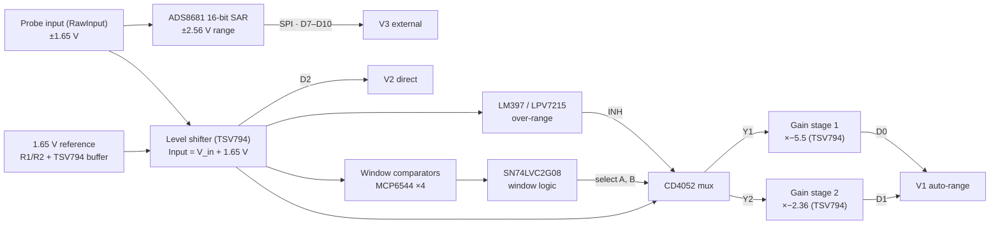

# Oscilloscope

A general-purpose DIY oscilloscope built from scratch on a Seeed XIAO ESP32. It compares three signal-acquisition architectures: hardware auto-ranging (window comparators + analog mux + gain stages), direct ADC sampling, and an external 16-bit SAR ADC. The board is a custom KiCad PCB, and a Python app shows the waveforms in real time.

All three paths look at the same probe input. The firmware can sample them **together, time-aligned** (the V2 and V3 readings at the same instant, V1 one or two ADC reads later), so you can compare them on the same signal.


<sub>The Python GUI in `--demo` mode (simulated signal). The bottom strip shows which V1 path each sample came from: ×1 (direct), S1 (gain stage 1) or S2 (gain stage 2).</sub>

---

## Contents

- [Features](#features)
- [How it works](#how-it-works)
- [Hardware](#hardware)
- [Firmware](#firmware)
- [Python app](#python-app)
- [Calibration](#calibration)
- [Serial command reference](#serial-command-reference)
- [Binary protocol](#binary-protocol)
- [Theory and math](#theory-and-math)
- [Limitations and notes](#limitations-and-notes)
- [Repository layout](#repository-layout)
- [Roadmap](#roadmap)

## Features

- **Three acquisition architectures**, selectable or all at once (`MODE ALL`):
  - **V1 – Auto-range:** window comparators steer the signal through a CD4052 mux into one of two gain stages. The firmware works out which stage is live and divides its gain back out.
  - **V2 – Direct:** the level-shifted signal goes straight into the ESP32's 12-bit ADC.
  - **V3 – External ADC:** an ADS8681 16-bit, 1 MSPS SAR ADC digitizes the raw input over SPI, using a from-scratch driver (no Arduino library exists for the ADS868x).
- **Triggering:** rising/falling edge, adjustable level and hysteresis, AUTO / NORMAL / SINGLE / FREE modes, 0–100 % pre-trigger, on any of the three paths.
- **Timebase:** sampling is paced by the CPU cycle counter. Every sample in a mode costs the same fixed sequence of reads, and the firmware never paces faster than it can sample, so the spacing stays uniform even when you ask for more than the hardware can deliver. The *measured* sample rate is sent with every frame.
- **Records** of up to 4096 samples per channel.
- **Calibration** stored in flash: zero and gain for the direct and ADS8681 paths, and a least-squares fit of each gain stage against the direct path (`CAL BANDS`).
- **Two output formats:** a binary stream for the Python GUI, or plain text that the Arduino IDE **Serial Plotter** draws directly.
- **Python GUI:** live traces, the V1 path strip, a draggable trigger level, measurements (min/max/pk-pk/mean/RMS/frequency), CSV export, and a demo mode that needs no hardware.

## How it works



### Shared front end

R1 and R2 (10 kΩ each) divide 3.3 V down to a 1.65 V mid-rail, which a TSV794 section buffers. A second section is a non-inverting summing amplifier: R3 = R6 average the probe voltage with the reference, and R4 = R5 set a gain of 2. Its output, the net called `Input`, is:

```
V_ls = V_in + 1.65 V        →  a probe voltage of ±1.65 V maps onto 0 … 3.3 V
```

### V1 – Hardware auto-ranging

Two window comparators decide how big the signal is. Each window is two MCP6544 comparators, one checking *above the low threshold* and one checking *below the high threshold*. The MCP6544 has push-pull outputs, so they can't be wire-ANDed; an SN74LVC2G08 gate combines each pair into one *inside this window* signal:

- **Window 1** uses the R19 / R20 / R21 ladder (5 kΩ / 2 kΩ / 5 kΩ across 3.3 V). Its thresholds are 1.375 V and 1.925 V on `Input`, which is ±0.275 V at the probe.
- **Window 2** uses the R15 / R16 / R17 ladder. Its design range is 0.95–2.35 V on `Input`, which is ±0.70 V at the probe.

The two window signals drive the CD4052's select lines, and the mux routes `Input` to one of two **inverting** gain stages. Both stages are biased at the R24/R27 mid-rail (V_ref2 ≈ 1.65 V). Stage 1 (R7 = 255 kΩ feedback) feeds XIAO pin D0, and stage 2 feeds D1:

```
V_D0 = V_ref2 − G1 · (V_ls − V_ref2)        G1 ≈ 5.5   (window 1: ±0.275 V → about 0.14 … 3.16 V)
V_D1 = V_ref2 − G2 · (V_ls − V_ref2)        G2 ≈ 2.36  (window 2: ±0.70 V)
```

A stage whose mux channel is off has no current in its input resistor, so it sits at its idle level V_ref2. The LM397/LPV7215 comparator watches for `Input` going above VDD and inhibits the mux (INH) when it does.

**How the firmware uses it.** The XIAO doesn't see the mux select lines, so it works out which stage is live from the readings. Every V1 sample uses the same four reads: D2, D0, D1, D2. Then, highest gain first, the firmware accepts a stage only if all of these hold:

1. The direct reading, interpolated to the moment that stage was read, is inside the stage's window and outside its *hole*.
2. The stage's reading is in the ADC's linear range.
3. The reading is not at the stage's idle level. (This is skipped once `CAL BANDS` has seen the stage driven around that level.)
4. Its reconstruction `(V_Db − off_b) / g_b`, with a signed gain g < 0, agrees with the interpolated direct reading to within 40 mV.

If no stage passes, the sample comes from the direct reading (×1).

A stage's *hole* is the input range inside its window where the mux never drives it; for nested windows, that's window 1 for stage 2. An undriven stage reads as roughly 0 V, so without these checks it would look valid for small inputs. `CAL BANDS` measures each stage's gain, offset, window and hole on the real board (see [Calibration](#calibration)). The math is in [Reconstruction and auto-range logic](#reconstruction-and-auto-range-logic).

> **⚠ Check the mux wiring.** In the schematic image, select A = window 1 and select B = window 2, with stage 1 on Y1 and stage 2 on Y2. Because the windows are *nested*, a signal inside window 1 is also inside window 2. That gives A = B = 1, which selects **Y3, and Y3 is unconnected**. Y1 (A = 1, B = 0) can never be selected, so gain stage 1 is never driven.
>
> There are two fixes. Drive select B from *window 2 AND NOT window 1*, which takes one more gate (or a re-wire, since the LVC2G08's two gates are both used). Or move stage 1's input from Y1 to Y3.
>
> The PCB has resistors (R9, R10, R28–R38) that aren't in that schematic image, so your built board may already differ. `CAL BANDS` reports whether each stage is ever driven. If stage 1 isn't, the firmware disables it and V1 uses stage 2 plus the direct path. The [Boolean algebra is worked out below](#reconstruction-and-auto-range-logic).

### V2 – Direct ESP32 ADC

The baseline: `V_in = (V_D2 − mid) / g`, using the ESP32's factory-calibrated `analogReadMilliVolts()`.

### V3 – ADS8681 external ADC

The ADS8681's AIN_P is wired straight to the probe (RawInput), not to the level shifter. Its supplies are AVDD = 5 V and DVDD = 3.3 V, so its SPI pins are 3.3 V-safe for the ESP32. Its programmable input range is set to ±2.56 V (code 0x4), the tightest range that covers ±1.65 V, which gives 78.125 µV per code. The chip also has its own anti-aliasing filter (about 15 kHz, see [Transfer functions and bandwidth](#transfer-functions-and-bandwidth)).

The ADS8681 starts a conversion on each CS rising edge and shifts the result out during the *next* frame. The driver primes one conversion, and the acquisition loop delays the native-ADC readings by one sample to match. In `MODE ALL` the ADS8681 and direct readings are therefore taken at the same instant, and the V1 stage readings one or two ADC reads later.

## Hardware

### Bill of materials

| Part | Description | Role in this design |
|---|---|---|
| Seeed Studio **XIAO ESP32** (C3 / S3 / C6) | Wi-Fi/BLE MCU module, USB-C | Sampling, triggering, USB link |
| **TSV794IYDT** | Quad 50 MHz, rail-to-rail 5 V op amp (SO-14) | 1.65 V buffer, level shifter, two inverting gain stages |
| **MCP6544-I/ST** | Quad push-pull comparator, 1.6 V min supply (TSSOP-14) | Window comparators (2 windows × 2) |
| **SN74LVC2G08DCTR** | Dual 2-input AND gate | Combines each comparator pair into an "inside window" signal |
| **CD4052BE** | Dual 4-channel analog multiplexer (DIP-16) | Routes `Input` to gain stage 1 (Y1) or 2 (Y2) |
| **LPV7215MF/NOPB** | Micropower CMOS push-pull comparator (SOT-23-5); drawn as LM397 in the schematic | Over-range detector: inhibits the mux when `Input` > VDD |
| **ADS8681IRUMR** | 16-bit, 1 MSPS SAR ADC with programmable input range (WQFN-16) | V3 path, on the raw input |
| Capacitors | 0.1 µF, 10 µF, 22 µF | Decoupling, ADS8681 reference |

### Resistors

| Resistor(s) | Value | Function |
|---|---|---|
| R1, R2 | 10 kΩ each | 1.65 V reference divider (buffered by a TSV794 section) |
| R3, R6 | 10 kΩ each | Level shifter: probe-input and reference summing resistors |
| R4, R5 | 10 kΩ each | Level shifter: feedback and ground legs (gain of 2) |
| R7 | 255 kΩ | Gain stage 1 feedback resistor |
| R8 | *not documented* | Gain stage 2 feedback resistor |
| R11, R14 | 2.0 kΩ each | Comparator hysteresis isolation |
| R12 | 1 MΩ | Comparator D positive feedback (hysteresis) |
| R13, R31 | 1 MΩ each | Comparators B and C positive feedback |
| R15, R16, R17 | *not documented* | Window 2 threshold ladder |
| R19, R21 | 5 kΩ each | Window 1 threshold ladder (outer legs) |
| R20 | 2 kΩ | Window 1 threshold ladder (middle leg, sets the window width) |
| R24, R27 | 10 kΩ each | 1.65 V mid-rail for the gain stages |
| R30 | 1 MΩ | Comparator A positive feedback (hysteresis) |

The gain stages' input resistors, and R9, R10 and R28–R38 on the PCB layout, aren't in the schematic image. `CAL BANDS` measures the stage gains, so the firmware doesn't need these values.

### XIAO pin map

These come from the KiCad schematic and match the pad labels on the PCB layout. They're set in [`firmware/oscilloscope/board_config.h`](firmware/oscilloscope/board_config.h).

| XIAO pin | Net | Connects to | Direction |
|---|---|---|---|
| D0 | OpAmpOut1 | Gain stage 1 output | analog in |
| D1 | OpAmpOut2 | Gain stage 2 output | analog in |
| D2 | Input | Level shifter output (V2 direct) | analog in |
| D3, D4, D5 | — | not connected | — |
| D6 | RST | ADS8681 RST_N | out |
| D7 | MIS1 | ADS8681 SDI (MOSI) | out |
| D8 | MIS0 | ADS8681 SDO-0 (MISO) | in |
| D9 | SCLK | ADS8681 SCLK | out |
| D10 | CS | ADS8681 CONVST/CS | out |

The ESP32 routes SPI through its GPIO matrix, so the ADS8681 works on D7–D10 even though they aren't the XIAO's default SPI pins.

## Firmware

The firmware is an Arduino sketch in [`firmware/oscilloscope/`](firmware/oscilloscope). It compiles cleanly (`-Wall -Wextra`) for the XIAO ESP32C3, ESP32S3 and ESP32C6 on arduino-esp32 **3.3.12**, and for the C3 and S3 on **2.0.9**.

### Build and upload (Arduino IDE 2)

1. **Boards Manager** → install **esp32 by Espressif Systems**.
2. **Tools → Board → esp32 →** `XIAO_ESP32C3` (or `XIAO_ESP32S3` / `XIAO_ESP32C6`). Leave **USB CDC On Boot** enabled; it's the default for the XIAO boards.
3. Open `firmware/oscilloscope/oscilloscope.ino` and click **Upload**.
   If the upload doesn't start, hold the XIAO's **BOOT** button while plugging it in.

Or with `arduino-cli`:

```bash
arduino-cli core install esp32:esp32
arduino-cli compile --fqbn esp32:esp32:XIAO_ESP32C3 firmware/oscilloscope
arduino-cli upload  --fqbn esp32:esp32:XIAO_ESP32C3 -p /dev/ttyACM0 firmware/oscilloscope
```

### First power-up (board bring-up)

1. Open the Serial Monitor (any baud rate; it's native USB) and send `INFO`. Check that it reports `ADS8681 detected`.
2. Short the probe input to GND and send `PROBE`. Expect D2 ≈ 1.65 V, both stage outputs ≈ 1.65 V, and the ADS8681 ≈ 0 V.
3. Apply a small DC voltage, for example a 1.5 V cell through a divider, and `PROBE` again. The direct and ADS8681 readings should agree.
4. Calibrate (see [Calibration](#calibration)), then send `SAVE`.
5. Send `RUN`. Open **Tools → Serial Plotter** to see the traces, or close the monitor and start the Python app.

### Code layout

| File | Contents |
|---|---|
| `oscilloscope.ino` | `setup()` / `loop()`, serial command parser, output formats, calibration commands |
| `board_config.h` | **Everything PCB-specific:** pins, design gains and windows, ADC limits, ADS range |
| `scope.h/.cpp` | Acquisition engine: cycle-counter pacing, ring buffer with pre-trigger, edge trigger with hysteresis, ADS latency alignment, V1 stage selection, least-squares stage fit |
| `ads8681.h/.cpp` | From-scratch ADS8681 SPI driver: register read/write, range select, presence check, fast conversion path |
| `protocol.h/.cpp` | Framed binary packets with CRC-16 |
| `settings.h/.cpp` | Settings and calibration, stored in NVS flash |

## Python app

```bash
pip install -r host/requirements.txt
python host/scope_gui.py              # auto-detects the XIAO's USB port
python host/scope_gui.py --port COM5  # or /dev/ttyACM0, /dev/cu.usbmodem…
python host/scope_gui.py --demo       # no hardware needed
```

The GUI sends its settings to the scope when it connects, so the controls always match what's running. Drag the orange dashed line to set the trigger level, and use the command box at the bottom to send any serial command.

For scripted measurements, for example comparing the three architectures on the same signal:

```bash
python host/scope_capture.py --mode ALL --rate 20000 --n 2000 --frames 5 --out run.csv
```

This writes one CSV per frame (`time_s, AUTO_V, DIRECT_V, EXT_V, band`) and prints measurements for each path.

Protocol tests: `python -m pytest host`

## Calibration

Run these in order, with `SAVE` at the end. The math behind each step is in [Calibration, triggering and measurements](#calibration-triggering-and-measurements).

1. **`CAL ZERO`.** Short the input to GND, or click **Zero cal** in the GUI. This measures the direct path's mid-point, the ADS8681's offset, and the gain stages' idle level.
2. **`CAL GAIN <volts>`.** Apply a DC voltage you've measured with a multimeter (for example 0.500 V). This sets the direct and ADS8681 path gains. The direct path must stay inside the ESP32 ADC's linear range, so on a C3 keep the voltage between about −1.5 V and +0.75 V; the firmware refuses readings outside that range and prints the limits.
3. **`CAL BANDS`.** Apply a slow signal (≤ 10 Hz) that sweeps across at least ±1 V, such as a function generator's sine or triangle, or a potentiometer turned end to end. If the input covers less than 0.5 V, nothing changes. For 2 s the firmware samples D2, D0 and D1 together, then fits each stage with least squares:
   - it fits `V_stage = off + g · V_in`, with `V_in` taken from the already-calibrated direct path;
   - it records each stage's window and hole;
   - it reports the fit residual.

   A stage that is never driven is reported and disabled.
4. **`SAVE`** stores everything in flash. `DEFAULTS` returns to the design values in `board_config.h`.

You can also set values by hand: `MID`, `PGAIN`, `STAGE` and `WINDOW` (see below).

## Serial command reference

Commands are case-insensitive, one per line. Replies start with `OK` or `ERR`.

| Command | Description |
|---|---|
| `RUN` / `STOP` / `SINGLE` | Start, stop, or capture one triggered frame and stop |
| `MODE AUTO\|DIRECT\|EXT\|ALL` | Which path(s) to sample |
| `RATE <Hz>` | Requested sample rate (1 – 1 000 000). The real rate is measured per frame |
| `N <samples>` | Record length, 16 – 4096 |
| `TRIG FREE\|AUTO\|NORMAL` | Trigger mode |
| `EDGE RISING\|FALLING` | Trigger edge |
| `LEVEL <V>` / `HYST <V>` | Trigger level and hysteresis (probe volts) |
| `SRC AUTO\|DIRECT\|EXT` | Trigger source |
| `PRE <0-100>` | Percentage of the record before the trigger |
| `FORMAT CSV\|BIN` | Serial Plotter text (default at boot) or binary for the Python app |
| `ADSRANGE <code>` | ADS8681 range: `0`–`4` bipolar (±12.288 … ±2.56 V; default `0x4` = ±2.56 V), `8`–`11` unipolar |
| `CAL ZERO` / `CAL GAIN <V>` / `CAL BANDS` | Calibration (see above) |
| `MID DIRECT\|EXT <V>` | Node voltage that means 0 V at the probe |
| `PGAIN DIRECT\|EXT <g>` | Path gain from the probe to the ADC node |
| `STAGE <1\|2> <gain> [offset V]` | Gain stage model `V_adc = offset + gain · V_in` (gain is negative: the stages invert) |
| `WINDOW <1\|2> <lo> <hi> [<hole lo> <hole hi>]` / `WINDOW <1\|2> OFF` | Probe-voltage range where a stage may be used, minus an optional hole |
| `PROBE` | Raw reading of every net, for bring-up |
| `INFO` / `HELP` | Show the current settings, calibration and pins / list the commands |
| `SAVE` / `LOAD` / `DEFAULTS` | Store, reload, or erase the saved settings |

In CSV mode each sample is one line, such as `auto:0.12345,direct:0.12000,ext:0.12210,band:1`. The Serial Plotter draws each label as its own trace; use `N 200` to make it easier to read.

## Binary protocol

After `FORMAT BIN`, everything the scope sends is framed (little-endian):

```
A5 5A | type u8 | version u8 (=1) | payload_len u32 | payload | crc16 u16
```

The CRC is CRC-16/CCITT-FALSE (poly 0x1021, init 0xFFFF) over `type … payload`. That's identical to Python's `binascii.crc_hqx(data, 0xFFFF)`.

- **Type 2, text:** a UTF-8 command reply.
- **Type 1, waveform:** a 28-byte header, then one `float32` array per channel (probe volts), then a `uint8` V1 path code per sample (0 = direct ×1, 1 = stage 1, 2 = stage 2) if the band flag is set.

| Header field | Type | Meaning |
|---|---|---|
| `seq` | u32 | Frame counter |
| `mode` | u8 | 0 AUTO, 1 DIRECT, 2 EXT, 3 ALL |
| `nch` | u8 | Number of channel arrays |
| `flags` | u8 | bit 0 triggered, bit 1 band array present, bit 2 single-shot |
| `trig_src` | u8 | 0 AUTO, 1 DIRECT, 2 EXT |
| `nsamples` | u32 | Samples per channel |
| `trig_index` | i32 | Sample index of the trigger (−1 if untriggered) |
| `sample_rate` | f32 | Measured sample rate, Hz |
| `trig_level` | f32 | Trigger level, V |
| `ch_id[4]` | u8 ×4 | Channel id of each array (0 AUTO, 1 DIRECT, 2 EXT; 0xFF unused) |

[`host/scope_protocol.py`](host/scope_protocol.py) is the reference decoder.

## Theory and math

This chapter covers the basic math behind the board: transfer functions, sampling, quantization and noise, and the firmware's algebra. Every number is theory, worked out from the schematic and datasheet typical values, **not a bench measurement**.

| Topic | Math used | Key number (theory) |
|---|---|---|
| Op-amp stages | Single pole, gain-bandwidth product | 25 / 7.7 / 14.9 MHz (level shifter / stage 1 / stage 2) |
| ADS8681 input filter | Two-pole low-pass | 15 kHz, about 14 µs delay |
| Probe tip | Voltage divider with the input load | 19.6 kΩ to +1.65 V |
| Input protection | Diode clamps, datasheet limits | About ±20 V while powered |
| Sampler | Nyquist and aliasing | 5 kHz Nyquist at 10 kS/s |
| Quantizer | $`\text{LSB} = \text{range}/2^N`$ | 1 mV direct, 78 µV ADS8681 |
| Noise | Quadrature sums, averaging | Dynamic range 55 / 62 / 86 dB (direct / auto-ranged as drawn / ADS8681), with 2 LSB of ESP32 ADC noise |
| Firmware | Signed gains, Boolean logic, least squares | Window 1 = ±0.275 V; as drawn, stage 1 is never selected |

### Transfer functions and bandwidth

The Laplace transform turns a circuit into algebra. Differentiating becomes multiplying by the complex frequency $`s`$, so a capacitor is an impedance $`1/(sC)`$. Output over input is the transfer function $`H(s)`$. Setting $`s = j\omega`$, with $`\omega = 2\pi f`$, gives the gain and phase for a sine of frequency $`f`$.

The basic building block is the single pole:

```math
H(s) = \frac{1}{1 + s\tau}, \qquad f_{-3\,\text{dB}} = \frac{1}{2\pi\tau}
```

Here $`\tau`$ is the time constant and $`f_{-3\,\text{dB}}`$ the bandwidth; above it the gain falls 20 dB per decade. A step rises as $`1 - e^{-t/\tau}`$, which gives the 10–90% rise-time rule bench scopes are rated by:

```math
t_r \approx \frac{0.35}{f_{-3\,\text{dB}}}
```

An op-amp stage with negative feedback is a single pole. Its open-loop gain falls to 1 at the gain-bandwidth product (GBW), so closing the loop trades gain for bandwidth:

```math
f_\text{CL} = \frac{\text{GBW}}{\text{noise gain}}
```

The noise gain is one over the fraction of the output fed back to the inverting input: 2 for the level shifter and $`1 + G`$ for an inverting stage of gain $`-G`$. With the TSV794's 50 MHz typical GBW:

| Stage | Noise gain | Bandwidth | Rise time |
|---|---|---|---|
| Level shifter | 2 | 25 MHz | 14 ns |
| Gain stage 1 ($`G_1 = 5.5`$) | 6.5 | 7.7 MHz | 45.5 ns |
| Gain stage 2 ($`G_2 = 2.36`$) | 3.36 | 14.9 MHz | 23.5 ns |

Next to the 10–20 µs of one ESP32 conversion, the front end is effectively instant.

The ADS8681 has its own low-pass filter, −3 dB at 15 kHz, so the 16-bit path (V3) tops out there. This README models it as two equal poles at 23.3 kHz ($`\tau = 6.83\,\mu\text{s}`$): a 5 kHz sine reads 4.4% low, and the signal is delayed by $`2\tau \approx 14\,\mu\text{s}`$ (0.14 sample at 10 kS/s).

### Input loading, attenuators and protection

The probe does not see a bench scope's 1 MΩ to ground. R3 + R6 (20 kΩ to the 1.65 V reference) and the ADS8681's input together act as $`R_L = 19.6\,\text{k}\Omega`$ to $`V_\text{th} = 1.649\,\text{V}`$, so a source forms a divider with an offset:

```math
V_\text{in} = \frac{R_L\,V_s + R_s\,V_\text{th}}{R_s + R_L}
```

$`V_s`$ is the source voltage and $`R_s`$ its internal resistance. A 1 kΩ source at 0 V reads about +80 mV, and its signal comes through 4.9% low. A 50 Ω source is off by only 4.2 mV and 0.25%. Calibration cannot remove these errors, because they depend on the source.

For signals beyond ±1.65 V, add a ×10 compensated attenuator: 9 MΩ over 1 MΩ, each with a capacitor across it. Its ratio is flat at every frequency when the top and bottom RC products match, $`R_t C_t = R_b C_b`$, so 20 pF at the bottom needs $`C_t = 2.22\,\text{pF}`$. Buffer it before RawInput and set `PGAIN` to match. A ×10 divider built onto the 19.6 kΩ load itself would pass 90% of the 1.649 V bias, for a lopsided −31.3 V to +1.66 V range.

The front end survives about ±20 V while powered. The level shifter clips at its rails, so everything after it stays within 0–3.3 V. Only two parts see the raw voltage. R3 limits the op-amp's ESD-diode current to 1.41 mA at +20 V, and TI rates the ADS8681's AIN_P input to ±20 V while powered. Do not drive the input while the board is off, because the signal then back-powers the 3.3 V rail.

### Sampling and aliasing

Sampling keeps one value every $`T = 1/f_s`$ seconds, which makes the spectrum repeat every $`f_s`$. Samples at $`f_s \gt 2B`$ capture a signal with no content above $`B`$ (Nyquist-Shannon). A sine above $`f_s/2`$ does not disappear; it folds back:

```math
f_\text{alias} = \lvert f - \ell f_s \rvert, \qquad \ell = \operatorname{round}(f/f_s)
```

$`f`$ is the input frequency and $`\ell f_s`$ the multiple of $`f_s`$ nearest to it. At the default 10 kS/s, $`f_s/2 = 5\,\text{kHz}`$, and a 12 kHz input shows up as 2 kHz. The trigger and the frequency readout treat an alias as a real signal.

The native paths alias almost everything. Between the probe and pins D0–D2 there are only op-amps and the mux, with no RC filter, so tones and noise up to several MHz fold into the trace. An analog low-pass in front of the ESP32 pins would fix this (see the [Roadmap](#roadmap)).

The ADS8681's filter is 26 dB down at 100 kHz, so far less wideband noise reaches V3. V3 still aliases at 10 kS/s, though: the filter's corner is above 5 kHz, so a 12 kHz tone arrives at 79% amplitude and appears at 2 kHz.

The z-transform is the sampled Laplace transform: $`z = e^{sT}`$, so $`z^{-1}`$ is one sample of delay. The ADS8681 returns each result one sample late, a pure $`z^{-1}`$, so the firmware delays the native readings to match.

An FFT (fast Fourier transform) of $`n`$ samples has bins $`f_s/n`$ apart: 10 Hz for the default 1000 samples at 10 kS/s.

Timing jitter sets a ceiling that no ADC can beat: a sampling instant off by $`\sigma_t`$ (rms) turns the signal's slope into a voltage error. For a sine of frequency $`f`$:

```math
\text{SNR}_\text{jitter} = -20\log_{10}(2\pi f\,\sigma_t)\ \text{dB}
```

With an assumed 1 µs of jitter, a 1 kHz sine is limited to 44 dB, about 7 effective bits, on any path.

The sample rate depends on the mode. A V1 sample costs four reads (D2, D0, D1, D2) of 10–20 µs each, so the stage readings lag the direct one by 10–40 µs. AUTO and ALL therefore top out around 11–22 kS/s, against 44–89 kS/s for DIRECT.

### Quantization and noise

An ADC rounds each sample to one of $`2^N`$ steps. When the signal moves by many steps between samples, the rounding error acts like noise spread evenly over one step:

```math
\text{LSB} = \frac{\text{FSR}}{2^N}, \qquad \sigma_q = \frac{\text{LSB}}{\sqrt{12}}
```

FSR is the full-scale range, $`N`$ the bits, LSB the step and $`\sigma_q`$ the rms quantization noise. The ADS8681's ±2.56 V range gives $`5.12\,\text{V}/2^{16} = 78.125\,\mu\text{V}`$. The ESP32 gives 805.7 µV, but `analogReadMilliVolts()` rounds to whole millivolts, so the direct path steps in 1 mV.

Bits set a best-case signal-to-quantization-noise ratio (SQNR) for a full-scale sine. Inverting the formula turns any real SNR into an effective number of bits (ENOB):

```math
\text{SQNR} = 6.02N + 1.76\ \text{dB}, \qquad \text{ENOB} = \frac{\text{SNR} - 1.76}{6.02}
```

That is 74.0 dB for 12 bits and 98.1 dB for 16. The ADS8681's typical 90 dB SNR on this range gives 14.7 effective bits.

Every resistor adds thermal noise, which grows with the square root of bandwidth:

```math
v_n = \sqrt{4kTRB}
```

$`k`$ is Boltzmann's constant, $`T`$ the temperature in kelvin (not the sample period), $`R`$ the resistance and $`B`$ the noise bandwidth. A 10 kΩ resistor at 300 K gives 80.7 µV rms over the level shifter's 39.3 MHz noise bandwidth ($`\pi/2`$ times its 25 MHz bandwidth, as for any single pole).

Independent noise sources add in quadrature, because their powers add, and averaging $`M`$ samples divides independent noise by $`\sqrt{M}`$:

```math
\sigma_\text{total} = \sqrt{\sigma_1^2 + \sigma_2^2 + \cdots}, \qquad \sigma_\text{avg} = \frac{\sigma}{\sqrt{M}}
```

The ADS8681's 57 µV is 22.6 µV of quantization and 52.6 µV of analog noise combined this way. The level shifter's sources combine to 194 µV rms. Noise aliases, so every native sample carries all of it, though only 2.19 µV lies in 0–5 kHz. Averaging sixteen samples gives 12 dB, or 2 extra bits.

Dynamic range is the largest usable sine over the noise floor. Referred to the probe, and assuming the ESP32 ADC's undocumented noise is 2 LSB, the paths compare like this:

| Path | Step | Noise (rms) | Dynamic range |
|---|---|---|---|
| V2 direct | 1 mV | 1.65 mV | 55 dB |
| V1 stage 2 | 0.42 mV | 0.75 mV | 62 dB (with direct) |
| V1 stage 1 (not reachable as drawn) | 0.18 mV | 0.33 mV | 69 dB (with direct) |
| V3 ADS8681 | 78 µV | 57 µV | 86 dB |

A gain stage shrinks the ESP32's noise and its own input range by the same factor. So auto-ranging pays off only combined with the direct path: 69 dB instead of 55 dB, or 62 dB as drawn. The ADS8681 is ahead at every amplitude.

### Reconstruction and auto-range logic

The firmware undoes the front end with one straight line per path:

```math
V_\text{in} = \frac{V_\text{adc} - \text{off}}{g}
```

$`V_\text{adc}`$ is the reading in volts, $`\text{off}`$ the offset and $`g`$ the gain. The level shifter outputs $`V_\text{ls} = V_\text{in} + 1.65\,\text{V}`$, so the direct path defaults to $`\text{off} = 1.65\,\text{V}`$ and $`g = 1`$. The inverting stages store signed gains, $`g_1 = -5.5`$ and $`g_2 = -2.36`$, so the same formula undoes the inversion. Calibration replaces the defaults.

A resistor ladder sets each window's edges. Window 1 compares $`V_\text{ls}`$ with the taps of R19/R20/R21 (5 kΩ / 2 kΩ / 5 kΩ across the 3.3 V supply $`V_{DD}`$), at 1.925 V and 1.375 V. Subtracting the 1.65 V mid-rail gives the half-width at the probe:

```math
\pm\frac{V_{DD}\,R_{20}}{2\,(R_{19} + R_{20} + R_{21})} = \pm\frac{V_{DD}}{12} = \pm 0.275\,\text{V}
```

The mux channel is a 2-bit number. Each window flag ($`W_1`$, $`W_2`$) is 1 when the signal is inside that window: the AND of its upper and lower comparators. The flags drive the CD4052's select lines $`S_A`$ and $`S_B`$:

```math
\text{channel} = 2S_B + S_A, \qquad S_A = W_1, \quad S_B = W_2
```

The windows are nested (±0.275 V inside ±0.70 V), so $`W_1`$ implies $`W_2`$. Inside window 1 both flags are 1, which selects the unconnected Y3. Channel 1 (stage 1) needs $`W_1 \land \lnot W_2`$, which never happens, so **as drawn, gain stage 1 can never be selected**. Either fix works: drive $`S_B`$ from $`W_2 \land \lnot W_1`$ (one XOR gate, since it equals $`W_1 \oplus W_2`$), or move stage 1 from Y1 to Y3.

The firmware cannot see the select lines, so it checks each stage against the direct path, highest gain first. Stage $`b`$'s reading $`y_b`$ is accepted only if it is inside the ADC's linear range and away from the stage's idle level (about 1.65 V, its output when its mux channel is off). It must also match the direct reading $`x_k`$, interpolated to the moment the stage was read: $`\lvert (y_b - \text{off}_b)/g_b - x_k \rvert \le 0.04\,\text{V}`$. Otherwise the direct reading is used. For a 1 kHz sine of 0.5 V amplitude at 15 µs per read, skipping the interpolation would leave a 47–94 mV mismatch; interpolating cuts it to 4.4 mV.

### Calibration, triggering and measurements

Calibration fits each straight line to known inputs ([steps](#calibration)). For the direct and ADS8681 paths, `CAL ZERO` (input shorted) gives the offset and `CAL GAIN` with a known voltage $`V`$ gives $`g = (\text{reading} - \text{off})/V`$. With averages good to 1 mV, $`V = 0.5\,\text{V}`$ gives about 0.28% gain error.

`CAL BANDS` fits each gain stage by least squares. A slow sweep gives $`m`$ pairs $`(x_i, y_i)`$ of direct-path input and stage output. Minimizing $`\sum (y_i - \text{off} - g\,x_i)^2`$ gives:

```math
g = \frac{m S_{xy} - S_x S_y}{m S_{xx} - S_x^2}, \qquad \text{off} = \frac{S_y - g S_x}{m}
```

$`S_x`$, $`S_y`$, $`S_{xx}`$ and $`S_{xy}`$ are running sums of $`x_i`$, $`y_i`$, $`x_i^2`$ and $`x_i y_i`$. A stage with fewer than 100 driven samples is reported as never driven and disabled, which is what stage 1 should report as drawn.

The trigger uses hysteresis so that noise cannot fire it. For a rising edge at level $`L`$ it arms below $`L - h`$, then fires on the first sample at or above $`L`$. Gaussian noise of rms $`\sigma`$ stays within $`\pm 3.29\sigma`$ for 99.9% of the time, so $`h`$ should exceed that full swing, $`6.6\sigma`$: the default $`h = 30\,\text{mV}`$ stays clean up to about 4.5 mV rms.

The host's readouts are simple statistics: mean $`\bar y`$, $`\text{RMS} = \sqrt{\tfrac{1}{n}\sum y_i^2}`$, AC RMS $`= \sqrt{\text{RMS}^2 - \bar y^2}`$ and peak-to-peak. A sine of 0.5 V amplitude on 0.2 V DC reads 0.406 V RMS, 0.354 V of it AC.

Frequency comes from interpolated crossings of the mid-level $`v_\text{mid} = (\max + \min)/2`$, with 10% of peak-to-peak as hysteresis. A crossing between samples $`i`$ and $`i+1`$ lands at sample position

```math
t_c = i + \frac{v_\text{mid} - y_i}{y_{i+1} - y_i}
```

For $`k`$ crossings at $`t_1`$ to $`t_k`$, the frequency is $`f = (k - 1)\,f_s/(t_k - t_1)`$. For a 1 kHz sine of 0.5 V amplitude with 5 mV rms of noise at 10 kS/s, the result scatters by about 0.02 Hz rms.

Each packet's CRC-16 catches every error burst of up to 16 bits.

## Limitations and notes

- **Input range is ±1.65 V.** That's set by the level shifter. For bigger signals, add a compensated attenuator ([how](#input-loading-attenuators-and-protection)) and set `PGAIN` to match. This is a low-voltage instrument with no isolation, so **never connect it to mains**.
- **Input impedance is about 20 kΩ to +1.65 V**, through R3 + R6, not the 1 MΩ of a bench scope. That loads high-impedance sources (a 1 kΩ source at 0 V reads about +80 mV), and a floating input reads near the top of the range: about +1.65 V on the ADS8681, with the native paths saturated. The front end survives about ±20 V while powered ([details](#input-loading-attenuators-and-protection)); don't drive the input while the board is off.
- **ESP32 ADC range.** Per Espressif's ADC documentation, the usable range at the highest attenuation is about 0–2.5 V on the ESP32-C3 and 0–3.1 V on the S3. The top of the 0–3.3 V level-shifted range therefore clips on the native-ADC paths (V1, V2), most noticeably on a C3. The firmware treats stage readings outside 0.10–3.00 V (2.45 V on a C3) as unusable. The ADS8681 path (V3) is not affected.
- **No anti-aliasing filter on the native paths.** The V1/V2 analog bandwidth is MHz, set by the op-amps, so anything above f_s/2 aliases. The ADS8681 has its own ~15 kHz filter ([Sampling and aliasing](#sampling-and-aliasing)).
- **V1 timing.** Stage 1 is read one ADC conversion after the direct read and stage 2 two (≈ 10–40 µs), so on fast edges the V1 trace lags slightly and the lag steps when the band changes. That is a fixed time shift per band, not a gain error. The ADS8681's internal filter likewise delays V3 by about 14 µs ([Transfer functions and bandwidth](#transfer-functions-and-bandwidth)).
- **Sample rate.** The native-ADC paths are limited by `analogReadMilliVolts()` (tens of kS/s, depending on the chip and core version). V1 needs four ADC reads per sample, so `MODE AUTO` and `MODE ALL` top out around 11–22 kS/s, against roughly 44–89 kS/s for DIRECT alone ([Sampling and aliasing](#sampling-and-aliasing)). Request any rate: if the hardware can't keep up, the firmware runs at the fastest rate it can sustain, keeps the samples evenly spaced, and reports that rate. Interrupts (USB, RTOS tick) add a few µs of sampling jitter.
- **What has been tested.** The firmware compiles for every XIAO variant. It was also run on a PC against a simulated board built from the schematic: inverting gain stages with a mismatched mid-rail, nested windows with both mux wirings, and an ADS8681 model with register map and one-frame latency. In that simulation `CAL BANDS` recovered the stage gains to within 0.1 %. **It has not been run on the real PCB yet**, so use `PROBE` and the calibration steps before trusting measurements.

## Repository layout

```
├── firmware/oscilloscope/   Arduino sketch for the XIAO ESP32
│   ├── oscilloscope.ino     commands, output, calibration
│   ├── board_config.h       pins, gains, windows, limits
│   ├── scope.*              acquisition, trigger, V1 stage selection, stage fit
│   ├── ads8681.*            ADS8681 SPI driver
│   ├── protocol.*           binary framing
│   └── settings.*           settings / calibration in flash
├── host/                    Python app
│   ├── scope_gui.py         real-time GUI
│   ├── scope_capture.py     headless capture to CSV
│   ├── scope_protocol.py    packet decoder, serial link, measurements
│   └── test_scope_protocol.py
└── docs/                    images
```

## Roadmap

- Fix the window-1 mux selection (see the warning in [V1](#v1--hardware-auto-ranging)) and add an RC anti-aliasing filter in front of the ESP32 ADC pins.
- Standalone mode: ILI9341 TFT display and KY-040 rotary encoder.
- DMA (continuous-mode) ADC sampling for higher V2 sample rates.
- An FFT view in the GUI ([Sampling and aliasing](#sampling-and-aliasing)).
- Publish V1 / V2 / V3 comparison results (noise, resolution, accuracy against a reference).
