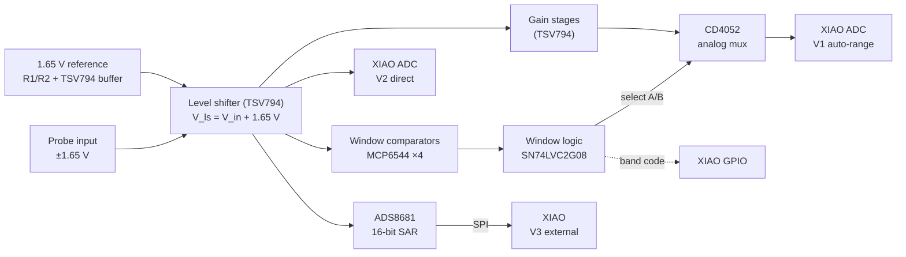

# Oscilloscope

A general-purpose DIY oscilloscope built from scratch on a Seeed XIAO ESP32. It compares three signal-acquisition architectures: hardware auto-ranging (window comparators + analog mux), direct ADC sampling, and an external 16-bit SAR ADC. The board is a custom KiCad PCB, and a Python app shows the waveforms in real time.

All three paths share one level-shifting front end. The firmware can sample them **at the same time, time-aligned**, so you can compare them on the same signal.


<sub>The Python GUI in `--demo` mode (simulated signal). The bottom strip shows which auto-range gain band the hardware selected for each sample.</sub>

---

## Contents

- [Features](#features)
- [How it works](#how-it-works)
- [Hardware](#hardware)
- [Firmware](#firmware)
- [Python app](#python-app)
- [Calibration](#calibration)
- [Serial command reference](#serial-command-reference)
- [Binary protocol](#binary-protocol)
- [Limitations and notes](#limitations-and-notes)
- [Repository layout](#repository-layout)
- [Roadmap](#roadmap)

## Features

- **Three acquisition architectures**, selectable or all at once (`MODE ALL`):
  - **V1 – Auto-range:** window comparators pick a gain band in hardware. The firmware reads the band and divides the gain back out.
  - **V2 – Direct:** the level-shifted signal goes straight into the ESP32's 12-bit ADC.
  - **V3 – External ADC:** an ADS8681 16-bit, 1 MSPS SAR ADC over SPI, using a from-scratch driver (no Arduino library exists for the ADS868x).
- **Triggering:** rising/falling edge, adjustable level and hysteresis, AUTO / NORMAL / SINGLE / FREE modes, 0–100 % pre-trigger. The trigger source can be any path or the LPV7215 hardware comparator.
- **Timebase:** sampling is paced by the CPU cycle counter, and the *measured* sample rate is sent with every frame, so the time axis stays correct even when you ask for more than the hardware can deliver.
- **Records** of up to 4096 samples per channel.
- **Calibration** (zero and gain per path, gain per auto-range band) stored in flash.
- **Two output formats:** a binary stream for the Python GUI, or plain text that the Arduino IDE **Serial Plotter** draws directly.
- **Python GUI:** live traces, the auto-range band strip, a draggable trigger level, measurements (min/max/pk-pk/mean/RMS/frequency), CSV export, and a demo mode that needs no hardware.

## How it works



### Shared front end

R1 and R2 (10 kΩ each) divide 3.3 V down to a 1.65 V mid-rail, which a TSV794 section buffers. A second section is a non-inverting summing amplifier: R3 = R6 average the input with the reference, and R4 = R5 set a gain of 2. So:

```
V_ls = V_in + 1.65 V        →  an input of ±1.65 V maps onto 0 … 3.3 V
```

### V1 – Hardware auto-ranging

Each "window" is two MCP6544 comparators: one checks *above the low threshold*, the other *below the high threshold*. The MCP6544 has push-pull outputs, so they can't be wire-ANDed. An SN74LVC2G08 AND gate combines each pair into one *inside this window* signal, and those signals drive the CD4052 select lines directly. The mux routes the gain stage that matches the signal's band to the XIAO's ADC, with no firmware in that loop.

The window 1 ladder (R19 / R20 / R21 = 5 kΩ / 2 kΩ / 5 kΩ across 3.3 V) gives thresholds of 1.375 V and 1.925 V. That's ±0.275 V at the input, so a gain of 6 would stretch that window over the full 0–3.3 V ADC range.

The firmware also reads the select lines on GPIOs, so it knows which gain applied to each sample. It reconstructs the input as:

```
V_in = (V_adc − V_mid) / (G_path × G_band[code])        code = (B << 1) | A
```

It reads the select lines before *and* after each conversion. If the comparators switch the mux mid-conversion, it samples again.

### V2 – Direct ESP32 ADC

The baseline: `V_in = (V_adc − V_mid) / G_path`, using the ESP32's factory-calibrated `analogReadMilliVolts()`.

### V3 – ADS8681 external ADC

The level-shifted signal goes to an ADS8681 (AVDD = 5 V, DVDD = 3.3 V, so its SPI pins are 3.3 V-safe for the ESP32). The firmware sets its programmable range to 0–5.12 V (78 µV per LSB). The ADS8681 starts a conversion on each CS rising edge and shifts the result out during the *next* frame. The driver primes one conversion, and the acquisition loop delays the native-ADC readings by one sample to match, so all three channels in `MODE ALL` are sampled at the same instant.

## Hardware

### Bill of materials

| Part | Description | Role in this design |
|---|---|---|
| Seeed Studio **XIAO ESP32** (C3 / S3 / C6) | Wi-Fi/BLE MCU module, USB-C | Sampling, triggering, USB link |
| **TSV794IYDT** | Quad 50 MHz, 200 µV offset, rail-to-rail 5 V op amp (SO-14) | 1.65 V buffer, level shifter, gain stages |
| **MCP6544-I/ST** | Quad push-pull comparator, 1.6 V min supply (TSSOP-14) | Window comparators (2 windows × 2) |
| **SN74LVC2G08DCTR** | Dual 2-input AND gate | Combines each comparator pair into an "inside window" signal |
| **CD4052BE** | Dual 4-channel analog multiplexer (DIP-16) | Routes the selected gain stage to the ADC |
| **LPV7215MF/NOPB** | Micropower CMOS push-pull comparator (SOT-23-5) | Firmware can use its output as a hardware trigger (`SRC HW`) |
| **ADS8681IRUMR** | 16-bit, 1 MSPS SAR ADC with programmable input range (WQFN-16) | V3 high-resolution path |
| Capacitors | 0.1 µF, 10 µF, 22 µF | |

### Resistors

| Resistor(s) | Value | Function |
|---|---|---|
| R1, R2 | 10 kΩ each | 1.65 V reference divider (buffered by the TSV794) |
| R3, R6 | 10 kΩ each | Level shifter: input and offset summing resistors |
| R4, R5 | 10 kΩ each | Level shifter: gain-setting resistors (gain of 2) |
| R7 | 255 kΩ | *to be documented* |
| R11, R14 | 2.0 kΩ each | Comparator A hysteresis isolation |
| R12 | 1 MΩ | Comparator D positive feedback (hysteresis) |
| R13, R31 | 1 MΩ each | Comparators B and C positive feedback (hysteresis) |
| R19, R21 | 5 kΩ each | Window 1 threshold ladder (outer legs) |
| R20 | 2 kΩ | Window 1 threshold ladder (middle leg, sets the window width) |
| R24, R27 | 10 kΩ each | 1.65 V mid-rail for the gain stages |
| R30 | 1 MΩ | Comparator A positive feedback (hysteresis) |

### XIAO pin map

These are the defaults in [`firmware/oscilloscope/board_config.h`](firmware/oscilloscope/board_config.h). **Check them against the KiCad schematic.** If any differ, change that one file. The `PROBE` command (below) shows every net live, so you can confirm each one on the real board.

| XIAO pin | Net | Direction |
|---|---|---|
| A0 / D0 | Level-shifted signal (V2 direct) | analog in |
| A1 / D1 | CD4052 common output (V1 auto-range) | analog in |
| D2 | CD4052 select **A** (from window logic) | digital in |
| D3 | CD4052 select **B** (from window logic) | digital in |
| D5 | LPV7215 comparator output (hardware trigger) | digital in |
| D7 | ADS8681 CONVST/CS | out |
| D8 | SPI SCK → ADS8681 SCLK | out |
| D9 | SPI MISO ← ADS8681 SDO-0 | in |
| D10 | SPI MOSI → ADS8681 SDI | out |

The ADS8681's RST pin isn't driven by default, since the chip resets itself at power-up. If RST is routed to a XIAO pin, set `PIN_ADS_RST` to that pin.

> **Check the pin map before flashing the assembled board.** The firmware drives CS, SCK and MOSI as outputs. If one of those pins is actually wired to another chip's output, both can be damaged.
>
> Every signal into a XIAO pin must stay within 0–3.3 V. If the AND gate or the CD4052 runs from 5 V, don't feed the select lines straight into D2/D3.

## Firmware

The firmware is an Arduino sketch in [`firmware/oscilloscope/`](firmware/oscilloscope). It compiles cleanly (`-Wall -Wextra`) for the XIAO ESP32C3, ESP32S3 and ESP32C6 on arduino-esp32 **3.3.12**, and for the C3 and S3 on **2.0.9**.

### Build and upload (Arduino IDE 2)

1. **Boards Manager** → install **esp32 by Espressif Systems**.
2. **Tools → Board → esp32 →** `XIAO_ESP32C3` (or `XIAO_ESP32S3` / `XIAO_ESP32C6`). Leave **USB CDC On Boot** enabled; it's the default for the XIAO boards.
3. Open `firmware/oscilloscope/oscilloscope.ino`, check `board_config.h`, then click **Upload**.
   If the upload doesn't start, hold the XIAO's **BOOT** button while plugging it in.

Or with `arduino-cli`:

```bash
arduino-cli core install esp32:esp32
arduino-cli compile --fqbn esp32:esp32:XIAO_ESP32C3 firmware/oscilloscope
arduino-cli upload  --fqbn esp32:esp32:XIAO_ESP32C3 -p /dev/ttyACM0 firmware/oscilloscope
```

### First power-up (board bring-up)

1. Open the Serial Monitor (any baud rate; it's native USB) and send `INFO`. Check that it reports `ADS8681 detected`.
2. Short the probe input to GND and send `PROBE`. Every ADC node should read about 1.65 V, the band code should be the innermost window's code, and the reconstructed inputs should be near 0 V.
3. Apply a small DC voltage, for example a 1.5 V cell through a divider, and `PROBE` again. All three paths should agree.
4. Calibrate (see [Calibration](#calibration)), then send `SAVE`.
5. Send `RUN`. Open **Tools → Serial Plotter** to see the traces, or close the monitor and start the Python app.

### Code layout

| File | Contents |
|---|---|
| `oscilloscope.ino` | `setup()` / `loop()`, serial command parser, output formats, calibration |
| `board_config.h` | **Everything PCB-specific:** pins, default gains, ADS range, limits |
| `scope.h/.cpp` | Acquisition engine: cycle-counter pacing, ring buffer with pre-trigger, edge trigger with hysteresis, ADS latency alignment, band-switch detection |
| `ads8681.h/.cpp` | From-scratch ADS8681 SPI driver: register read/write, range select, presence check, fast conversion path |
| `protocol.h/.cpp` | Framed binary packets with CRC-16 |
| `settings.h/.cpp` | Settings and calibration, stored in NVS flash |

## Python app

```bash
pip install -r host/requirements.txt
python host/scope_gui.py              # auto-detects the XIAO's USB port
python host/scope_gui.py --port COM5  # or /dev/ttyACM0, /dev/cu.usbmodem…
python host/scope_gui.py --demo       # no hardware needed
```

The GUI sends its settings to the scope when it connects, so the controls always match what's running. Drag the orange dashed line to set the trigger level, and use the command box at the bottom to send any serial command.

For scripted measurements, for example comparing the three architectures on the same signal:

```bash
python host/scope_capture.py --mode ALL --rate 20000 --n 2000 --frames 5 --out run.csv
```

This writes one CSV per frame (`time_s, AUTO_V, DIRECT_V, EXT_V, band`) and prints measurements for each path.

Protocol tests: `python -m pytest host`

## Calibration

Each path's reconstruction depends on its mid-point (the ADC-side voltage that means 0 V at the input) and its gain. Measure both on the real board:

1. **Zero:** short the input to GND and send `CAL ZERO`, or click **Zero cal** in the GUI. This measures every path's mid-point.
2. **Gain:** apply a DC voltage you've measured with a multimeter and send `CAL GAIN <volts>`, e.g. `CAL GAIN 0.500`. This sets the DIRECT and EXT path gains, plus the gain of whichever auto-range band the voltage falls in. Repeat with a voltage inside each band to calibrate them all (for example 0.1 V, 0.5 V and 1.2 V).
3. `SAVE` stores everything in flash. `DEFAULTS` returns to the values in `board_config.h`.

You can also set values directly: `GAIN <code> <gain>`, `PGAIN <path> <gain>`, `MID <path> <volts>`.

## Serial command reference

Commands are case-insensitive, one per line. Replies start with `OK` or `ERR`.

| Command | Description |
|---|---|
| `RUN` / `STOP` / `SINGLE` | Start, stop, or capture one triggered frame and stop |
| `MODE AUTO\|DIRECT\|EXT\|ALL` | Which path(s) to sample |
| `RATE <Hz>` | Requested sample rate (1 – 1 000 000). The real rate is measured per frame |
| `N <samples>` | Record length, 16 – 4096 |
| `TRIG FREE\|AUTO\|NORMAL` | Trigger mode |
| `EDGE RISING\|FALLING` | Trigger edge |
| `LEVEL <V>` / `HYST <V>` | Trigger level and hysteresis (input-referred volts) |
| `SRC AUTO\|DIRECT\|EXT\|HW` | Trigger source (`HW` = LPV7215 comparator pin) |
| `PRE <0-100>` | Percentage of the record before the trigger |
| `FORMAT CSV\|BIN` | Serial Plotter text (default at boot) or binary for the Python app |
| `ADSRANGE <code>` | ADS8681 range: `0`–`4` bipolar (±12.288 … ±2.56 V), `8`–`11` unipolar (0–12.288 … 0–5.12 V) |
| `CAL ZERO` / `CAL GAIN <V>` | Calibration (see above) |
| `GAIN <0-3> <g>` / `PGAIN <path> <g>` / `MID <path> <V>` | Set calibration values by hand |
| `PROBE` | Raw reading of every net, for bring-up and checking the pin map |
| `INFO` / `HELP` | Show the current settings, calibration and pins / list the commands |
| `SAVE` / `LOAD` / `DEFAULTS` | Store, reload, or erase the saved settings |

In CSV mode each sample is one line, such as `auto:0.12345,direct:0.12000,ext:0.12210,band:3`. The Serial Plotter draws each label as its own trace; use `N 200` to make it easier to read.

## Binary protocol

After `FORMAT BIN`, everything the scope sends is framed (little-endian):

```
A5 5A | type u8 | version u8 (=1) | payload_len u32 | payload | crc16 u16
```

The CRC is CRC-16/CCITT-FALSE (poly 0x1021, init 0xFFFF) over `type … payload`. That's identical to Python's `binascii.crc_hqx(data, 0xFFFF)`.

- **Type 2, text:** a UTF-8 command reply.
- **Type 1, waveform:** a 28-byte header, then one `float32` array per channel (input-referred volts), then a `uint8` band code per sample if the band flag is set.

| Header field | Type | Meaning |
|---|---|---|
| `seq` | u32 | Frame counter |
| `mode` | u8 | 0 AUTO, 1 DIRECT, 2 EXT, 3 ALL |
| `nch` | u8 | Number of channel arrays |
| `flags` | u8 | bit 0 triggered, bit 1 band array present, bit 2 single-shot |
| `trig_src` | u8 | 0 AUTO, 1 DIRECT, 2 EXT, 3 HW |
| `nsamples` | u32 | Samples per channel |
| `trig_index` | i32 | Sample index of the trigger (−1 if untriggered) |
| `sample_rate` | f32 | Measured sample rate, Hz |
| `trig_level` | f32 | Trigger level, V |
| `ch_id[4]` | u8 ×4 | Channel id of each array (0 AUTO, 1 DIRECT, 2 EXT; 0xFF unused) |

[`host/scope_protocol.py`](host/scope_protocol.py) is the reference decoder.

## Limitations and notes

- **Input range is ±1.65 V.** That's set by the level shifter. For bigger signals, add an attenuator and set `PGAIN` to match. This is a low-voltage instrument with no isolation, so **never connect it to mains**.
- **ESP32 ADC range.** Per Espressif's ADC documentation, the usable range at the highest attenuation is about 0–2.5 V on the ESP32-C3 and 0–3.1 V on the S3. The top of the 0–3.3 V level-shifted range therefore clips on the native-ADC paths (V1, V2), most noticeably on a C3. The ADS8681 path (V3) is not affected.
- **Choose band gains with headroom.** A gain that maps a window exactly onto 0–3.3 V clips at the window edges for the same reason. Aim the top of each band at about 3.0 V (2.4 V on a C3), and let `CAL GAIN` measure the real values.
- **Sample rate.** The native-ADC paths are limited by `analogReadMilliVolts()` (tens of kS/s, depending on the chip and core version), and `MODE ALL` is slower than one path alone. Request any rate: if the hardware can't keep up, the firmware samples as fast as it can and reports the real rate, so the time axis stays right. Interrupts (USB, RTOS tick) add a few µs of sampling jitter.
- The firmware was compiled for every XIAO variant and tested on a PC against a simulated board: sine input, comparator bands, and an ADS8681 model with register map and one-frame latency. **Check the pin map and gains on the real PCB with `PROBE`** before trusting measurements.

## Repository layout

```
├── firmware/oscilloscope/   Arduino sketch for the XIAO ESP32
│   ├── oscilloscope.ino     commands, output, calibration
│   ├── board_config.h       pins, gains, limits (edit for your PCB)
│   ├── scope.*              acquisition + trigger engine
│   ├── ads8681.*            ADS8681 SPI driver
│   ├── protocol.*           binary framing
│   └── settings.*           settings / calibration in flash
├── host/                    Python app
│   ├── scope_gui.py         real-time GUI
│   ├── scope_capture.py     headless capture to CSV
│   ├── scope_protocol.py    packet decoder, serial link, measurements
│   └── test_scope_protocol.py
└── docs/                    images
```

## Roadmap

- Standalone mode: ILI9341 TFT display and KY-040 rotary encoder.
- DMA (continuous-mode) ADC sampling for higher V2 sample rates.
- Publish V1 / V2 / V3 comparison results (noise, resolution, accuracy against a reference).
