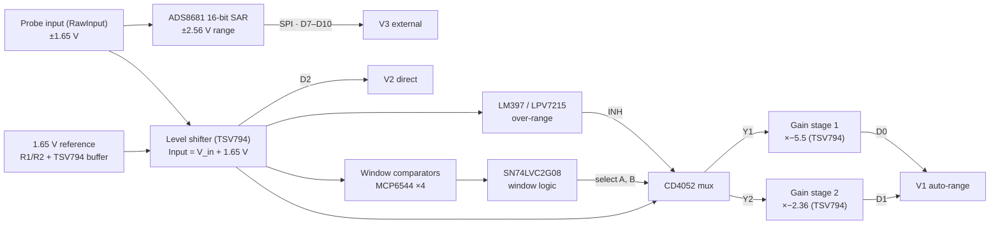

# Oscilloscope

A general-purpose DIY oscilloscope built from scratch on a Seeed XIAO ESP32. It compares three signal-acquisition architectures: hardware auto-ranging (window comparators + analog mux + gain stages), direct ADC sampling, and an external 16-bit SAR ADC. The board is a custom KiCad PCB, and a Python app shows the waveforms in real time.

All three paths look at the same probe input. The firmware can sample them **at the same time, time-aligned**, so you can compare them on the same signal.


<sub>The Python GUI in `--demo` mode (simulated signal). The bottom strip shows which V1 path each sample came from: ×1 (direct), S1 (gain stage 1) or S2 (gain stage 2).</sub>

---

## Contents

- [Features](#features)
- [How it works](#how-it-works)
- [Hardware](#hardware)
- [Firmware](#firmware)
- [Python app](#python-app)
- [Calibration](#calibration)
- [Serial command reference](#serial-command-reference)
- [Binary protocol](#binary-protocol)
- [Theory and math](#theory-and-math)
- [Limitations and notes](#limitations-and-notes)
- [Repository layout](#repository-layout)
- [Roadmap](#roadmap)

## Features

- **Three acquisition architectures**, selectable or all at once (`MODE ALL`):
  - **V1 – Auto-range:** window comparators steer the signal through a CD4052 mux into one of two gain stages. The firmware works out which stage is live and divides its gain back out.
  - **V2 – Direct:** the level-shifted signal goes straight into the ESP32's 12-bit ADC.
  - **V3 – External ADC:** an ADS8681 16-bit, 1 MSPS SAR ADC digitizes the raw input over SPI, using a from-scratch driver (no Arduino library exists for the ADS868x).
- **Triggering:** rising/falling edge, adjustable level and hysteresis, AUTO / NORMAL / SINGLE / FREE modes, 0–100 % pre-trigger, on any of the three paths.
- **Timebase:** sampling is paced by the CPU cycle counter, and the *measured* sample rate is sent with every frame, so the time axis stays correct even when you ask for more than the hardware can deliver.
- **Records** of up to 4096 samples per channel.
- **Calibration** stored in flash: zero and gain for the direct and ADS8681 paths, and a least-squares fit of each gain stage against the direct path (`CAL BANDS`).
- **Two output formats:** a binary stream for the Python GUI, or plain text that the Arduino IDE **Serial Plotter** draws directly.
- **Python GUI:** live traces, the V1 path strip, a draggable trigger level, measurements (min/max/pk-pk/mean/RMS/frequency), CSV export, and a demo mode that needs no hardware.

## How it works



### Shared front end

R1 and R2 (10 kΩ each) divide 3.3 V down to a 1.65 V mid-rail, which a TSV794 section buffers. A second section is a non-inverting summing amplifier: R3 = R6 average the probe voltage with the reference, and R4 = R5 set a gain of 2. Its output, the net called `Input`, is:

```
V_ls = V_in + 1.65 V        →  a probe voltage of ±1.65 V maps onto 0 … 3.3 V
```

### V1 – Hardware auto-ranging

Two window comparators decide how big the signal is. Each window is two MCP6544 comparators, one checking *above the low threshold* and one checking *below the high threshold*. The MCP6544 has push-pull outputs, so they can't be wire-ANDed; an SN74LVC2G08 gate combines each pair into one *inside this window* signal:

- **Window 1** uses the R19 / R20 / R21 ladder (5 kΩ / 2 kΩ / 5 kΩ across 3.3 V). Its thresholds are 1.375 V and 1.925 V on `Input`, which is ±0.275 V at the probe.
- **Window 2** uses the R15 / R16 / R17 ladder. Its design range is 0.95–2.35 V on `Input`, which is ±0.70 V at the probe.

The two window signals drive the CD4052's select lines, and the mux routes `Input` to one of two **inverting** gain stages. Both stages are biased at the R24/R27 mid-rail (V_r ≈ 1.65 V). Stage 1 (R7 = 255 kΩ feedback) feeds XIAO pin D0, and stage 2 feeds D1:

```
V_D0 = V_r − G1 · (V_ls − V_r)        G1 ≈ 5.5   (window 1: ±0.275 V → about 0.14 … 3.16 V)
V_D1 = V_r − G2 · (V_ls − V_r)        G2 ≈ 2.36  (window 2: ±0.70 V)
```

A stage whose mux channel is off has no current in its input resistor, so it sits at its idle level V_r. The LM397/LPV7215 comparator watches for `Input` going above VDD and inhibits the mux (INH) when it does.

**How the firmware uses it.** The XIAO doesn't see the mux select lines, so for every sample the firmware:

1. Reads the direct path on D2 and reconstructs `x`, the probe voltage.
2. Tries the highest-gain stage whose window (minus its *hole*, below) contains `x`, and reads that stage's pin.
3. Accepts the stage only if its reading is in the ADC's linear range and its reconstruction `(V_Db − off_b) / g_b` (with a signed gain g < 0) agrees with the direct path. The direct reading is averaged from reads taken just before and just after the stage read, so the comparison is time-aligned.
4. Falls back to the direct reading (×1) if no stage passes.

A stage's *hole* is the input range inside its window where the mux never drives it; for nested windows, that's window 1 for stage 2. An idle stage reads as roughly 0 V, so without the hole it would look valid for small inputs. `CAL BANDS` measures each stage's gain, offset, window and hole on the real board (see [Calibration](#calibration)).

> **⚠ Check the mux wiring.** In the schematic image, select A = window 1 and select B = window 2, with stage 1 on Y1 and stage 2 on Y2. Because the windows are *nested*, a signal inside window 1 is also inside window 2. That gives A = B = 1, which selects **Y3, and Y3 is unconnected**. Y1 (A = 1, B = 0) can never be selected, so gain stage 1 is never driven.
>
> There are two fixes. Drive select B from *window 2 AND NOT window 1*, which takes one more gate (or a re-wire, since the LVC2G08's two gates are both used). Or move stage 1's input from Y1 to Y3.
>
> The PCB has resistors (R9, R10, R28–R38) that aren't in that schematic image, so your built board may already differ. `CAL BANDS` reports whether each stage is ever driven. If stage 1 isn't, the firmware disables it and V1 uses stage 2 plus the direct path. The [Boolean algebra is worked out below](#t4-the-math-inside-the-firmware-and-the-measurements).

### V2 – Direct ESP32 ADC

The baseline: `V_in = (V_D2 − mid) / g`, using the ESP32's factory-calibrated `analogReadMilliVolts()`.

### V3 – ADS8681 external ADC

The ADS8681's AIN_P is wired straight to the probe (RawInput), not to the level shifter. Its supplies are AVDD = 5 V and DVDD = 3.3 V, so its SPI pins are 3.3 V-safe for the ESP32. Its programmable input range is set to ±2.56 V (code 0x4), the tightest range that covers ±1.65 V, which gives 78.125 µV per code. The chip also has its own anti-aliasing filter (about 15 kHz, see [T1](#t1-laplace-transforms-and-the-analog-front-end)).

The ADS8681 starts a conversion on each CS rising edge and shifts the result out during the *next* frame. The driver primes one conversion, and the acquisition loop delays the native-ADC readings by one sample to match, so all three channels in `MODE ALL` are sampled at the same instant.

## Hardware

### Bill of materials

| Part | Description | Role in this design |
|---|---|---|
| Seeed Studio **XIAO ESP32** (C3 / S3 / C6) | Wi-Fi/BLE MCU module, USB-C | Sampling, triggering, USB link |
| **TSV794IYDT** | Quad 50 MHz, rail-to-rail 5 V op amp (SO-14) | 1.65 V buffer, level shifter, two inverting gain stages |
| **MCP6544-I/ST** | Quad push-pull comparator, 1.6 V min supply (TSSOP-14) | Window comparators (2 windows × 2) |
| **SN74LVC2G08DCTR** | Dual 2-input AND gate | Combines each comparator pair into an "inside window" signal |
| **CD4052BE** | Dual 4-channel analog multiplexer (DIP-16) | Routes `Input` to gain stage 1 (Y1) or 2 (Y2) |
| **LPV7215MF/NOPB** | Micropower CMOS push-pull comparator (SOT-23-5); drawn as LM397 in the schematic | Over-range detector: inhibits the mux when `Input` > VDD |
| **ADS8681IRUMR** | 16-bit, 1 MSPS SAR ADC with programmable input range (WQFN-16) | V3 path, on the raw input |
| Capacitors | 0.1 µF, 10 µF, 22 µF | Decoupling, ADS8681 reference |

### Resistors

| Resistor(s) | Value | Function |
|---|---|---|
| R1, R2 | 10 kΩ each | 1.65 V reference divider (buffered by a TSV794 section) |
| R3, R6 | 10 kΩ each | Level shifter: probe-input and reference summing resistors |
| R4, R5 | 10 kΩ each | Level shifter: feedback and ground legs (gain of 2) |
| R7 | 255 kΩ | Gain stage 1 feedback resistor |
| R8 | *not documented* | Gain stage 2 feedback resistor |
| R11, R14 | 2.0 kΩ each | Comparator hysteresis isolation |
| R12 | 1 MΩ | Comparator D positive feedback (hysteresis) |
| R13, R31 | 1 MΩ each | Comparators B and C positive feedback |
| R15, R16, R17 | *not documented* | Window 2 threshold ladder |
| R19, R21 | 5 kΩ each | Window 1 threshold ladder (outer legs) |
| R20 | 2 kΩ | Window 1 threshold ladder (middle leg, sets the window width) |
| R24, R27 | 10 kΩ each | 1.65 V mid-rail for the gain stages |
| R30 | 1 MΩ | Comparator A positive feedback (hysteresis) |

The gain stages' input resistors, and R9, R10 and R28–R38 on the PCB layout, aren't in the schematic image. `CAL BANDS` measures the stage gains, so the firmware doesn't need these values.

### XIAO pin map

These come from the KiCad schematic and match the pad labels on the PCB layout. They're set in [`firmware/oscilloscope/board_config.h`](firmware/oscilloscope/board_config.h).

| XIAO pin | Net | Connects to | Direction |
|---|---|---|---|
| D0 | OpAmpOut1 | Gain stage 1 output | analog in |
| D1 | OpAmpOut2 | Gain stage 2 output | analog in |
| D2 | Input | Level shifter output (V2 direct) | analog in |
| D3, D4, D5 | — | not connected | — |
| D6 | RST | ADS8681 RST_N | out |
| D7 | MIS1 | ADS8681 SDI (MOSI) | out |
| D8 | MIS0 | ADS8681 SDO-0 (MISO) | in |
| D9 | SCLK | ADS8681 SCLK | out |
| D10 | CS | ADS8681 CONVST/CS | out |

The ESP32 routes SPI through its GPIO matrix, so the ADS8681 works on D7–D10 even though they aren't the XIAO's default SPI pins.

## Firmware

The firmware is an Arduino sketch in [`firmware/oscilloscope/`](firmware/oscilloscope). It compiles cleanly (`-Wall -Wextra`) for the XIAO ESP32C3, ESP32S3 and ESP32C6 on arduino-esp32 **3.3.12**, and for the C3 and S3 on **2.0.9**.

### Build and upload (Arduino IDE 2)

1. **Boards Manager** → install **esp32 by Espressif Systems**.
2. **Tools → Board → esp32 →** `XIAO_ESP32C3` (or `XIAO_ESP32S3` / `XIAO_ESP32C6`). Leave **USB CDC On Boot** enabled; it's the default for the XIAO boards.
3. Open `firmware/oscilloscope/oscilloscope.ino` and click **Upload**.
   If the upload doesn't start, hold the XIAO's **BOOT** button while plugging it in.

Or with `arduino-cli`:

```bash
arduino-cli core install esp32:esp32
arduino-cli compile --fqbn esp32:esp32:XIAO_ESP32C3 firmware/oscilloscope
arduino-cli upload  --fqbn esp32:esp32:XIAO_ESP32C3 -p /dev/ttyACM0 firmware/oscilloscope
```

### First power-up (board bring-up)

1. Open the Serial Monitor (any baud rate; it's native USB) and send `INFO`. Check that it reports `ADS8681 detected`.
2. Short the probe input to GND and send `PROBE`. Expect D2 ≈ 1.65 V, both stage outputs ≈ 1.65 V, and the ADS8681 ≈ 0 V.
3. Apply a small DC voltage, for example a 1.5 V cell through a divider, and `PROBE` again. The direct and ADS8681 readings should agree.
4. Calibrate (see [Calibration](#calibration)), then send `SAVE`.
5. Send `RUN`. Open **Tools → Serial Plotter** to see the traces, or close the monitor and start the Python app.

### Code layout

| File | Contents |
|---|---|
| `oscilloscope.ino` | `setup()` / `loop()`, serial command parser, output formats, calibration commands |
| `board_config.h` | **Everything PCB-specific:** pins, design gains and windows, ADC limits, ADS range |
| `scope.h/.cpp` | Acquisition engine: cycle-counter pacing, ring buffer with pre-trigger, edge trigger with hysteresis, ADS latency alignment, V1 stage selection, least-squares stage fit |
| `ads8681.h/.cpp` | From-scratch ADS8681 SPI driver: register read/write, range select, presence check, fast conversion path |
| `protocol.h/.cpp` | Framed binary packets with CRC-16 |
| `settings.h/.cpp` | Settings and calibration, stored in NVS flash |

## Python app

```bash
pip install -r host/requirements.txt
python host/scope_gui.py              # auto-detects the XIAO's USB port
python host/scope_gui.py --port COM5  # or /dev/ttyACM0, /dev/cu.usbmodem…
python host/scope_gui.py --demo       # no hardware needed
```

The GUI sends its settings to the scope when it connects, so the controls always match what's running. Drag the orange dashed line to set the trigger level, and use the command box at the bottom to send any serial command.

For scripted measurements, for example comparing the three architectures on the same signal:

```bash
python host/scope_capture.py --mode ALL --rate 20000 --n 2000 --frames 5 --out run.csv
```

This writes one CSV per frame (`time_s, AUTO_V, DIRECT_V, EXT_V, band`) and prints measurements for each path.

Protocol tests: `python -m pytest host`

## Calibration

Run these in order, with `SAVE` at the end. The math behind each step is in [T4](#t4-the-math-inside-the-firmware-and-the-measurements).

1. **`CAL ZERO`.** Short the input to GND, or click **Zero cal** in the GUI. This measures the direct path's mid-point, the ADS8681's offset, and the gain stages' idle level.
2. **`CAL GAIN <volts>`.** Apply a DC voltage you've measured with a multimeter (for example 1.000 V). This sets the direct and ADS8681 path gains.
3. **`CAL BANDS`.** Apply a slow signal (≤ 50 Hz) that sweeps across at least ±1 V, such as a function generator's sine or a potentiometer turned end to end. For 2 s the firmware samples D2, D0 and D1 together, then fits each stage with least squares:
   - it fits `V_stage = off + g · V_in`, with `V_in` taken from the already-calibrated direct path;
   - it records each stage's window and hole;
   - it reports the fit residual.

   A stage that is never driven is reported and disabled.
4. **`SAVE`** stores everything in flash. `DEFAULTS` returns to the design values in `board_config.h`.

You can also set values by hand: `MID`, `PGAIN`, `STAGE` and `WINDOW` (see below).

## Serial command reference

Commands are case-insensitive, one per line. Replies start with `OK` or `ERR`.

| Command | Description |
|---|---|
| `RUN` / `STOP` / `SINGLE` | Start, stop, or capture one triggered frame and stop |
| `MODE AUTO\|DIRECT\|EXT\|ALL` | Which path(s) to sample |
| `RATE <Hz>` | Requested sample rate (1 – 1 000 000). The real rate is measured per frame |
| `N <samples>` | Record length, 16 – 4096 |
| `TRIG FREE\|AUTO\|NORMAL` | Trigger mode |
| `EDGE RISING\|FALLING` | Trigger edge |
| `LEVEL <V>` / `HYST <V>` | Trigger level and hysteresis (probe volts) |
| `SRC AUTO\|DIRECT\|EXT` | Trigger source |
| `PRE <0-100>` | Percentage of the record before the trigger |
| `FORMAT CSV\|BIN` | Serial Plotter text (default at boot) or binary for the Python app |
| `ADSRANGE <code>` | ADS8681 range: `0`–`4` bipolar (±12.288 … ±2.56 V; default `0x4` = ±2.56 V), `8`–`11` unipolar |
| `CAL ZERO` / `CAL GAIN <V>` / `CAL BANDS` | Calibration (see above) |
| `MID DIRECT\|EXT <V>` | Node voltage that means 0 V at the probe |
| `PGAIN DIRECT\|EXT <g>` | Path gain from the probe to the ADC node |
| `STAGE <1\|2> <gain> [offset V]` | Gain stage model `V_adc = offset + gain · V_in` (gain is negative: the stages invert) |
| `WINDOW <1\|2> <lo> <hi> [<hole lo> <hole hi>]` / `WINDOW <1\|2> OFF` | Probe-voltage range where a stage may be used, minus an optional hole |
| `PROBE` | Raw reading of every net, for bring-up |
| `INFO` / `HELP` | Show the current settings, calibration and pins / list the commands |
| `SAVE` / `LOAD` / `DEFAULTS` | Store, reload, or erase the saved settings |

In CSV mode each sample is one line, such as `auto:0.12345,direct:0.12000,ext:0.12210,band:1`. The Serial Plotter draws each label as its own trace; use `N 200` to make it easier to read.

## Binary protocol

After `FORMAT BIN`, everything the scope sends is framed (little-endian):

```
A5 5A | type u8 | version u8 (=1) | payload_len u32 | payload | crc16 u16
```

The CRC is CRC-16/CCITT-FALSE (poly 0x1021, init 0xFFFF) over `type … payload`. That's identical to Python's `binascii.crc_hqx(data, 0xFFFF)`.

- **Type 2, text:** a UTF-8 command reply.
- **Type 1, waveform:** a 28-byte header, then one `float32` array per channel (probe volts), then a `uint8` V1 path code per sample (0 = direct ×1, 1 = stage 1, 2 = stage 2) if the band flag is set.

| Header field | Type | Meaning |
|---|---|---|
| `seq` | u32 | Frame counter |
| `mode` | u8 | 0 AUTO, 1 DIRECT, 2 EXT, 3 ALL |
| `nch` | u8 | Number of channel arrays |
| `flags` | u8 | bit 0 triggered, bit 1 band array present, bit 2 single-shot |
| `trig_src` | u8 | 0 AUTO, 1 DIRECT, 2 EXT |
| `nsamples` | u32 | Samples per channel |
| `trig_index` | i32 | Sample index of the trigger (−1 if untriggered) |
| `sample_rate` | f32 | Measured sample rate, Hz |
| `trig_level` | f32 | Trigger level, V |
| `ch_id[4]` | u8 ×4 | Channel id of each array (0 AUTO, 1 DIRECT, 2 EXT; 0xFF unused) |

[`host/scope_protocol.py`](host/scope_protocol.py) is the reference decoder.

## Theory and math

<!-- THEORY -->
_The derivations (T1–T4: Laplace analysis of the front end, sampling and transforms, noise and resolution, firmware math) are being verified and will appear here._

## Limitations and notes

- **Input range is ±1.65 V.** That's set by the level shifter. For bigger signals, add a compensated attenuator ([T1](#t1-laplace-transforms-and-the-analog-front-end)) and set `PGAIN` to match. This is a low-voltage instrument with no isolation, so **never connect it to mains**.
- **Input impedance is about 20 kΩ to +1.65 V**, through R3 + R6, not the 1 MΩ of a bench scope. That loads high-impedance sources, and a floating input reads about +1.6 V ([T1](#t1-laplace-transforms-and-the-analog-front-end)).
- **ESP32 ADC range.** Per Espressif's ADC documentation, the usable range at the highest attenuation is about 0–2.5 V on the ESP32-C3 and 0–3.1 V on the S3. The top of the 0–3.3 V level-shifted range therefore clips on the native-ADC paths (V1, V2), most noticeably on a C3. The firmware treats stage readings outside 0.10–3.00 V (2.45 V on a C3) as unusable. The ADS8681 path (V3) is not affected.
- **No anti-aliasing filter on the native paths.** The V1/V2 analog bandwidth is MHz, set by the op-amps, so anything above f_s/2 aliases. The ADS8681 has its own ~15 kHz filter ([T2](#t2-sampling-from-laplace-to-the-z-transform-and-the-fft)).
- **V1 timing.** A stage pin is read one or two ADC conversions (≈ 10–30 µs) after the direct read, so on fast edges the V1 trace lags slightly. That shows up as a small time shift, not a gain error.
- **Sample rate.** The native-ADC paths are limited by `analogReadMilliVolts()` (tens of kS/s, depending on the chip and core version). V1 needs two to three ADC reads per sample, and `MODE ALL` is slower than one path alone. Request any rate: if the hardware can't keep up, the firmware samples as fast as it can and reports the real rate, so the time axis stays right. Interrupts (USB, RTOS tick) add a few µs of sampling jitter.
- **What has been tested.** The firmware compiles for every XIAO variant. It was also run on a PC against a simulated board built from the schematic: inverting gain stages with a mismatched mid-rail, nested windows with both mux wirings, and an ADS8681 model with register map and one-frame latency. In that simulation `CAL BANDS` recovered the stage gains to within 0.1 %. **It has not been run on the real PCB yet**, so use `PROBE` and the calibration steps before trusting measurements.

## Repository layout

```
├── firmware/oscilloscope/   Arduino sketch for the XIAO ESP32
│   ├── oscilloscope.ino     commands, output, calibration
│   ├── board_config.h       pins, gains, windows, limits
│   ├── scope.*              acquisition, trigger, V1 stage selection, stage fit
│   ├── ads8681.*            ADS8681 SPI driver
│   ├── protocol.*           binary framing
│   └── settings.*           settings / calibration in flash
├── host/                    Python app
│   ├── scope_gui.py         real-time GUI
│   ├── scope_capture.py     headless capture to CSV
│   ├── scope_protocol.py    packet decoder, serial link, measurements
│   └── test_scope_protocol.py
└── docs/                    images
```

## Roadmap

- Fix the window-1 mux selection (see the warning in [V1](#v1--hardware-auto-ranging)) and add an RC anti-aliasing filter in front of the ESP32 ADC pins.
- Standalone mode: ILI9341 TFT display and KY-040 rotary encoder.
- DMA (continuous-mode) ADC sampling for higher V2 sample rates.
- An FFT view in the GUI ([T2](#t2-sampling-from-laplace-to-the-z-transform-and-the-fft)).
- Publish V1 / V2 / V3 comparison results (noise, resolution, accuracy against a reference).
